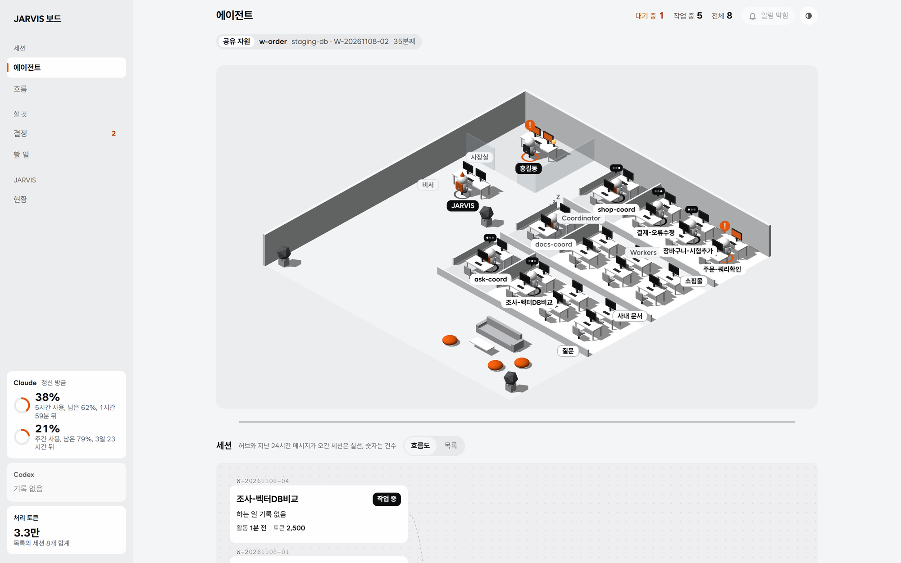
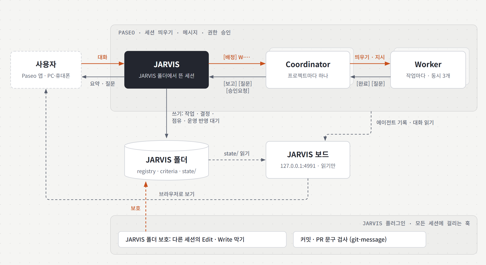
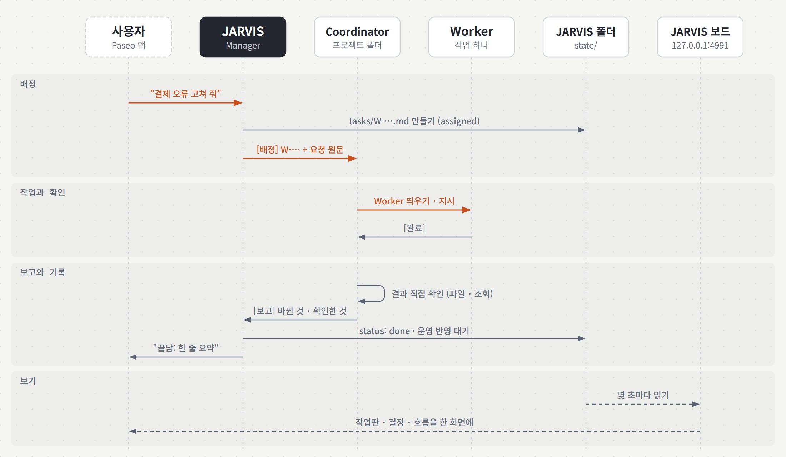
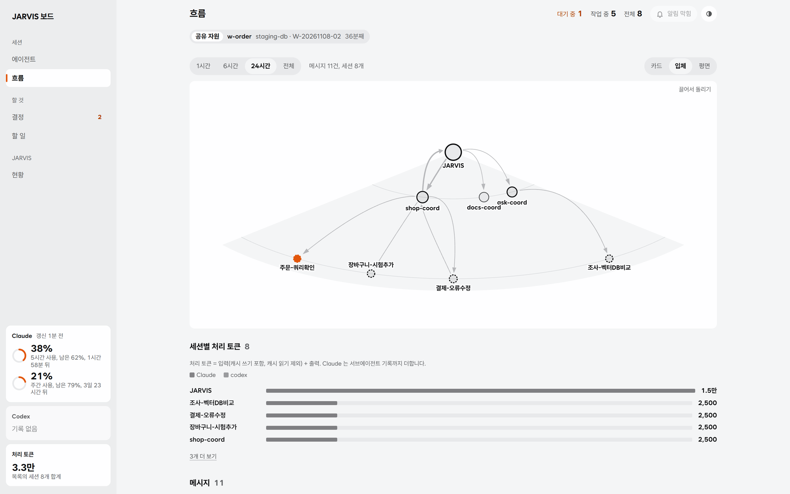

# JARVIS

한 창구에서 대화하면 프로젝트별 Coordinator 와 Worker 세션에 일을 맡기는 개인 Manager 에이전트입니다. 사용자는 JARVIS 하고만 이야기하고, JARVIS 는 일을 프로젝트 Coordinator 에게 넘기고 보고를 받아 짧게 알리고 기록합니다. 세션 실행과 대화 화면은 [Paseo](https://paseo.sh) 가, 각 세션은 Claude Code(또는 Codex)가 맡습니다. 이 저장소는 그 위에 얹는 규칙, 상태 파일 형식, 로컬 대시보드, 공통 훅입니다.

<picture>
  <source media="(prefers-color-scheme: dark)" srcset="docs/images/dashboard-dark.png">
  
</picture>

<picture>
  <source media="(prefers-color-scheme: dark)" srcset="docs/images/architecture-dark.png">
  
</picture>

그림과 화면의 세션·데이터는 설명용 예시입니다.

## 무엇이 들어 있나

| 부분 | 위치 | 하는 일 |
|---|---|---|
| JARVIS 규칙 | `CLAUDE.md` | 이 폴더에서 뜬 세션이 JARVIS 가 됩니다. 어디에 맡길지, 무엇을 사용자에게 물을지, 무엇을 어떻게 기록할지 |
| Coordinator · Worker 규칙 | `rules/` | JARVIS 가 Coordinator 를 만들 때, Coordinator 가 Worker 를 만들 때 첫 지시로 넘기는 규칙 |
| 판단 기준 | `criteria.md` | JARVIS 가 사용자 대신 정해도 되는 기준. 사용자 결정에서 하나씩 늘어남 |
| 프로젝트 목록 | `registry.yaml` | 프로젝트 키, 폴더, 지금 Coordinator ID. 개인 상태라 git 에 올리지 않음(`registry.example.yaml` 참고) |
| 상태 파일 | `state/` | 작업, 결정, 공유 자원 점유, 운영 반영 대기. JARVIS 만 쓰고 git 에 올리지 않음 |
| 대시보드 | `dashboard/` | 읽기만 하는 로컬 웹 화면(JARVIS 보드). Python 표준 라이브러리만 씀 |
| 플러그인 | `.claude-plugin/`, `hooks/`, `skills/` | 모든 세션에 걸리는 JARVIS 폴더 보호 훅, 커밋·PR 문구 규칙(`git-message` 스킬)과 검사 훅 |
| 권한 예시 | `.claude/settings.json`, `templates/project-settings.json` | JARVIS 폴더와 프로젝트 폴더에 둘 Paseo 도구 권한 |

## 세 계층

회사에 비유하면 사용자는 사장, Manager 인 JARVIS 는 비서실장, Coordinator 는 프로젝트 PM, Worker 는 일 하나를 맡아 투입되는 실무 담당자입니다. 사장은 비서실장하고만 이야기하고, 비서실장은 PM 에게, PM 은 담당자에게 일을 내립니다. 보고는 같은 길을 거꾸로 올라옵니다.

| 계층 | 비유 | 몇 개, 얼마나 | 어디서 | 하는 일 | 하지 않는 일 |
|---|---|---|---|---|---|
| 사용자 | 사장 | 한 명 | Paseo 앱(PC · 휴대폰) | 요청, 판단, 되돌리기 어려운 일 승인 | Coordinator · Worker 에 직접 지시 |
| Manager (JARVIS) | 비서실장 | 하나, 계속 떠 있음 | JARVIS 폴더 | 어느 프로젝트 일인지 정해 넘기기, 기준으로 판단, 보고 요약, 기록 | 코드 읽기, 일 쪼개기, 직접 검증 |
| Coordinator | 프로젝트 PM | 프로젝트마다 하나, 계속 떠 있음 | 프로젝트 폴더 | 일 나누기, Worker 붙이기, 차례 정하기, 결과 검수, `[보고]` | 다른 프로젝트 건드리기, 권한 승인, 기록 |
| Worker | 실무 담당자 | 작업마다 하나, PM 하나에 동시 3명까지, 끝나면 닫힘 | 프로젝트 폴더(같은 저장소를 동시에 고치면 git worktree) | 맡은 일 하나, `[완료]` 로 끝맺기 | 범위 밖 수정, push · 운영 반영 · DB 변경 · 삭제 |

**Manager (JARVIS): 비서실장.** 사장의 말을 받아 어느 프로젝트 일인지 정하고 그 PM 에게 그대로 넘깁니다. 어떻게 나누고 누구를 붙일지는 정하지 않습니다. PM 이 올린 판단 질문은 사내 기준(`criteria.md`)에 답이 있으면 바로 답하고, 없으면 사장에게 선택지와 추천을 붙여 묻습니다. 사장이 정한 답은 "기준으로 남길까요?" 를 물어 기준에 더하므로, 같은 질문은 다음부터 사장에게 오지 않습니다. 끝난 일은 한두 줄로 알리고, 작업 · 결정 장부(`state/`)를 씁니다. 현장 일을 대신하지 않듯 코드를 직접 읽거나 다시 검증하지 않고, PM 이 확인한 것과 보고만 받은 것을 나눠 전합니다.

**Coordinator: 프로젝트 PM.** 프로젝트마다 한 명이 그 프로젝트 폴더에 상주합니다. 받은 일을 쪼개 담당자(Worker)를 붙이고, 같은 파일이나 같은 서버 플로우를 만지는 일은 차례로 돌립니다. 파일 몇 개 보는 정도의 짧은 확인은 직접 하지만, 고치는 일이나 여러 단계인 일은 담당자에게 맡깁니다. 담당자가 끝냈다고 하면 문서만 보지 않고 결과물(파일, 서버 상태, DB 조회)을 직접 열어 검수한 뒤 비서실장에게 보고합니다. 다른 프로젝트와 겹칠 수 있는 공용 자원은 쓰기 전에 비서실장에게 알립니다(`[점유]`).

**Worker: 실무 담당자.** 작업 하나를 받아 투입됐다가 끝나면 빠지는 담당자입니다(세션이 닫힘). 이름은 맡은 일을 알아보게 `결제-오류수정` 처럼 짓습니다. 맡은 범위만 하고, 범위를 넘거나 판단이 필요하면 손을 멈추고 PM 에게 `[질문]` 을 올립니다. push, 운영 반영, DB 변경, 삭제처럼 되돌리기 어려운 일은 준비까지만 합니다. 끝나면 "바뀐 것 / 확인한 것 / 남은 것" 으로 `[완료]` 를 냅니다.

## 배정에서 보고까지

사용자가 JARVIS 에게 요청하면 JARVIS 는 작업 파일(`state/tasks/W-….md`)을 만들고 그 프로젝트 Coordinator 에게 `[배정]` 을 보냅니다. Coordinator 는 일을 나눠 Worker 를 띄우고, Worker 의 `[완료]` 를 받으면 결과를 직접 확인한 뒤 JARVIS 에게 `[보고]` 를 보냅니다. JARVIS 는 작업 파일을 고치고 사용자에게 한두 줄로 알립니다. 판단이 필요한 `[질문]` 은 `criteria.md` 에 기준이 있으면 JARVIS 가 답하고, 없으면 사용자에게 선택지와 추천을 붙여 묻습니다.

<picture>
  <source media="(prefers-color-scheme: dark)" srcset="docs/images/flow-dark.png">
  
</picture>

메시지는 머리말로 구분합니다. 아래로는 `[배정]`, 위로는 `[진행]` `[질문]` `[승인요청]` `[보고]` `[완료]`, 프로젝트끼리 겹치는 자원은 `[점유]` `[해제]` 입니다. 형식은 [CLAUDE.md](CLAUDE.md), [rules/coordinator.md](rules/coordinator.md), [rules/worker.md](rules/worker.md) 에 있습니다.

프로젝트와 관계없는 질문(일반 지식, 도구 비교, 글 다듬기)은 registry 의 `ask` 프로젝트로 넘깁니다. 프로젝트 폴더 대신 빈 폴더 하나를 질문 방으로 씁니다.

## 설치

Windows, Paseo 0.15.2, Claude Code 2.1 에서 확인했습니다. Python 3.8 이상이 필요합니다.

JARVIS 는 이 저장소를 받은 폴더에서 돕니다. 플러그인은 훅과 스킬만 싣고, `CLAUDE.md` · `rules/` · 대시보드는 받은 폴더에서 씁니다.

1. Paseo 데스크톱 앱을 설치하고 원격 중계는 끕니다. 설정 → 호스트 → 에이전트에서 **Paseo 도구 활성화** 를 켭니다.
2. 저장소를 받고 프로젝트 목록을 만듭니다.

   ```powershell
   git clone https://github.com/smdeveloper7/jarvis.git C:\Users\<나>\JARVIS
   cd C:\Users\<나>\JARVIS
   Copy-Item registry.example.yaml registry.yaml
   ```

   `registry.yaml` 에 프로젝트마다 이름과 폴더(`root`)를 적습니다. `coordinator` 는 비워 두면 JARVIS 가 처음 맡길 때 만들고 채웁니다.
3. JARVIS 폴더와 각 프로젝트 폴더를 Claude Code 로 한 번씩 열어 신뢰를 승인합니다. 신뢰하지 않은 폴더는 그 폴더의 권한 설정이 무시됩니다.
4. 프로젝트 폴더마다 `templates/project-settings.json` 을 `.claude/settings.json` 으로 둡니다. Coordinator 가 Worker 를 만들고 지시하는 것은 허용하고, 권한 승인과 강제 종료는 막습니다.
5. 전역 `~/.claude/settings.json` 에는 Paseo 도구 중 상태 · 목록 보기만 허용합니다. 전역 deny 는 두지 않습니다. deny 는 어디에 있든 이겨서 JARVIS 의 허용까지 막습니다.
6. 플러그인을 설치합니다. Windows 는 훅이 셸 없이 돌기 때문에 `python.exe` 절대 경로를 씁니다(`py -3 -c "import sys; print(sys.executable)"` 로 확인하고 `\` 를 `/` 로).

   ```powershell
   claude plugin marketplace add smdeveloper7/jarvis
   claude plugin install jarvis@jarvis `
     --config python=C:/Users/<나>/AppData/Local/Programs/Python/Python312/python.exe `
     --config jarvis_dir=C:/Users/<나>/JARVIS
   ```

7. Paseo 에 JARVIS 폴더와 프로젝트 폴더를 프로젝트로 등록하고(`paseo project create <폴더>`), JARVIS 폴더에서 제목 `JARVIS` 로 에이전트를 띄웁니다. 그다음부터는 Paseo 앱에서 JARVIS 와 대화합니다.

### 플러그인 설정

설치할 때 `--config 키=값` 으로 넣고, 나중에는 `claude plugin configure jarvis@jarvis` 로 바꿉니다.

| 키 | 필수 | 뜻 |
|---|---|---|
| `python` | 예 | 훅을 돌릴 Python 3. Windows 는 `python.exe` 절대 경로. 비어 있으면 훅이 돌지 않음 |
| `jarvis_dir` | 아니요 | JARVIS 폴더 절대 경로. 다른 세션이 이 폴더 파일을 Edit · Write 하지 못하게 막음. 비우면 막지 않음 |

## 업데이트

JARVIS 폴더에서 `git pull` 을 합니다. `registry.yaml` 과 `state/` 는 git 에 없으므로 그대로 남습니다. 규칙(`CLAUDE.md`, `rules/`)이 바뀌었으면 Paseo 의 JARVIS 에게 "CLAUDE.md 다시 읽어줘" 라고 말합니다. 이미 떠 있는 Coordinator 는 다음에 새로 만들어질 때 새 규칙을 받습니다.

플러그인(훅 · 스킬)은 따로 받습니다.

```powershell
claude plugin marketplace update jarvis
claude plugin update jarvis@jarvis
```

## JARVIS 보드

JARVIS 폴더의 `state/` 와 Paseo 에이전트 기록(`~/.paseo/agents`), 각 세션의 대화 기록을 몇 초마다 읽어 보여 줍니다. 읽기만 하고 세션에 입력을 보내거나 멈추지 않습니다. 대화와 권한 승인은 Paseo 앱에서 합니다.

```powershell
$env:JARVIS_DIR = "C:\Users\<나>\JARVIS"; $env:PORT = "4991"; python dashboard\server.py   # http://127.0.0.1:4991
```

<picture>
  <source media="(prefers-color-scheme: dark)" srcset="docs/images/dashboard-flow-dark.png">
  
</picture>

| 탭 | 보여 주는 것 | 출처 |
|---|---|---|
| 에이전트 | 3D 사무실. 사장실, JARVIS 자리, 프로젝트별 방에 Coordinator 와 Worker 책상. 일하면 앉아서 치고, 권한을 기다리면 주황 `!`, 쉬면 휴게실로 감 | Paseo 에이전트 기록(제목, 부모, 상태, `jarvis.task` 라벨) |
| 흐름 | `[배정]` `[보고]` `[질문]` 메시지를 카드 트리, 3D 부채꼴, 평면 그래프와 목록으로 | 각 세션 대화 기록 |
| 결정 | 지금 결정할 것, 작업은 끝났는데 안 정한 것, 미뤄 둔 것, 정한 것(누가, 기준 몇 번). 권한을 기다리는 세션 | `state/decisions/*.md`, Paseo 주의 표시 |
| 할 일 | Notion 할일 DB 의 오늘 · 이번 주 · 밀린 일. 완료 체크와 오늘로 옮기기 | Notion API(토큰은 `~/.jarvis/notion_token`) |
| 현황 | 프로젝트별 작업판, 운영 반영 대기, 공유 자원 점유 | `state/tasks`, `releases.json`, `occupancy.json` |

화면마다 자세한 내용은 [dashboard/README.md](dashboard/README.md) 에 있습니다. 팀 밖 Claude · Codex 세션까지 보려면 `JARVIS_SHOW_OTHER=1` 을 줍니다.

## 상태 파일

JARVIS 는 상태가 바뀌면 그 자리에서 `state/` 에 씁니다. 대화가 길어져 JARVIS 를 새로 띄워도 이 파일로 이어받습니다(`CLAUDE.md` "새로 떴을 때").

| 파일 | 내용 |
|---|---|
| `state/tasks/W-YYYYMMDD-NN.md` | 작업 하나: 상태(assigned, working, question, done, cancelled), 확인 여부, 운영 반영 여부, 경과 |
| `state/decisions/D-YYYYMMDD-NN.md` | 판단 하나: 질문, 선택지, 추천, 상태(open, waiting, decided, dropped), 누가 어떤 기준으로 정했는지 |
| `state/occupancy.json` | 프로젝트끼리 겹칠 수 있는 공유 자원(dev 서버 플로우, 공용 DB 등)을 지금 누가 쓰는지 |
| `state/releases.json` | dev 에만 반영하고 운영 반영을 기다리는 변경 |

형식은 [CLAUDE.md](CLAUDE.md) "상태 파일" 에 있습니다.

## 지금 상태

- 확인함: Paseo 가 띄운 Claude 세션이 CLAUDE.md · 플러그인 · 스킬 · MCP 를 그대로 읽음, git 이 아닌 폴더도 프로젝트로 등록, JARVIS → Coordinator → Worker 가 승인 창 없이 이어짐, 부모 · 자식 관계 기록.
- 고침: Coordinator 가 Worker 를 기다리며 낸 이른 보고를 JARVIS 가 완료로 받던 문제. 하위 에이전트 종료 알림은 부모에게 처음 한 번만 가서, Coordinator 가 다 끝난 뒤 `[보고]` 를 JARVIS 에게 직접 보내게 바꿈.
- 남은 일: 설치를 맡을 setup 스킬과 플러그인 구조 정리, 규칙에 박힌 JARVIS 폴더 경로 걷어내기, JARVIS 권한 승인 범위를 훅으로 막기, Obsidian 기록.

## 라이선스

MIT. 가져온 것:

- `dashboard/`(server.py, index.html, test_server.py), `skills/git-message`, `hooks/git-message-style.py`, `hooks/pathutil.py`, `hooks/jarvis_only_write.py` 의 바탕: [holiday0726/lanekeeper](https://github.com/holiday0726/lanekeeper)(옛 claude-hub-plugin), MIT
- `dashboard/vendor/three.min.js`, `OrbitControls.js`: three.js r128, MIT
- `dashboard/vendor/xterm.js`, `xterm.css`: xterm.js 5.5.0, MIT
- `dashboard/vendor/WantedSansVariable.woff2`: Wanted Sans 1.0.3, SIL OFL 1.1
