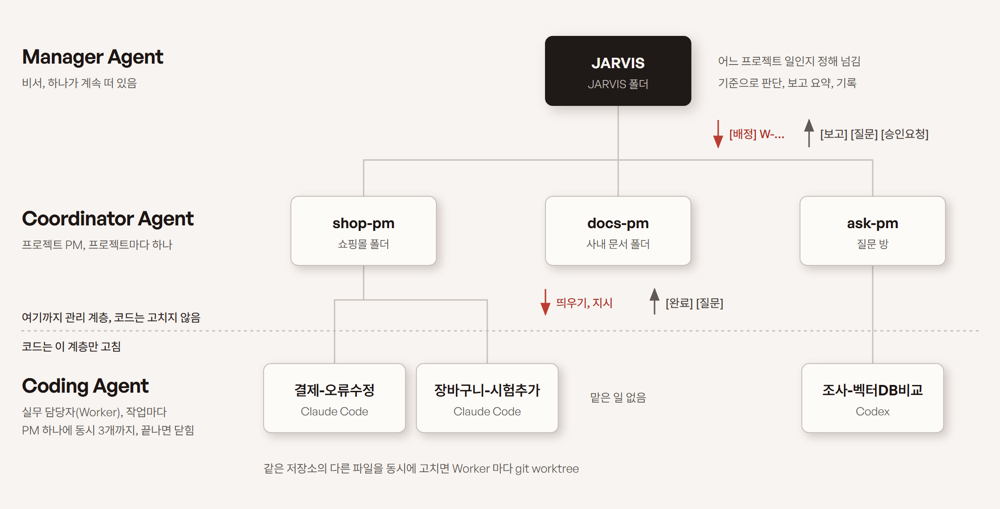
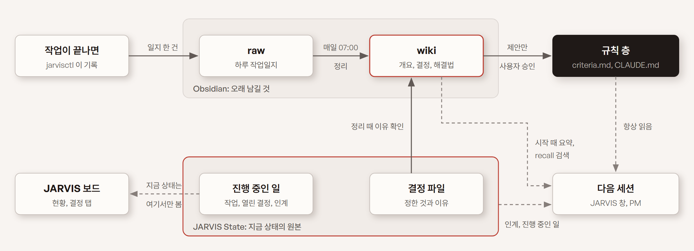

# JARVIS

JARVIS 는 개인용 Manager 에이전트입니다. 사용자는 JARVIS 하고만 대화하고, JARVIS 는 일을 프로젝트별 PM(Coordinator)에게 넘긴 뒤 보고를 받아 짧게 알리고 기록합니다. Coordinator 는 작업마다 Worker 를 띄워 실제 코드를 고치게 합니다. 세션 실행과 대화 화면은 [Paseo](https://paseo.sh) 가 맡고, 각 세션은 Claude Code 나 Codex 로 돕니다. 이 저장소에는 그 위에 얹는 규칙과 상태 파일 형식, 로컬 대시보드, 공통 훅이 들어 있습니다.

구조는 개발동생 채널의 영상 [에이전트 관리의 표준이 될 거라고 봅니다 | Manager Agent](https://www.youtube.com/watch?v=NoatYSA9RyU) 에서 소개한 Manager, Coordinator, Coding Agent 세 계층을 바탕으로 만들었습니다.

## 아키텍처: 세 계층

에이전트는 Manager, Coordinator, Coding Agent 세 계층으로 나뉩니다. 위의 두 계층은 일을 나누고 넘기고 확인만 하고, 코드는 맨 아래 Coding Agent(Worker)만 고칩니다.

<picture>
  <source media="(prefers-color-scheme: dark)" srcset="docs/images/layers-dark.png">
  
</picture>

회사로 치면 JARVIS 는 사용자의 비서, Coordinator 는 프로젝트 PM, Worker 는 일 하나를 맡아 들어왔다가 끝나면 빠지는 실무 담당자입니다. 사용자는 비서하고만 이야기하고, 일은 비서에게서 PM 을 거쳐 담당자에게 내려갑니다. 보고는 같은 길을 거꾸로 올라옵니다.

| 계층 | 비유 | 수와 수명 | 일하는 곳 | 하는 일 | 하지 않는 일 |
|---|---|---|---|---|---|
| 사용자 | 일을 맡기는 사람 | 한 명 | Paseo 앱(PC, 휴대폰) | 요청, 판단, 되돌리기 어려운 일 승인 | Coordinator 나 Worker 에 직접 지시 |
| Manager Agent (JARVIS) | 비서 | 논리적으로 하나. 대화창(세션)은 여러 개 열 수 있음 | JARVIS 폴더 | 어느 프로젝트 일인지 정해 넘기기, 기준으로 판단, 보고 요약, 기록, Notion 할 일 관리 | 코드 읽기, 일 쪼개기, 직접 검증 |
| Coordinator Agent (PM) | 프로젝트 PM | 프로젝트마다 하나(역할은 계속, 실행 세션은 컨텍스트가 커지면 교체) | 프로젝트 폴더 | 일 나누기, Worker 붙이기, 차례 정하기, 결과 검수, `[보고]` | 다른 프로젝트 건드리기, 권한 승인, 기록, Notion·Linear 쓰기 |
| Coding Agent (Worker) | 실무 담당자 | 작업마다 하나, PM 하나에 동시 3개까지, 끝나면 닫힘 | 프로젝트 폴더(같은 저장소를 동시에 고치면 git worktree) | 맡은 일 하나, `[완료]` 로 끝맺기 | 범위 밖 수정, push, 운영 반영, DB 변경, 삭제 |

### Manager Agent: JARVIS, 비서

사용자의 말을 받으면 어느 프로젝트 일인지 정해 그 PM 에게 그대로 넘깁니다. 일을 어떻게 나누고 누구를 붙일지는 PM 이 정합니다. PM 이 판단을 물어 오면 판단 기준(`criteria.md`)에 답이 있을 때는 바로 답하고, 없으면 사용자에게 선택지와 추천을 붙여 묻습니다. 사용자가 답하면 "기준으로 남길까요?" 를 물어 기준에 더하므로, 같은 질문을 두 번 묻지 않습니다. 끝난 일은 한두 줄로 알리고 작업과 결정 장부(`state/`)와 작업일지를 씁니다. 사용자의 할 일 목록(Notion 할일 DB)도 비서가 직접 챙깁니다. 코드를 직접 읽거나 결과를 다시 검증하지 않고, PM 이 확인한 것과 보고만 받은 것을 나눠 전합니다.

### Coordinator Agent: 프로젝트 PM

프로젝트마다 하나가 그 프로젝트 폴더에 상주합니다. 받은 일을 쪼개 Worker 를 붙이고, 같은 파일이나 같은 서버 플로우를 만지는 일은 차례로 돌립니다. 파일 몇 개를 보는 정도는 직접 확인하지만 고치는 일이나 여러 단계인 일은 Worker 에게 맡깁니다. Worker 가 끝냈다고 하면 보고서만 믿지 않고 파일, 서버 상태, DB 조회 결과를 직접 열어 검수한 뒤 JARVIS 에게 보고합니다. 다른 프로젝트와 겹칠 수 있는 공용 자원은 쓰기 전에 JARVIS 에게 알립니다(`[점유]`).

### Coding Agent: Worker, 실무 담당자

작업 하나를 받아 투입됐다가 끝나면 세션을 닫고 빠집니다. 이름은 맡은 일이 보이게 `<영역>-<작업 이름>`(예: `결제-오류수정`, `wf3-쿼리확인`)으로 짓고, 작업 번호는 라벨(`jarvis.task`)에 둡니다. 번호나 순번만 있는 이름은 훅이 막습니다. 맡은 범위만 고치고, 범위를 넘거나 판단이 필요하면 손을 멈추고 PM 에게 `[질문]` 을 올립니다. push, 운영 반영, DB 변경, 삭제처럼 되돌리기 어려운 일은 준비까지만 합니다. 끝나면 바뀐 것, 확인한 것, 남은 것을 적어 `[완료]` 를 냅니다.

### 구성 요소

세 계층의 세션은 모두 Paseo 위에서 돕니다. JARVIS 는 JARVIS 폴더에 상태를 쓰고, 할 일은 Notion 할일 DB 에 넣고 정리합니다. 대시보드는 JARVIS 폴더와 Paseo 기록, Notion 할 일을 읽어 한 화면에 보여 줍니다. 플러그인 훅은 모든 세션에 걸립니다. 새 PM 에게 규칙과 진행 중인 일을 넣어 주고, PM 을 만들고 닫는 호출을 지키고, JARVIS 폴더를 다른 세션이 고치지 못하게 막고, 커밋 문구를 검사합니다.

<picture>
  <source media="(prefers-color-scheme: dark)" srcset="docs/images/architecture-dark.png">
  
</picture>

그림과 화면에 나오는 세션과 데이터는 설명용 예시입니다.

## 관리 영역: 네 문서

운영 규칙은 질문 넷으로 나뉩니다. 문서가 정책이고, `CLAUDE.md` 와 `rules/` 는 그것을 실행 지침으로 줄인 것입니다. 읽는 순서와 그림 안내는 [docs/README.md](docs/README.md) 에 있습니다.

| 순서 | 영역 | 핵심 질문 | 문서 | 구현 |
|---|---|---|---|---|
| 01 | State & Memory Management (상태·기억 관리) | 무엇을 영구적으로 기억하고 보존할 것인가? | [docs/01_State_Memory_Management.md](docs/01_State_Memory_Management.md) | `state/`, `registry.yaml`, 인계 노트, 쓰기 권한 훅 |
| 02 | Agent Lifecycle Management (에이전트 수명주기 관리) | Agent 와 세션을 어떻게 생성·교체·복구할 것인가? | [docs/02_Agent_Lifecycle_Management.md](docs/02_Agent_Lifecycle_Management.md) | `hooks/`, `scripts/jarvisctl.py` |
| 03 | Work Lifecycle Management (업무 수명주기 관리) | 프로젝트·기능·작업을 어떻게 관리하고 완료할 것인가? | [docs/03_Work_Lifecycle_Management.md](docs/03_Work_Lifecycle_Management.md) | `scripts/linear.py`, Notion 할 일 |
| 04 | 기억 구조 | 세션이 바뀌고 창이 닫혀도 무엇이 어디에 남고, 다음 세션은 무엇을 읽는가? | [docs/04_Memory_Structure.md](docs/04_Memory_Structure.md) | 작업일지, 위키 정리, 시작 주입 훅, `recall` 스킬, `session-end` 스킬 |

역할은 계속 있고 세션은 바꿀 수 있습니다. PM 은 프로젝트(registry 키)로 계속 있고, 그 역할을 맡은 Paseo 세션은 컨텍스트가 커지면 인계 노트를 받아 새 세션으로 바뀝니다. 언제 바꿀지는 JARVIS 가 정하고, lock·registry 전환·기록은 `jarvisctl` 이 원자적으로 하며, 훅이 규칙을 어기는 도구 호출을 막습니다.

## 기억은 어디에 남나

기억은 네 단계로 나뉘고, 한 단계는 한 곳에 있습니다. 기록은 앞 단계에서 뒤 단계로만 올라갑니다. 행동을 바꾸는 규칙은 기억과 따로 둡니다. 원본은 [docs/04](docs/04_Memory_Structure.md) 입니다.

| 단계 | 자리 | 담는 것 | 다음 단계로 가는 때 |
|---|---|---|---|
| 1 원문 | `~/.claude`, `~/.codex`, `~/.paseo` | 대화 전체. Claude 원문은 30일 뒤 지워짐 | 훅과 `jarvisctl` 이 사건을 상태로 옮길 때 |
| 2 상태 | `state/`, `registry.yaml` | 진행 중인 작업(W), 결정(D), 인계 노트, 세션 이력 | 작업이 끝날 때, 세션 종료 때 |
| 3 일지 | `projects/worklog/raw/` | 끝난 작업 하나에 일지 한 건, 정한 것과 이유 | 매일 07:00 정리 |
| 4 지식 | `projects/worklog/wiki/<프로젝트>/` | 개요, 결정, 해결법 | 규칙 후보를 제안만 함 |

| 규칙 | 자리 | 쓰는 쪽 |
|---|---|---|
| 판단 기준 | `criteria.md` | JARVIS(사용자 승인 뒤) |
| JARVIS 운영 규칙 | `CLAUDE.md`, `rules/`, `docs/` | JARVIS(사용자와 설계 뒤) |
| 프로젝트 전체 규칙 | 프로젝트 저장소 `CLAUDE.md` | PM |
| 그 폴더에서 일하는 방식 | Claude 자동 메모리(`feedback`·`reference` 만) | 그 폴더 세션 |

<picture>
  <source media="(prefers-color-scheme: dark)" srcset="docs/images/state-memory-dark.png">
  
</picture>

- 작업이 끝나면 JARVIS 가 `jarvisctl task <W> --status done --worklog …` 로 작업 파일을 닫고, 같은 명령이 작업일지에 한 건 남깁니다.
- 매일 07:00 Paseo schedule 이 `wiki-curator` 로 일지를 위키로 정리하고, 월요일 07:05 에는 위키를 점검합니다. 규칙 후보가 나오면 JARVIS 가 "기준으로 남길까요?" 라고 묻습니다.
- 새 세션이 뜨면 SessionStart 훅이 인계 노트, 진행 중인 작업과 결정, 판단 기준, 위키 요약을 넣습니다. 그 밖의 과거 일은 `recall` 스킬(`scripts/recall.py`)로 찾습니다.
- 영구 지식은 사용자가 JARVIS 창에 "세션 종료" 라고 할 때만 남깁니다(`session-end` 스킬). Paseo 보관 버튼으로 바로 닫으면 아무것도 남지 않습니다.

지금 상태는 JARVIS 보드에서 봅니다. Obsidian 에 상태 사본을 두지 않습니다.

## 무엇이 들어 있나

| 부분 | 위치 | 내용 |
|---|---|---|
| 정책 문서 | `docs/01~04_*.md` | 위 네 관리 영역. 그림 원본은 `docs/diagrams/`, PNG 는 `docs/images/` |
| JARVIS 규칙 | `CLAUDE.md` | 이 폴더에서 뜬 세션이 JARVIS 가 됩니다. 어디에 맡길지, PM 을 어떻게 띄우고 바꿀지, 무엇을 사용자에게 물을지, 무엇을 어떻게 기록할지 |
| PM, Worker 규칙 | `rules/` | PM 은 SessionStart 훅으로, Worker 는 PM 의 첫 지시로 받는 규칙 |
| 수명주기·상태 명령 | `scripts/jarvisctl.py` | 작업·결정 번호 발급, 결정 확정(CAS), 공유 자원 점유, 프로젝트 등록·필드, 교체 조건 점검, 교체 lock(소유 창만), registry 전환(CAS), 인계 노트 보관, 기본 수신자 전환. 모두 잠금 안에서 |
| Linear 연동 | `scripts/linear.py` | JARVIS 만 쓰는 Linear 조회·이슈 만들기·상태·코멘트, 실패 재시도 |
| 기억 찾기 | `scripts/recall.py`, `tools/qmd/` | 판단 기준 → 위키 → 일지 순으로 키워드를 찾아 출처와 함께 돌려줌. `--qmd` 는 로컬 검색 엔진 qmd 시범(`tools/qmd` 에서 `npm install`, 설치물은 git 제외) |
| 판단 기준 | `criteria.md` | JARVIS 가 사용자 대신 정해도 되는 기준. 사용자가 결정할 때마다 하나씩 늘어남 |
| 프로젝트 목록 | `registry.yaml` | 프로젝트 키, 폴더, 지금 PM ID, PM 제목(`pm_title`), Linear Project, 기본 수신 JARVIS. `jarvisctl` 로만 바꿈. 개인 상태라 git 에 올리지 않음(`registry.example.yaml` 참고) |
| 상태 파일 | `state/` | 작업, 결정, 인계 노트, 세션 이력, 공유 자원 점유, 운영 반영 대기. JARVIS·훅·`scripts/` 만 쓰고 git 에 올리지 않음 |
| 대시보드 | `dashboard/` | 읽기만 하는 로컬 웹 화면(JARVIS 보드). Python 표준 라이브러리만 씀. 할 일 탭만 Notion 에 완료 체크와 날짜 옮기기를 씀 |
| 플러그인 | `.claude-plugin/`, `hooks/`, `skills/` | 모든 세션에 걸리는 훅: 시작 맥락 주입(SessionStart), 닫힌 PM 대조(UserPromptSubmit), 사용량 기록(Stop), PM 생성·닫기 가드(PreToolUse·PostToolUse), 종료 기록(SessionEnd·PreCompact), JARVIS 폴더 보호, 커밋 문구 검사. 스킬 `git-message`, `recall`(기억 찾기), `session-end`(세션 종료) |
| 테스트 | `tests/`, `dashboard/test_server.py` | 임시 폴더에서 훅 스크립트와 `jarvisctl` 을 실제로 돌려 보는 시험 |
| 권한 예시 | `.claude/settings.json`, `templates/project-settings.json` | JARVIS 폴더와 프로젝트 폴더에 둘 Paseo 도구 권한 |

이 저장소 밖에 두는 것도 있습니다.

| 부분 | 위치 | 이유 |
|---|---|---|
| `notion-todo` 스킬 | `~/.claude/skills/notion-todo` | 자기 Notion DB ID 가 들어가는 개인 스킬([Notion 할 일](#notion-할-일)) |
| `wiki-curator` 에이전트 | `~/.claude/agents/wiki-curator.md` | 매일 위키 정리를 맡는 하위 에이전트. 정리 절차의 원본은 `worklog/AGENTS.md` |
| 작업일지 스크립트 | `projects/worklog/scripts/worklog.ps1` | 모든 프로젝트가 같이 쓰는 일지. 경로는 환경변수 `JARVIS_WORKLOG` 로 바꿈 |
| 일지와 위키 | `projects/worklog/`(Obsidian 보관함) | 경로는 환경변수 `JARVIS_WORKLOG_DIR` 로 바꿈 |
| 다른 플러그인 | `superpowers`, `humanizer` 등 | `CLAUDE.md`·`rules/` 의 "쓸 스킬" 에 나오는 스킬. 없으면 그 단계만 건너뜀 |

## 배정에서 보고까지

사용자가 요청하면 JARVIS 가 작업 파일(`state/tasks/W-….md`)을 만들고 그 프로젝트 Coordinator 에게 `[배정]` 을 보냅니다. Coordinator 는 Worker 를 띄우고, Worker 의 `[완료]` 를 받으면 결과를 직접 확인한 뒤 JARVIS 에게 `[보고]` 를 보냅니다. JARVIS 는 작업 파일을 고치고 사용자에게 한두 줄로 알립니다.

<picture>
  <source media="(prefers-color-scheme: dark)" srcset="docs/images/flow-dark.png">
  
</picture>

메시지 종류는 맨 앞 머리말로 가립니다. 아래로 내려가는 것은 `[배정]` `[인계요청]` `[점유허가]` `[점유대기]` 이고, 위로 올라오는 것은 `[진행]` `[질문]` `[승인요청]` `[계획]` `[보고]` `[완료]` `[인계노트]` `[준비]` 입니다. 프로젝트끼리 겹치는 자원은 `[점유]` 로 허가를 받고 `[해제]` 로 놓습니다. 형식은 [CLAUDE.md](CLAUDE.md), [rules/coordinator.md](rules/coordinator.md), [rules/worker.md](rules/worker.md) 에 있습니다.

프로젝트와 관계없는 질문(일반 지식, 도구 비교, 글 다듬기)은 registry 의 `ask` 로 넘깁니다. 프로젝트 폴더 대신 빈 폴더 하나를 질문 방으로 씁니다.

## JARVIS 세션

JARVIS 대화창은 동시에 여러 개 열 수 있고, 모두 같은 상태 파일을 고칩니다. 창끼리 겹치면 안 되는 일(작업·결정 번호 발급, 결정 확정, 공유 자원 점유, registry 변경, PM 교체)은 `jarvisctl` 이 잠금 안에서 처리하고, 훅이 그 밖의 경로를 막습니다. 창끼리는 사용자와 나눈 대화를 모르므로, 지켜야 할 지시는 결정 파일이나 `criteria.md` 에 남깁니다.

registry 의 `jarvis:` 는 쓰기 권한이 아니라 기본 수신자입니다. 아침 정리 보고, 맡긴 창이 닫힌 뒤 도착한 보고, PM 이 보낼 곳을 모르는 글을 이 창이 받습니다.

대화가 길어지면 사용자가 새 창으로 옮기자고 말합니다. PM 과 달리 JARVIS 는 교체 시점을 스스로 판단하지 않습니다.

```powershell
python scripts\jarvisctl.py handoff manager note.md    # 옛 창: 인계 노트를 state/handoff/manager/latest.md 로 (이전 노트는 이력으로)
python scripts\jarvisctl.py transfer-jarvis --to next  # 옛 창이 기본 수신자일 때만: 다음에 claim 하는 창에 넘김
python scripts\jarvisctl.py claim-jarvis <새 ID>       # 새 창: 기본 수신자를 넘겨받음 (옛 창이 닫혔거나 넘겼을 때만)
```

새 창은 대화 기억이 없으므로 파일에서 이어받습니다. SessionStart 훅이 기본 수신자와 PM 현황을 먼저 넣어 주고, 새 창은 registry, `criteria.md`, 인계 노트, 진행 중인 작업, 열린 결정, 공유 자원 점유, 운영 반영 대기, Linear 쓰기 실패 목록을 읽습니다. 기본 수신자를 넘겨받으면 살아 있는 PM 마다 `[인계]` 를 보내 보고받을 곳을 알리고, 사용자에게 진행 중인 일을 다섯 줄 안으로 알립니다. 자세한 순서는 `CLAUDE.md` 의 "새로 떴을 때(인계)" 에 있습니다.

## PM 세션 교체

PM 은 한 세션을 오래 쓰면 한 번 주고받을 때마다 큰 컨텍스트를 다시 읽습니다(예: 86만 토큰). JARVIS 는 `[보고]` 를 받을 때마다 교체 조건을 보고, 넘으면 인계 노트를 받아 새 세션으로 바꿉니다.

```powershell
python scripts\jarvisctl.py can-rotate nipa          # 컨텍스트 > 20만, PM idle, 진행 중 작업 없음, 열린 Worker 없음, lock 없음
python scripts\jarvisctl.py lock acquire nipa --reason context
#  옛 PM 에 [인계요청] → [인계노트] 를 파일로 저장
python scripts\jarvisctl.py handoff nipa note.md    # state/handoff/nipa/latest.md (이전 노트는 이력으로)
#  create_agent: 제목은 registry pm_title(nipa-pm), labels {"jarvis.role":"pm","jarvis.project":"nipa"} → 훅이 맥락을 넣고 detach
python scripts\jarvisctl.py hook-check <새 ID>      # [준비] 의 표식과 비교
python scripts\jarvisctl.py switch nipa <새 ID>     # registry 를 CAS 로 바꾸고 lock 해제
```

새 프로젝트, 보관된 PM 다시 만들기, 교체가 모두 같은 "PM 띄우기" 절차를 씁니다. PM 이 닫히면 JARVIS 가 다음 글을 받을 때 훅이 알아채 알려 줍니다. 다음 `[배정]` 전에 `jarvisctl pm-check <프로젝트>` 가 할 일을 정해 줍니다. 프로세스만 닫혔으면 새로 띄우지 않고 그대로 보내 이어 띄우고(대화 맥락 유지), 보관·삭제됐으면 새로 띄웁니다. 자세한 순서와 실패 처리는 [docs/02](docs/02_Agent_Lifecycle_Management.md) 와 `CLAUDE.md` 의 "PM 띄우기", "PM 세션 교체" 에 있습니다.

## Linear

개발 작업 단위는 Linear 에 둡니다. JARVIS 만 `scripts/linear.py` 로 씁니다. 프로젝트는 registry 의 `linear_project` 로 Linear Project 와 잇고(이름이 달라도 됨, 예: nipa → KSM), 기능은 `Feature` 라벨 상위 이슈, 작업은 하위 이슈입니다. 같은 `--key` 로는 이슈를 두 번 만들지 않고, 실패한 쓰기는 `state/linear_pending.jsonl` 에 남겨 `retry` 합니다. API 키는 사용자 환경변수 `LINEAR_API_KEY` 에 둡니다. 배포 이력(Jira)은 수작업입니다. 자세한 흐름은 [docs/03](docs/03_Work_Lifecycle_Management.md).

## 설치

Windows, Paseo 0.15.2, Claude Code 2.1 에서 확인했습니다. Python 3.8 이상이 필요합니다.

JARVIS 는 이 저장소를 받은 폴더에서 돌아갑니다. 플러그인에는 훅과 스킬만 들어 있고, `CLAUDE.md` 와 `rules/`, 대시보드는 받은 폴더에 있는 것을 씁니다.

1. Paseo 데스크톱 앱을 설치하고 원격 중계는 끕니다. 설정 → 호스트 → 에이전트에서 **Paseo 도구 활성화** 를 켭니다.
2. 저장소를 받고 프로젝트 목록을 만듭니다.

   ```powershell
   git clone https://github.com/smdeveloper7/jarvis.git C:\Users\<나>\JARVIS
   cd C:\Users\<나>\JARVIS
   Copy-Item registry.example.yaml registry.yaml
   ```

   `registry.yaml` 에 프로젝트마다 이름과 폴더(`root`)를 적습니다. `coordinator` 를 비워 두면 JARVIS 가 처음 일을 맡길 때 만들고 채웁니다. 처음 만든 뒤 프로젝트를 더할 때는 `python scripts\jarvisctl.py register <키> --root <폴더>` 를 씁니다.
3. JARVIS 폴더와 각 프로젝트 폴더를 Claude Code 로 한 번씩 열어 신뢰를 승인합니다. 신뢰하지 않은 폴더에서는 그 폴더의 권한 설정이 무시됩니다.
4. 프로젝트 폴더마다 `templates/project-settings.json` 을 `.claude/settings.json` 으로 둡니다. Coordinator 가 Worker 를 만들고 지시하는 것은 허용하고, 권한 승인과 강제 종료는 막는 설정입니다.
5. 전역 `~/.claude/settings.json` 에서는 Paseo 도구 중 상태와 목록 보기만 허용합니다. 전역 deny 는 두지 마세요. deny 는 어느 설정 파일에 있든 이기기 때문에 JARVIS 폴더의 허용까지 막습니다.
6. 플러그인을 설치합니다. Windows 에서는 훅이 셸 없이 돌기 때문에 `python.exe` 절대 경로가 필요합니다. `py -3 -c "import sys; print(sys.executable)"` 로 경로를 확인하고 `\` 를 `/` 로 바꿔 넣습니다.

   ```powershell
   claude plugin marketplace add smdeveloper7/jarvis
   claude plugin install jarvis@jarvis `
     --config python=C:/Users/<나>/AppData/Local/Programs/Python/Python312/python.exe `
     --config jarvis_dir=C:/Users/<나>/JARVIS
   ```

7. JARVIS 폴더와 프로젝트 폴더를 Paseo 프로젝트로 등록하고(`paseo project create <폴더>`), JARVIS 폴더에서 제목을 `JARVIS` 로 해 에이전트를 띄웁니다. 처음 뜬 JARVIS 는 `python scripts\jarvisctl.py claim-jarvis <자기 에이전트 ID>` 로 기본 수신자가 됩니다(`CLAUDE.md` "새로 떴을 때"). 창은 더 열어도 됩니다. 그다음부터는 Paseo 앱에서 JARVIS 와 대화하면 됩니다.
8. Notion 할 일을 쓰려면 [Notion 할 일](#notion-할-일) 의 설정을 따릅니다. 쓰지 않으면 건너뛰어도 됩니다.
9. Linear 를 쓰려면 개인 API 키를 사용자 환경변수 `LINEAR_API_KEY` 에 두고, registry 프로젝트에 `linear_project` 를 적습니다.
10. 작업일지와 위키를 쓰려면 `projects/worklog`(Obsidian 보관함, `worklog.ps1`)를 두고, `wiki-curator` 에이전트를 `~/.claude/agents/` 에 둡니다. 경로가 다르면 환경변수 `JARVIS_WORKLOG_DIR`(보관함), `JARVIS_WORKLOG`(`worklog.ps1`)를 줍니다. 매일 정리는 Paseo schedule 로 겁니다(07:00 정리, 월요일 07:05 점검).

### 플러그인 설정

설치할 때 `--config 키=값` 으로 넣고, 나중에 바꿀 때는 `claude plugin configure jarvis@jarvis` 를 씁니다.

| 키 | 필수 | 뜻 |
|---|---|---|
| `python` | 예 | 훅을 돌릴 Python 3. Windows 는 `python.exe` 절대 경로. 비어 있으면 훅이 돌지 않음 |
| `jarvis_dir` | 아니요 | JARVIS 폴더 절대 경로. 비우면 수명주기 훅과 폴더 보호가 모두 꺼짐. PM, Worker 가 이 폴더 파일을 Edit, Write 로 고치지 못하게 막고, JARVIS 창도 `registry.yaml` 과 새 작업·결정 파일은 `jarvisctl` 로만 쓰게 함 |

훅은 새로 뜨는 세션부터 걸립니다. 설치 전에 떠 있던 세션에는 걸리지 않습니다.

## 업데이트

JARVIS 폴더에서 `git pull` 을 합니다. `registry.yaml` 과 `state/` 는 git 에 없어서 그대로 남습니다. `CLAUDE.md` 나 `rules/` 가 바뀌었으면 Paseo 에서 JARVIS 에게 "CLAUDE.md 다시 읽어줘" 라고 말합니다. PM 은 다음에 새로 뜨거나 대화가 압축될 때 SessionStart 훅으로 새 규칙을 받습니다.

플러그인(훅, 스킬)은 따로 받습니다.

```powershell
claude plugin marketplace update jarvis
claude plugin update jarvis@jarvis
```

## JARVIS 보드

JARVIS 폴더의 `state/`, Paseo 에이전트 기록(`~/.paseo/agents`), 각 세션의 대화 기록을 몇 초마다 읽어 화면에 그립니다. 세션에 입력을 보내거나 멈추지 않습니다. 대화와 권한 승인은 Paseo 앱에서 합니다.

```powershell
$env:JARVIS_DIR = "C:\Users\<나>\JARVIS"; $env:PORT = "4991"; python dashboard\server.py   # http://127.0.0.1:4991
```

<picture>
  <source media="(prefers-color-scheme: dark)" srcset="docs/images/dashboard-dark.png">
  
</picture>

<picture>
  <source media="(prefers-color-scheme: dark)" srcset="docs/images/dashboard-flow-dark.png">
  
</picture>

| 탭 | 보여 주는 것 | 출처 |
|---|---|---|
| 에이전트 | 3D 사무실. 사용자 방, JARVIS 자리, 프로젝트별 방에 PM 과 Worker 책상이 있습니다. 일하는 세션은 앉아서 타자를 치고, 권한을 기다리면 머리 위에 주황 `!` 가 뜨고, 쉬면 자기 책상에서 모니터를 끄고 머리 위에 zzz 가 뜹니다(휴게실은 없앴습니다. 방이 프로젝트별이라 쉬는 사람도 자기 방에 둡니다). 교체된 옛 PM 은 archive 전까지 칸막이 안 둘째 책상에 흐린 이름표로 앉습니다. 방은 일이 있을 때(세션 작업·대기, 진행 중 작업, 정할 결정, PM 교체 중) 보이고, 그 밖의 방은 장면 위 "항상 보이기" 에서 체크한 것만 보입니다(브라우저에 저장). 아래 세션 흐름도도 같은 방만 그립니다. 프로세스가 닫혔거나 2시간 넘게 활동이 없는 세션은 숨기고 "꺼진 세션 보기" 로 다시 봅니다. PM 이 꺼진 방에는 "PM 꺼짐" 이 붙습니다 | Paseo 에이전트 기록(제목, 부모, 상태, `jarvis.role`·`jarvis.project`·`jarvis.task` 라벨), registry 의 기본 수신 JARVIS·현재 PM |
| 흐름 | `[배정]` `[보고]` `[질문]` 메시지를 카드 트리, 3D 부채꼴, 평면 그래프와 목록으로 | 각 세션 대화 기록 |
| 결정 | 지금 정할 것, 작업은 끝났는데 안 정한 것, 미뤄 둔 것, 정한 것(누가, 기준 몇 번으로). 권한을 기다리는 세션 | `state/decisions/*.md`, Paseo 주의 표시 |
| 할 일 | Notion 할일 DB 의 오늘, 이번 주, 밀린 일. 완료 체크와 오늘로 옮기기 | Notion API |
| 현황 | 프로젝트별 작업판, 운영 반영 대기, 공유 자원 점유 | `state/tasks`, `releases.json`, `occupancy.json` |

탭마다 자세한 설명은 [dashboard/README.md](dashboard/README.md) 에 있습니다. JARVIS 팀 밖의 Claude, Codex 세션까지 보려면 `JARVIS_SHOW_OTHER=1` 을, 활동 기준 시간을 바꾸려면 `JARVIS_ACTIVE_HOURS`(기본 2)를 줍니다.

## Notion 할 일

할 일의 원본은 Notion 할일 DB 입니다. 할 일을 넣고 찾고 정리하는 일은 JARVIS 가 `notion-todo` 스킬로 직접 합니다. "오늘 할 일 뭐 있어", "이거 할 일에 넣어 줘" 처럼 말하면 됩니다. Coordinator 와 Worker 는 Notion 을 고치지 않습니다.

JARVIS 보드의 할 일 탭은 같은 DB 를 Notion API 로 읽습니다. 오늘 할 일, 이번 주 남은 일, 이번 주 전에 밀린 일, 프로젝트가 붙은 날짜 없는 일을 칸으로 나눠 보여 주고, 이름을 누르면 Notion 페이지가 열립니다. 화면에서 바꿀 수 있는 것은 완료 체크와 날짜를 오늘로 옮기기 두 가지뿐입니다. Notion 은 처음 한 번 읽고, 그 뒤로는 새로고침 버튼을 누를 때만 다시 읽습니다.

설정:

1. `notion-todo` 스킬을 `~/.claude/skills/notion-todo` 에 둡니다. JARVIS 는 이 스킬로 Notion MCP 를 씁니다.
2. 할일 DB 에는 `이름`(제목), `완료`(체크박스), `날짜`, `유형`(다중 선택), `프로젝트`(관계) 속성이 있어야 합니다.
3. 대시보드용으로 Notion 에서 내부 통합(integration)을 만들어 할일 DB 에 연결합니다. 화면에서 완료 체크를 하려면 통합의 콘텐츠 업데이트 기능을 켭니다.
4. 통합 토큰을 `~/.jarvis/notion_token` 파일이나 환경변수 `NOTION_TOKEN` 에 둡니다. 저장소에는 넣지 않습니다. 토큰이 없으면 할 일 탭에 설정 안내만 보입니다.
5. 다른 DB 를 쓰면 환경변수 `JARVIS_NOTION_DS` 에 그 DB 의 data source ID 를 줍니다.

## 상태 파일

JARVIS 는 상태가 바뀌는 즉시 `state/` 에 씁니다. 대화가 길어져 JARVIS 를 새로 띄워도 이 파일을 읽고 이어받습니다(`CLAUDE.md` 의 "새로 떴을 때").

| 파일 | 내용 |
|---|---|
| `state/tasks/W-YYYYMMDD-NN.md` | 작업 하나. 상태(assigned, working, question, done, cancelled), 확인 여부, 운영 반영 여부, 경과 |
| `state/decisions/D-YYYYMMDD-NN.md` | 판단 하나. 질문, 선택지, 추천, 상태(open, waiting, decided, dropped), 누가 어떤 기준으로 정했는지 |
| `state/handoff/<역할>/` | 인계 노트. `manager/`(JARVIS), `<프로젝트>/`(PM) 마다 `latest.md` 와 이전 노트, 교체 중에만 있는 `rotating.lock` |
| `state/sessions.jsonl` | 세션 교체·닫힘·종료·기본 수신자 전환 이력(event_id 가 붙은 한 줄씩) |
| `state/sessions/<에이전트ID>.json` | PM 의 마지막 컨텍스트 크기(Stop 훅), `.hook.json` 은 SessionStart 표식 |
| `state/linear_pending.jsonl` | 실패한 Linear 쓰기, `linear.py retry` 로 다시 |
| `state/occupancy.json` | 프로젝트끼리 겹칠 수 있는 공유 자원(dev 서버 플로우, 공용 DB 등)을 지금 누가 쓰는지 |
| `state/releases.json` | dev 에만 반영하고 운영 반영을 기다리는 변경 |

형식은 [CLAUDE.md](CLAUDE.md) 의 "상태 파일" 과 [docs/01](docs/01_State_Memory_Management.md) 에 있습니다.

## 지금 상태

- 확인함: Paseo 가 띄운 Claude 세션도 CLAUDE.md, 플러그인, 스킬, MCP 를 그대로 읽습니다. git 저장소가 아닌 폴더도 프로젝트로 등록됩니다. JARVIS → PM → Worker 가 승인 창 없이 이어지고, 부모와 자식 관계가 기록됩니다.
- 확인함(2026-11-09): 시험 PM 에서 SessionStart 훅이 규칙·인계 노트·열린 작업과 세션별 표식을 넣고, Stop 훅이 컨텍스트 크기를 남기고, Paseo 에서 archive 하면 SessionEnd 훅이 불리고, 대조 훅이 닫힌 PM 을 한 번만 알립니다. nipa PM 을 실제로 교체했습니다(87.8만 → 6.8만 토큰).
- 확인함: 에이전트가 `create_agent` 로 만든 에이전트는 그 에이전트의 subagent 가 되므로, PM 은 만든 직후 `paseo agent detach` 로 떼어 냅니다. detach 한 PM 의 끝남 알림은 JARVIS 에게 오지 않아, PM 이 `[준비]`·`[보고]` 를 직접 보냅니다.
- 고친 것: PM 이 Worker 를 기다리며 낸 이른 보고를 JARVIS 가 완료로 받던 문제. 하위 에이전트가 끝났다는 알림은 부모에게 처음 한 번만 가서, PM 이 모두 끝난 뒤 JARVIS 에게 `[보고]` 를 직접 보내게 바꿨습니다.
- 확인함(2026-11-09): 닫힌 PM 에 그대로 글을 보내면 Paseo 가 저장된 세션으로 다시 열고 대화 맥락이 이어집니다. 새로 뜬 JARVIS 창에 SessionStart 훅이 인계 노트, 진행 중인 작업과 결정, 위키 최근 결정을 넣습니다.
- 확인함(2026-11-10): 07:00 위키 정리와 07:20 할일 정리 schedule 이 처음 혼자 돌아 기본 수신 JARVIS 창에 `[보고]` 를 보냈습니다.
- 실측 필요: 새로 뜬 JARVIS 창에서 PM 을 만들 때의 생성 가드와 자동 detach, UserPromptSubmit 대조, PreCompact 기록, JARVIS 폴더 쓰기 차단.
- 시범: `recall.py --qmd` 키워드 검색은 동작합니다. 의미 검색은 임베딩 모델을 받기 전입니다.
- 남은 일: 설치를 맡을 setup 스킬, 규칙과 스킬에 적힌 개인 경로(`C:/Users/SMDEVELOPER/…`) 걷어내기, nipa 자동 메모리 정리.
- 하지 않기로 함(2026-11-09): Paseo 플러그인 `agent.archive.after`(대조 훅으로 충분), `state/` 별도 백업, claude-mem. Claude 원문 보관 기간은 30일 그대로 둡니다.

## 라이선스와 참고

MIT. 바탕으로 삼은 것:

- 세 계층 구조: 개발동생, [에이전트 관리의 표준이 될 거라고 봅니다 | Manager Agent](https://www.youtube.com/watch?v=NoatYSA9RyU)
- `dashboard/`(server.py, index.html, test_server.py), `skills/git-message`, `hooks/git-message-style.py`, `hooks/pathutil.py`, `hooks/jarvis_only_write.py`: [holiday0726/lanekeeper](https://github.com/holiday0726/lanekeeper)(옛 claude-hub-plugin), MIT
- `dashboard/vendor/three.min.js`, `OrbitControls.js`: three.js r128, MIT
- `dashboard/vendor/xterm.js`, `xterm.css`: xterm.js 5.5.0, MIT
- `dashboard/vendor/WantedSansVariable.woff2`: Wanted Sans 1.0.3, SIL OFL 1.1
