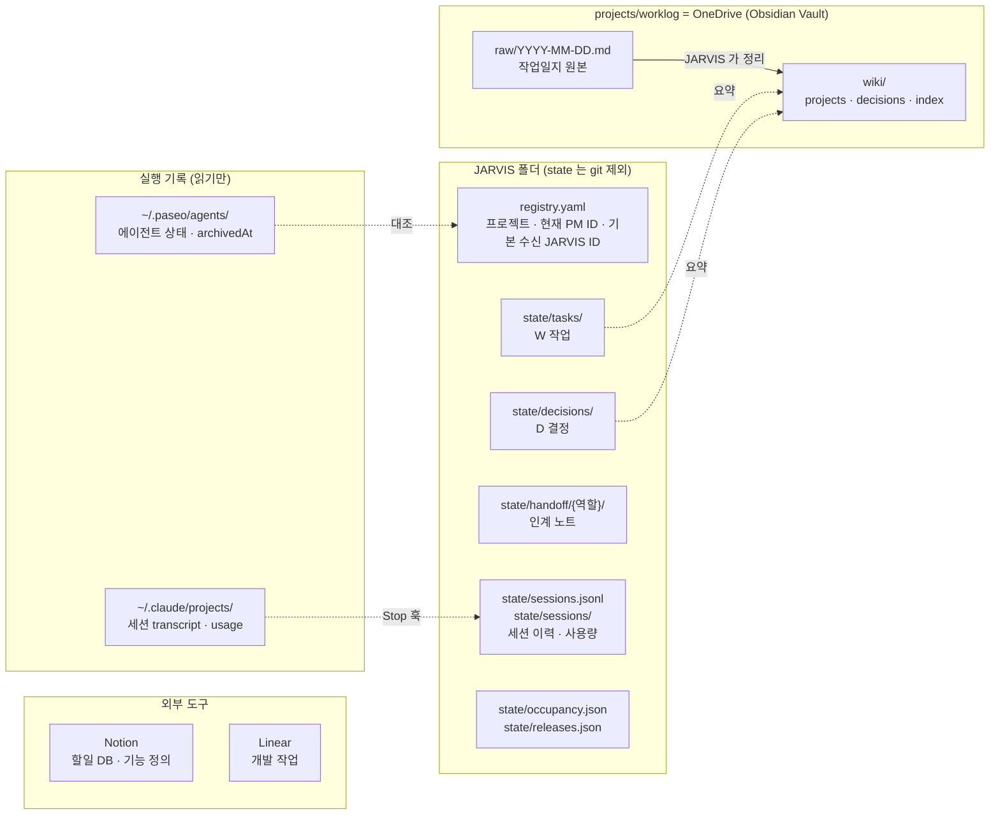
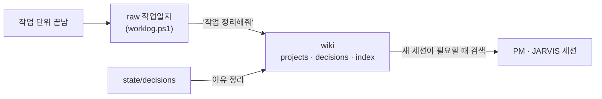

# 01. State & Memory Management (상태·기억 관리)

> **핵심 질문:** 무엇을 영구적으로 보존하고, 세션이 바뀌어도 어떻게 기억을 이어 가는가?
> **버전:** v0.4 · 2026-11-09 · 구조 재정리(정책·구현 변경 없음)
> **관련:** [02 Agent Lifecycle](02_Agent_Lifecycle_Management.md) · [03 Work Lifecycle](03_Work_Lifecycle_Management.md)
> **실행 지침:** `CLAUDE.md`, `rules/` 는 이 문서를 운영 규칙으로 줄인 것이다. 둘이 다르면 이 문서를 고치고 규칙에 반영한다.

## 요약

### 목적

JARVIS·PM·Worker 의 세션은 언제든 바뀐다. 이 문서는 세션이 바뀌어도 일이 이어지도록 무엇을, 어디에, 어떤 형식으로, 누가 남기는지를 정한다.

### 핵심 원칙

1. 상태는 세션 밖에 둔다. 진행 상황은 `registry.yaml`·`state/`·worklog 에 남기고, 대화 원문으로 복원하지 않는다.
2. 정보마다 원본은 하나다. 같은 정보를 두 곳에 원본으로 두지 않고, 다른 곳에는 요약과 링크만 둔다.
3. 실행 상태의 원본은 JARVIS State(`JARVIS/state/`, `JARVIS/registry.yaml`)이고, 장기 지식은 Obsidian(`projects/worklog/`)이다. 정리는 State → Obsidian 한 방향이며, Obsidian 노트를 고쳐도 상태는 바뀌지 않는다.
4. 논리적 JARVIS 는 하나, 대화창은 여러 개다. 모든 창이 같은 상태를 고치고, 겹치면 안 되는 쓰기만 `jarvisctl` 이 잠금 안에서 처리한다.
5. 모르는 값은 추정하지 않는다. 확인 못 한 값은 `null` 로 두고, 인계 노트와 상태 파일이 다르면 상태 파일이 맞다.

### 범위

| 이 문서가 정한다 | 다른 문서가 정한다 |
|---|---|
| 저장소별 원본(Source of Truth) | 세션 교체 시점과 순서 → 02 |
| 파일 위치와 형식 | 작업 상태 전이와 완료 기준 → 03 |
| 쓰기 권한과 동시성 규칙 | 승인 기준 → 03 |
| 장기 기억에 남길 것과 남기지 않을 것 | 외부 도구(Notion·Linear) 발행 절차 → 03 |

### 다른 문서와의 관계

02 는 이 문서의 상태 파일을 읽고 써서 세션을 만들고 바꾼다. 03 은 이 문서의 작업·결정 파일을 업무 단위(기능·작업)와 연결한다. 이 문서는 "어디에 무엇이 있는가"만 정하고, "언제 무엇을 하는가"는 두 문서에 맡긴다.

## 1. 개념: State 와 Memory

State(상태) 는 지금 무엇이 진행 중인지에 대한 구조화된 사실이다. 실제 위치는 `C:/Users/SMDEVELOPER/JARVIS/state/` 와 같은 폴더의 `registry.yaml` 이고, 문서에서는 이 둘을 JARVIS State 라고 부른다. 프로젝트별 현재 PM, 맡긴 작업, 사용자가 정한 결정, 세션 교체 이력이 여기에 속한다. 자동화(훅·`jarvisctl`·대시보드)가 이 값을 읽고 판단하므로 형식이 정해져 있다.

Memory(기억) 는 사람이 읽는 지식이다. 결정의 배경, 재사용할 해결법, 회고가 여기에 속한다. Obsidian 보관함(`projects/worklog`)에 두고, 필요할 때 검색한다. 자동 판단의 근거로 쓰지 않는다.

Handoff(인계 노트) 는 둘 사이에 있다. 세션을 바꿀 때 다음 세션이 일을 이어 가는 데 필요한 최소 맥락만 적은 노트다. 상태처럼 State 쪽(`state/handoff/`)에 두지만, 상태 파일과 다르면 상태 파일이 우선한다.

실행 기록(Paseo 에이전트 기록, Claude 세션 transcript)은 세션 자체가 남기는 원본이다. JARVIS 는 이 기록을 읽기만 하고 고치지 않는다.

Source of Truth(원본) 는 어떤 정보에 대해 "여기 적힌 값이 맞다"고 정한 단 하나의 위치다.

## 2. 전체 저장 구조



실선은 쓰기, 점선은 읽어서 반영하는 방향이다. 저장소는 네 묶음이다.

- JARVIS State(`registry.yaml`, `state/`): 실행 상태의 원본. 자동화가 읽고 판단한다.
- Obsidian 보관함(`projects/worklog`): 작업일지 원본(`raw/`)과 정리된 지식(`wiki/`).
- 외부 도구(Notion, Linear): 기능 정의와 개발 작업의 원본. 연결 방법은 03 이 정한다.
- 실행 기록(Paseo, Claude transcript): 읽기만 한다.

주요 파일은 다음 질문에 하나씩 답한다.

| 질문 | 답하는 곳 |
|---|---|
| 지금 이 프로젝트의 PM 세션은 누구인가? | `registry.yaml` 의 `coordinator` |
| PM 에게 무엇을 맡겼고 어디까지 왔나? | `state/tasks/W-*.md` |
| 사용자가 무엇을 왜 정했나? | `state/decisions/D-*.md` (배경은 wiki `decisions/`) |
| 다음 세션이 이어 가려면 무엇을 알아야 하나? | `state/handoff/<역할>/latest.md` |
| 이 일에서 무엇을 배웠나? | `worklog/wiki/` |

## 3. Source of Truth

| 정보 | 원본 | 다른 곳에 남기는 것 |
|---|---|---|
| 프로젝트 목록, 현재 PM 에이전트 ID, 기본 수신 JARVIS ID | `registry.yaml` (`jarvisctl` 로만 바꿈) | 대시보드 표시 |
| 위임한 작업(W)의 상태·보고 | `state/tasks/W-*.md` | wiki 요약, Notion 할일 체크리스트 |
| 사용자·기준으로 정한 결정(D) | `state/decisions/D-*.md` | wiki `decisions/` 에 이유 정리 |
| 최신 인계 맥락 | `state/handoff/<역할>/latest.md` | 없음 |
| 세션 교체·종료 이력, 사용량 | `state/sessions.jsonl`, `state/sessions/` | 없음 |
| 공유 자원 점유, 운영 반영 대기 | `state/occupancy.json`, `state/releases.json` | 대시보드 |
| 하루 작업 기록 | `worklog/raw/YYYY-MM-DD.md` | wiki |
| 프로젝트 지식, 결정 배경, 재사용할 해결법 | `worklog/wiki/` | — |
| 할 일, 일정 | Notion 할일 DB | — |
| 프로젝트 ↔ Linear Project 연결 | `registry.yaml` `linear_project` (프로젝트 단위 한 칸) | — |
| 기능 정의 | Notion 기능 페이지 | Linear 상위 이슈 설명에 링크 |
| 작업 단위·진행 상태 | Linear 이슈 | W 작업 파일 `linear:` 필드, `state/features/` (복사본, 03) |
| Linear 쓰기 실패 | `state/linear_pending.jsonl` | — |
| 에이전트 실제 상태, 대화 원문 | Paseo, Claude transcript | 요약만, 원문 복제 안 함 |

이 표에서 세 가지 규칙이 나온다.

- 같은 정보를 두 곳에 원본으로 두지 않는다. 다른 곳에는 요약·링크만 둔다.
- 작업 상태는 `state/` → wiki 한 방향으로만 흐른다. wiki 를 고쳐서 상태를 바꾸지 않는다.
- 인계 노트와 상태 파일이 다르면 상태 파일이 맞다.

## 4. 역할별 상태 관리

세 계층은 상태를 다루는 방식이 다르다. JARVIS 폴더를 고치는 것은 JARVIS 와 훅·스크립트뿐이다.

| 역할 | 남기는 상태 | 남기는 방법 |
|---|---|---|
| JARVIS(Manager) | registry, 작업·결정 파일, Manager 인계 노트, 점유·운영 반영 대기, 작업일지, Notion 할일 | 직접 쓰기 또는 `jarvisctl`(겹치면 안 되는 쓰기) |
| PM(Coordinator) | 진행·보고 내용, 인계 노트 내용 | 메시지(`[보고]`·`[인계노트]` 등)로 JARVIS 에게 보내고 JARVIS 가 기록 |
| Worker | 작업 결과 | `[완료]` 로 PM 에게. Paseo 라벨 `jarvis.task` 로 W 와 묶임 |
| 훅·스크립트 | 세션 이벤트, PM 사용량, 교체 lock, Linear 실패 큐 | 정해진 경로에만 코드로 기록 |

JARVIS 는 논리적으로 하나지만 대화창(Claude 세션)은 여러 개일 수 있다(2026-11-09 사용자 결정). 창들은 같은 상태 파일을 고치므로, 번호 발급·결정 확정·registry·공유 자원처럼 겹치면 안 되는 쓰기는 잠금 안에서 처리한다(6절). registry 의 `jarvis:` 는 기본 수신자(아침 정리 보고와 주인 없는 보고를 받는 창)이고, 쓰기 권한과는 관계없다. 창과 세션을 다루는 절차는 02 가 정한다.

## 5. 장기 기억과 Obsidian

Obsidian 은 장기 지식을 읽고 정리하는 데 쓴다. 실행 상태의 원본은 JARVIS State 이므로, Obsidian 노트만 보고 작업 상태를 판정하지 않는다.



작업 단위가 끝나면 JARVIS 가 작업일지 원본(`raw/`)을 스크립트로 추가한다. 사용자가 정리를 요청하면 JARVIS 가 raw 와 결정 파일을 근거로 wiki 를 갱신한다. 새 세션은 과거 맥락이 필요할 때만 wiki·raw 를 검색한다.

지금 상태(진행 중인 작업, 열린 결정, 운영 반영 대기, 점유)는 Obsidian 에 사본을 두지 않고 JARVIS 보드(`dashboard/`, "현황"·"결정" 탭)에서 본다. 보드는 JARVIS State 를 직접 읽는다. Obsidian 에는 정해진 결정의 이유와 배운 것처럼 오래 남길 지식만 둔다(2026-11-09 사용자 결정).

| 남긴다 | 필요하면 남긴다 | 남기지 않는다 |
|---|---|---|
| 확정한 결정과 이유, 승인 결과 | 상세 회고, 아키텍처 논의 | 중간 추론, 단순 대화 |
| 구현·테스트 결과와 증거 | 반복되는 실패 패턴 | 비밀번호·토큰·키 |
| 풀리지 않은 문제 | | 검증 안 한 LLM 요약 |
| 세션 교체 이유 | | 대화 원문 |

## 6. 쓰기 권한과 동시성

JARVIS 대화창은 동시에 여러 개일 수 있고 모두 같은 상태 파일을 고친다. 창끼리 겹치면 안 되는 쓰기만 `scripts/jarvisctl.py` 로 모아 잠금 안에서 한다.

| 주체 | 쓸 수 있는 것 | 강제 방법 |
|---|---|---|
| JARVIS 창(어느 것이든) | `state/` 의 기존 작업 파일 등, `criteria.md`, `rules/`, worklog, Notion 할일 | — |
| JARVIS 창, 겹치면 안 되는 쓰기 | 새 작업·결정 파일(번호 발급), 결정 확정, `registry.yaml`, `occupancy.json` | 훅 `jarvis_only_write` 가 Edit·Write 를 막고 `jarvisctl` 로 안내 |
| PM, Worker | 프로젝트 폴더. JARVIS 폴더와 `jarvisctl` 은 못 씀 | 훅 `jarvis_only_write`, `jarvisctl` 의 호출자 역할 검사 |
| 훅 스크립트, `scripts/` | `state/sessions*`, lock, `linear_pending`, registry(`jarvisctl`) | 쓰는 경로를 코드로 고정 |
| Paseo 밖 사용자 세션 | 작업 폴더가 JARVIS 폴더면 전부(직접 복구용) | 겹치면 안 되는 쓰기 검사는 Paseo 세션에만 적용. 단 작업 폴더가 JARVIS 밖이면 폴더 검사에 걸려 JARVIS 파일 Edit·Write 가 막힌다 |

여러 창이 동시에 일할 때 지키는 규칙은 다음과 같다.

- 번호 발급: 새 작업·결정 파일은 `jarvisctl new-task`·`new-decision` 이 잠금 안에서 번호를 정해 만든다.
- 결정 중복: 같은 프로젝트·같은 작업·같은 질문(질문 문장 해시 `key`)의 열린 결정이 있으면 `new-decision` 이 그것을 돌려준다. 다른 질문은 새 결정이다.
- 결정 확정: `jarvisctl decide` 가 `open`·`waiting` → `decided` 를 CAS(읽은 값이 그대로일 때만 바꾸기)로 처리한다. 성공한 창만 PM 에게 답을 보낸다. 결정 파일은 이미 있는 것도 Edit·Write 로 고치지 않는다(`decide`·`decision-note`).
- 공유 자원 점유: `occupancy.json` 은 `jarvisctl occupy`·`vacate` 로만 바꾼다. 확인과 등록이 한 잠금 안이다.
- PM 교체 lock: 잡은 창(`owner`)만 진행한다. 세부는 02.
- 기본 수신자 넘김: `transfer.json` 의 작성·소비는 registry 잠금 안에서 한다. 세부는 02.
- 작업의 주인: 작업 파일의 `jarvis:` 는 그 일을 맡긴 창이다. PM 의 보고는 그 창으로 간다(`rules/coordinator.md`).

창끼리 사용자와 나눈 대화를 모른다는 위험은 코드로 막을 수 없다. 지켜야 할 지시는 결정 파일이나 `criteria.md` 에 남긴다.

`jarvis_only_write` 는 두 가지를 본다. ① 폴더 검사: 세션의 작업 폴더가 JARVIS 폴더 밖이면 JARVIS 파일 쓰기를 막는다(역할과 무관, Paseo 밖 세션도 해당). ② 겹치는 쓰기 검사: Paseo 세션이면 JARVIS 창이라도 `registry.yaml`·`occupancy.json`·결정 파일 수정과 새 작업 파일 생성을 막는다. 역할(`role_of`) 판정은 `agent_guard`·`jarvisctl` 이 쓴다.

이 훅은 Edit·Write 도구만 막는다. Bash·PowerShell·Python 으로 쓰는 것은 막지 못하므로 규칙(`rules/`, `CLAUDE.md`)으로 금지한다. 설정(`jarvis_dir`)이 비어 있으면 보호 훅은 아무것도 막지 않고, 훅 입력이 깨졌을 때도 통과시킨다(세션을 멈추지 않는 쪽을 택함).

## 7. 운영 시나리오

### 7.1 작업을 맡기고 기록할 때

1. JARVIS 가 `jarvisctl new-task <프로젝트> --title … --request …` 로 작업 파일을 만든다.
2. PM 의 `[진행]`·`[질문]`·`[보고]` 를 받을 때마다 같은 파일의 `status`·`updated_at`·`경과` 를 고친다.
3. `[보고]` 로 끝나면 작업일지(raw)에 한 번 기록한다. 단, 프로젝트와 관계없는 질문(`ask`)처럼 단순 질의응답은 W 로 맡겨도 작업일지를 남기지 않는다(`CLAUDE.md`). 업무 단위(기능·이슈)와의 연결은 03.

### 7.2 결정을 남길 때

1. PM 의 `[질문]` 이 오면 `jarvisctl new-decision` 으로 `open` 결정을 만든다(같은 질문이면 기존 결정을 받는다).
2. 기준(`criteria.md`)이 있으면 그대로, 없으면 사용자에게 묻는다.
3. `jarvisctl decide` 로 확정하고, 성공한 창이 PM 에게 답한다. 사용자가 기준으로 남기자고 하면 `criteria.md` 에 더한다.

### 7.3 세션이 바뀌어 맥락을 복원할 때

새 세션은 아래 순서로 읽는다. 대화 원문 전체를 다시 넣지 않는다.

1. 역할과 권한: `CLAUDE.md` 또는 `rules/coordinator.md`
2. 현재 상태: `registry.yaml`, 열린 `state/tasks`
3. 최근 인계: `state/handoff/<역할>/latest.md`
4. 결정: `open`·`waiting` 결정 파일 경로
5. 과거 기록: 필요할 때만 wiki·raw 검색

PM 에게는 SessionStart 훅이 1~4 를 자동으로 넣는다. 인계 노트를 받고 바꾸는 절차는 02.

### 7.4 JARVIS 창을 하나 더 열 때

새 창은 SessionStart 훅에서 기본 수신자와 PM 현황을 받고, 같은 상태 파일로 바로 일한다. 기본 수신자를 넘기는 절차는 02.

## 8. 기술 명세

### 8.1 디렉터리 구조

```text
C:/Users/SMDEVELOPER/
├── JARVIS/                          # JARVIS 루트. 저장소 자체가 Claude 플러그인 `jarvis`
│   ├── CLAUDE.md                    # JARVIS 실행 지침
│   ├── criteria.md                  # 사용자가 확인한 판단 기준
│   ├── registry.yaml                # (git 제외)
│   ├── rules/                       # coordinator.md, worker.md
│   ├── hooks/                       # 플러그인 훅
│   ├── scripts/                     # jarvisctl.py, linear.py
│   ├── docs/                        # 01·02·03 정책 문서
│   └── state/                       # (git 제외)
│       ├── tasks/                   # W-YYYYMMDD-NN.md
│       ├── decisions/               # D-YYYYMMDD-NN.md
│       ├── handoff/
│       │   ├── manager/             # JARVIS 교체용
│       │   │   ├── latest.md
│       │   │   ├── YYYYMMDD-HHmmss.md # 이전 노트
│       │   │   └── transfer.json    # 기본 수신자를 넘길 때만
│       │   └── <프로젝트>/          # PM 교체용
│       │       ├── latest.md
│       │       ├── YYYYMMDD-HHmmss.md
│       │       └── rotating.lock    # 교체 중에만 있음 (jarvisctl 이 배타적으로 만듦)
│       ├── sessions.jsonl           # 세션 이벤트 이력
│       ├── sessions/<에이전트ID>.json # 마지막 사용량 Snapshot
│       ├── sessions/<에이전트ID>.hook.json # SessionStart 표식(nonce)
│       ├── sessions/reconciled.json # 이미 알린 닫힘
│       ├── linear_pending.jsonl     # Linear 쓰기 실패 → retry
│       ├── features/<프로젝트>.yaml # 기능 ↔ Notion ↔ Linear (03, 도입 시)
│       ├── occupancy.json
│       └── releases.json
└── projects/
    ├── <프로젝트>/                  # 프로젝트 소스 (PM·Worker 작업 폴더)
    └── worklog/                     # = OneDrive/worklog, Obsidian Vault 루트
        ├── raw/                     # 스크립트로만 추가
        └── wiki/
            ├── index.md · log.md
            ├── projects/<프로젝트>.md
            └── decisions/
```

### 8.2 `registry.yaml`

```yaml
boss: 상문
jarvis: <기본 수신 JARVIS Paseo 에이전트 ID>   # 아침 보고·주인 없는 보고를 받는 창 (쓰기 권한과 무관)
projects:
  nipa:
    name: "NIPA"
    root: "C:/Users/SMDEVELOPER/projects/nipa"
    coordinator: <현재 PM Paseo 에이전트 ID>
    linear_project: KSM      # Linear Project 이름 (03)
    pm_title: "nipa-pm"      # PM 세션 제목 (02)
```

- 프로젝트 키(`nipa`)가 PM 의 영구 식별자다. 에이전트 ID 는 바뀐다.
- 바꾸는 명령: 등록 `jarvisctl register`, 필드 `set <프로젝트> <name|root|pm_title|linear_project> <값>`, PM `switch`(02), 기본 수신자 `claim-jarvis`(02).

### 8.3 작업·결정 파일

형식은 `CLAUDE.md` "상태 파일" 절을 따른다. 상태 값의 의미와 전이는 03 이 정한다. `jarvisctl` 이 만들 때 채우는 필드:

- 작업 파일: `jarvis:`(맡긴 창), `coordinator:`(배정할 때의 PM), `linear:`·`feature:`(빈 칸, 03)
- 결정 파일: `key:`(질문 해시), `jarvis:`(만든 창). `decide` 가 `decided_by`·`decided_at`·`decision`·`decided_in`(확정한 창)을 채운다.

### 8.4 인계 노트 `state/handoff/<역할>/`

- `latest.md` 가 지금 쓰는 노트다. 새 노트는 `jarvisctl handoff <역할> <파일>` 로 둔다. 기존 `latest.md` 는 `YYYYMMDD-HHmmss.md`(같은 초면 `-2`)로 옮겨진다. 지우지 않는다.
- 60줄 이하로, 다음 세션이 일을 이어 가는 데 필요한 최소 맥락만 적는다. 대화를 요약하지 않는다.
- 상태 파일·결정 파일에 이미 있는 내용은 경로만 적는다.

PM 노트(`<프로젝트>/latest.md`, PM 이 `[인계노트]` 로 보내고 JARVIS 가 쓴다):

```markdown
## 지금 상태
## 진행 중·미완료      # W-…: 어디까지 / 다음 행동
## 최근 결정           # 결정 파일에 없는 것만
## 열린 문제·위험
## 다음 할 일
## 참조 경로
## JARVIS 확인         # 상태 파일과 다른 점 (JARVIS 가 덧붙임)
```

Manager 노트(`manager/latest.md`, JARVIS 가 직접 쓴다):

```markdown
## 프로젝트별 현황      # 프로젝트 키 · 현재 PM ID · 열린 작업 수
## 사용자와 진행 중인 대화 # 답을 기다리는 질문, 미룬 결정
## 운영 반영 대기
## 최근 정한 것         # criteria.md 에 아직 안 올린 것
## 주의
```

### 8.5 `state/sessions.jsonl` (이벤트 이력, 한 줄 = 한 이벤트)

```json
{"event_id":"3f9c…","timestamp":"2026-11-09T15:00:00+09:00","event":"rotation","project_id":"nipa","old_agent_id":"…","new_agent_id":"…","context_tokens_before":864356,"total_cost_usd_before":63.90,"reason":"context","result":"switched"}
{"timestamp":"…","event":"closed","project_id":"nipa","agent_id":"…","closed_by":"user","source":"paseo:agent.archive.after"}
```

| 필드 | 값 |
|---|---|
| `event_id` | 12자리 무작위 ID (중복 판별) |
| `event` | `rotation` · `closed` · `session_end` · `pre_compact` · `jarvis_claim` |
| `reason` | `context` · `crash` · `manual` |
| `result` | `switched` · `failed:<단계>` · `archived` |
| `closed_by` | `jarvis` · `pm` · `unknown` (대조·Paseo 이벤트로는 누가 닫았는지 모름) |
| `source` | 기록한 곳: `jarvis` · `hook:<이름>` · `paseo:<이벤트>` · `reconcile` |

모르는 값은 `null`. 추정값을 넣지 않는다. 여러 훅이 동시에 써도 줄이 섞이지 않게 `sessions.jsonl.lock` 으로 잠그고 한 줄씩 추가한다.

### 8.6 `state/sessions/` (Snapshot·표식·대조)

`state/sessions/<에이전트ID>.json` 은 PM 의 마지막 사용량이다. Stop 훅이 임시 파일에 쓰고 이름을 바꿔(원자적) 덮어쓴다.

```json
{"agent_id":"…","project_id":"nipa","role":"pm","observed_at":"2026-11-09T15:00:00+09:00",
 "context_tokens":864356,"source":"transcript","claude_session_id":"…"}
```

- `observed_at` 이 6시간보다 오래되면 교체 판단에 쓰지 않는다.
- `context_tokens` = transcript 마지막 assistant `usage` 의 `input_tokens + cache_read_input_tokens + cache_creation_input_tokens + output_tokens`. Paseo `contextWindowUsedTokens` 와 같은 값이다(nipa PM 에서 확인).
- `<에이전트ID>.hook.json` 은 SessionStart 훅이 세션마다 남기는 표식(nonce), `reconciled.json` 은 이미 알린 PM 닫힘 목록이다(02).

### 8.7 공유 자원·운영 반영 대기

`occupancy.json` 과 `releases.json` 의 형식은 `CLAUDE.md` "상태 파일" 절을 따른다. `occupancy.json` 은 `jarvisctl occupy`·`vacate` 로만 바꾼다. 점유한 PM 이 archive·삭제됐고 그 PM 의 Worker 도 모두 닫혔을 때만 다음 `occupy` 가 그 점유를 회수한다. 파일을 읽지 못하면 허가·해제를 거절한다.

### 8.8 파일 잠금

모든 잠금은 `<파일>.lock` 을 배타적으로 만들고 `<pid> <토큰>` 을 적는다. 잡은 프로세스가 죽었을 때만 남이 치우고, 풀 때는 자기 토큰일 때만 지운다. 교체 lock 과 CAS 의 세부는 02 기술 명세.

## 9. 미결정 사항과 관련 문서

| 항목 | 상태 |
|---|---|
| `jarvis` 플러그인 설치 | 완료(2026-11-09). 실측 범위는 02 10절 |
| `agent-hub-ao` 플러그인 | 결정됨: 제거(2026-11-09, D-20261109-01). `C:/Users/SMDEVELOPER/hub` 보호도 함께 사라짐 |
| state 백업 | git 제외라 백업이 없다. 결정 대기(D-20261109-04) |
| wiki 정리 | 11-05 이후 멈춤. 구조 바꾸기 전에 밀린 정리 먼저 |
| OneDrive 동기화 충돌 | raw 는 스크립트 잠금으로 추가. wiki 는 JARVIS 가 정리할 때만 고치므로 위험 낮음 |
| claude-mem | JARVIS 에서만 시험. 공식 상태를 대체하지 않는 보조 검색으로만 검토 |

관련 문서: 세션 생성·교체·복구는 [02](02_Agent_Lifecycle_Management.md), 업무 단위와 외부 도구는 [03](03_Work_Lifecycle_Management.md), 실행 지침은 `CLAUDE.md`.
