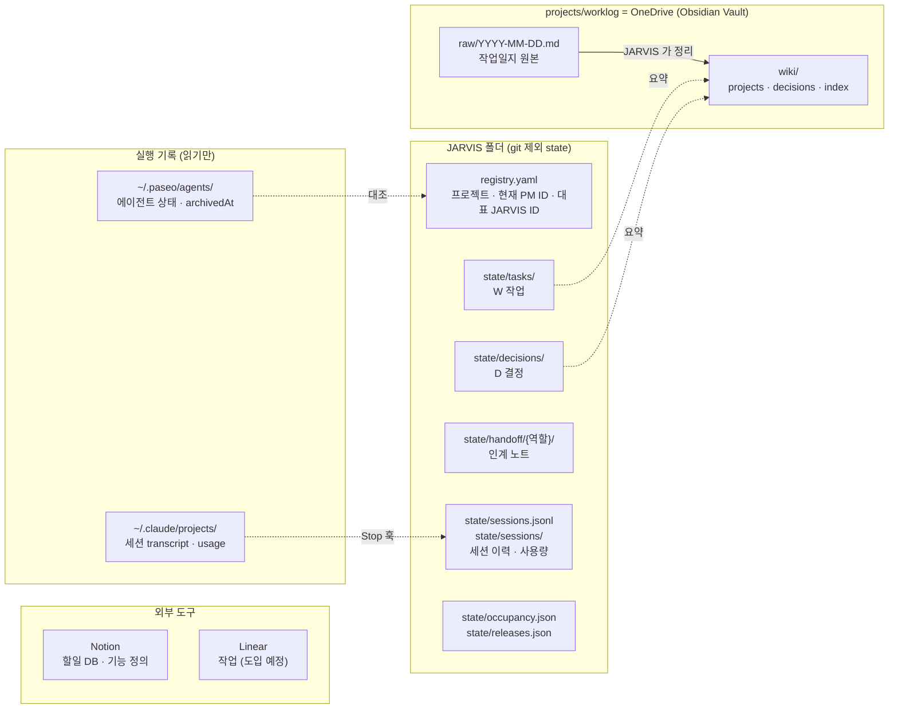
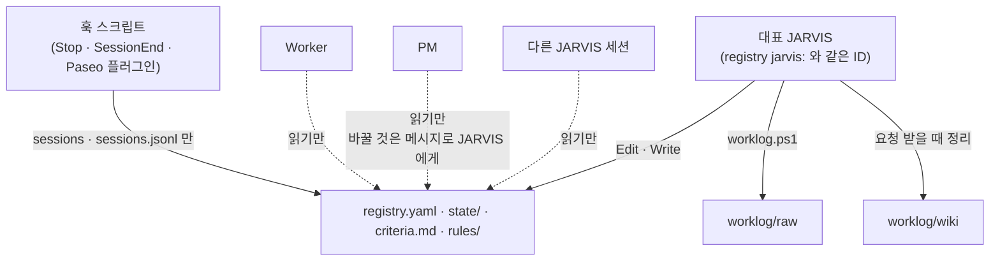
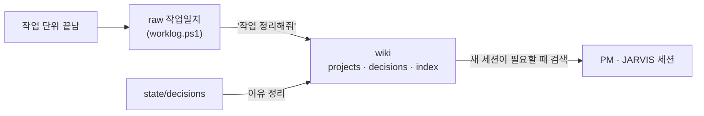

# 01. State & Memory Management

> **핵심 질문:** 무엇을 영구적으로 기억하고 보존할 것인가?
> **버전:** v0.2 · 2026-11-09 · 구현 반영 (Codex 검토 1차 반영)
> **관련:** [02 Agent Lifecycle](02_Agent_Lifecycle_Management.md) · [03 Work Lifecycle](03_Work_Lifecycle_Management.md)
> **실행 지침:** `CLAUDE.md`, `rules/` 는 이 문서를 운영 규칙으로 줄인 것이다. 둘이 다르면 이 문서를 고치고 규칙에 반영한다.

## 1. 범위

이 문서는 **무엇을, 어디에, 어떤 형식으로, 누가 쓰는지**를 정한다. 언제·어떤 순서로 쓰는지는 02(에이전트 세션)와 03(업무)이 정한다.

| 이 문서가 정한다 | 이 문서가 정하지 않는다 |
|---|---|
| 저장소별 원본(Source of Truth) | 세션 교체 시점과 순서 (02) |
| 파일 위치와 형식 | 작업 상태 전이와 완료 기준 (03) |
| 쓰기 권한과 강제 방법 | 승인 기준 (03) |
| 장기 기억에 남길 것과 남기지 않을 것 | 외부 도구 발행 절차 (03) |

## 2. 저장소 지도



실선은 쓰기, 점선은 읽어서 반영하는 방향이다. 실행 기록(Paseo, Claude transcript)은 원본으로 읽기만 하고 고치지 않는다.

## 3. 원본(Source of Truth) 표

| 정보 | 원본 | 다른 곳에 남기는 것 |
|---|---|---|
| 프로젝트 목록, 현재 PM 에이전트 ID, 대표 JARVIS ID | `registry.yaml` | 대시보드 표시 |
| 위임한 작업(W)의 상태·보고 | `state/tasks/W-*.md` | wiki 요약, Notion 할일 체크리스트 |
| 사용자·기준으로 정한 결정(D) | `state/decisions/D-*.md` | wiki `decisions/` 에 이유 정리 |
| 최신 인계 맥락 | `state/handoff/<역할>/latest.md` | 없음 |
| 세션 교체·종료 이력, 사용량 | `state/sessions.jsonl`, `state/sessions/` | 없음 |
| 공유 자원 점유, 운영 반영 대기 | `state/occupancy.json`, `state/releases.json` | 대시보드 |
| 하루 작업 기록 | `worklog/raw/YYYY-MM-DD.md` | wiki |
| 프로젝트 지식, 결정 배경, 재사용할 해결법 | `worklog/wiki/` | — |
| 할 일, 일정 | Notion 할일 DB | — |
| 프로젝트 ↔ Linear Project 연결 | `registry.yaml` `linear_project` (프로젝트 단위 한 칸) | — |
| 기능 정의 | Notion 기능 페이지 | Linear 상위 이슈 설명에 링크 |
| 작업 단위·진행 상태 | Linear 이슈 | W 작업 파일 `linear:` 필드, `state/features/` (복사본, 03) |
| Linear 쓰기 실패 | `state/linear_pending.jsonl` | — |
| 에이전트 실제 상태, 대화 원문 | Paseo, Claude transcript | 요약만, 원문 복제 안 함 |

**원칙**
- 같은 정보를 두 곳에 **원본으로** 두지 않는다. 다른 곳에는 요약·링크만 둔다.
- 작업 상태는 `state/` → wiki 한 방향으로만 흐른다. wiki 를 고쳐서 상태를 바꾸지 않는다.
- 인계 노트와 상태 파일이 다르면 상태 파일이 맞다.

## 4. 디렉터리 구조

```text
C:/Users/SMDEVELOPER/
├── JARVIS/                          # JARVIS 루트. 저장소 자체가 Claude 플러그인 `jarvis`
│   ├── CLAUDE.md                    # JARVIS 실행 지침
│   ├── criteria.md                  # 사용자가 확인한 판단 기준
│   ├── registry.yaml                # (git 제외)
│   ├── rules/                       # coordinator.md, worker.md
│   ├── hooks/                       # 플러그인 훅
│   ├── docs/                        # 01·02·03 정책 문서
│   └── state/                       # (git 제외)
│       ├── tasks/                   # W-YYYYMMDD-NN.md
│       ├── decisions/               # D-YYYYMMDD-NN.md
│       ├── handoff/
│       │   ├── manager/             # JARVIS 교체용
│       │   │   ├── latest.md
│       │   │   ├── YYYYMMDD-HHmmss.md # 이전 노트
│       │   │   └── transfer.json    # 대표를 넘길 때만
│       │   └── <프로젝트>/          # PM 교체용
│       │       ├── latest.md
│       │       ├── YYYYMMDD-HHmmss.md
│       │       └── rotating.lock    # 교체 중에만 있음 (jarvisctl 이 배타적으로 만듦)
│       ├── sessions.jsonl           # 세션 이벤트 이력
│       ├── sessions/<에이전트ID>.json # 마지막 사용량 Snapshot
│       ├── sessions/reconciled.json # 이미 알린 닫힘
│       ├── linear_pending.jsonl     # Linear 쓰기 실패 → retry
│       ├── features/<프로젝트>.yaml # 기능 ↔ Notion ↔ Linear (03, 도입 시)
│       ├── occupancy.json
│       └── releases.json
└── projects/
    ├── <프로젝트>/                  # 프로젝트 소스 (PM·Worker 작업 폴더)
    └── worklog/                     # = OneDrive/worklog, Obsidian Vault 루트
        ├── raw/                     # 스크립트로만 추가
        └── wiki/
            ├── index.md · log.md
            ├── projects/<프로젝트>.md
            └── decisions/
```

## 5. 파일 형식

### 5.1 `registry.yaml`

```yaml
boss: 상문
jarvis: <대표 JARVIS Paseo 에이전트 ID>   # 쓰기 권한을 가진 JARVIS 는 이 하나
projects:
  nipa:
    name: "NIPA"
    root: "C:/Users/SMDEVELOPER/projects/nipa"
    coordinator: <현재 PM Paseo 에이전트 ID>
```

- 프로젝트 키(`nipa`)가 PM 의 영구 식별자다. 에이전트 ID 는 바뀐다.
- `coordinator` 값을 바꾸는 절차는 02 가 정한다.

### 5.2 `state/tasks/`, `state/decisions/`

형식은 `CLAUDE.md` "상태 파일" 절을 따른다. 상태 값의 의미와 전이는 03 이 정한다.

### 5.3 인계 노트 `state/handoff/<역할>/`

- `latest.md` 가 지금 쓰는 노트다. 새 노트는 `jarvisctl handoff <역할> <파일>` 로 둔다. 기존 `latest.md` 는 `YYYYMMDD-HHmmss.md`(같은 초면 `-2`)로 옮겨진다. 지우지 않는다.
- 60줄 이하. 대화 요약이 아니라 **다음 세션이 일을 이어 가는 데 필요한 최소 맥락**이다.
- 상태 파일·결정 파일에 이미 있는 내용은 경로만 적는다.

PM 노트(`<프로젝트>/latest.md`, PM 이 `[인계노트]` 로 보내고 JARVIS 가 쓴다):

```markdown
## 지금 상태
## 진행 중·미완료      # W-…: 어디까지 / 다음 행동
## 최근 결정           # 결정 파일에 없는 것만
## 열린 문제·위험
## 다음 할 일
## 참조 경로
## JARVIS 확인         # 상태 파일과 다른 점 (JARVIS 가 덧붙임)
```

Manager 노트(`manager/latest.md`, JARVIS 가 직접 쓴다):

```markdown
## 프로젝트별 현황      # 프로젝트 키 · 현재 PM ID · 열린 작업 수
## 사용자와 진행 중인 대화 # 답을 기다리는 질문, 미룬 결정
## 운영 반영 대기
## 최근 정한 것         # criteria.md 에 아직 안 올린 것
## 주의
```

### 5.4 `state/sessions.jsonl` (이벤트 이력, 한 줄 = 한 이벤트)

```json
{"event_id":"3f9c…","timestamp":"2026-11-09T15:00:00+09:00","event":"rotation","project_id":"nipa","old_agent_id":"…","new_agent_id":"…","context_tokens_before":864356,"total_cost_usd_before":63.90,"reason":"context","result":"switched"}
{"timestamp":"…","event":"closed","project_id":"nipa","agent_id":"…","closed_by":"user","source":"paseo:agent.archive.after"}
```

| 필드 | 값 |
|---|---|
| `event_id` | 12자리 무작위 ID (중복 판별) |
| `event` | `rotation` · `closed` · `session_end` · `pre_compact` · `jarvis_claim` |
| `reason` | `context` · `crash` · `manual` |
| `result` | `switched` · `failed:<단계>` · `archived` |
| `closed_by` | `jarvis` · `pm` · `unknown` (대조·Paseo 이벤트로는 누가 닫았는지 모름) |
| `source` | 기록한 곳: `jarvis` · `hook:<이름>` · `paseo:<이벤트>` · `reconcile` |

모르는 값은 `null`. 추정값을 넣지 않는다. 여러 훅이 동시에 써도 줄이 섞이지 않게 `sessions.jsonl.lock` 으로 잠그고 한 줄씩 추가한다.

### 5.5 `state/sessions/<에이전트ID>.json` (마지막 사용량, Stop 훅이 덮어씀)

```json
{"agent_id":"…","project_id":"nipa","role":"pm","observed_at":"2026-11-09T15:00:00+09:00",
 "context_tokens":864356,"source":"transcript","claude_session_id":"…"}
```

임시 파일에 쓰고 이름을 바꿔(원자적) 덮어쓴다. `observed_at` 이 6시간보다 오래되면 교체 판단에 쓰지 않는다.

`context_tokens` = transcript 마지막 assistant `usage` 의 `input_tokens + cache_read_input_tokens + cache_creation_input_tokens + output_tokens`. Paseo `contextWindowUsedTokens` 와 같은 값이다(nipa PM 에서 확인).

## 6. 쓰기 권한



| 주체 | 쓸 수 있는 것 | 강제 방법 |
|---|---|---|
| 대표 JARVIS | JARVIS 폴더 전부, worklog, Notion 할일 | — |
| 다른 JARVIS 세션 | 없음(읽기). 대표가 되려면 `jarvisctl claim-jarvis` | `jarvis_only_write`: `PASEO_AGENT_ID` ≠ `registry.jarvis` 면 막음. schedule 로 뜬 세션은 예외 |
| PM, Worker | 프로젝트 폴더. JARVIS 폴더는 못 씀 | `jarvis_only_write`(작업 폴더가 JARVIS 밖이면 막음) |
| 훅 스크립트, `scripts/` | `state/sessions*`, lock, `linear_pending` | 쓰는 경로를 코드로 고정. registry 는 `jarvisctl` 만 CAS 로 바꿈 |

설정(`jarvis_dir`)이 비어 있으면 보호 훅은 아무것도 막지 않는다(설치 확인 항목). 훅 입력이 깨졌을 때도 통과시킨다(세션을 멈추지 않는 쪽을 택함).

**알려진 빈틈:** `jarvis_only_write` 는 Edit·Write 도구만 막는다. Bash·PowerShell·Python 으로 쓰는 것은 막지 못한다. 규칙(`rules/`)으로 금지하고, 필요해지면 Bash 패턴 검사를 더한다.

## 7. 장기 기억

### 7.1 흐름



### 7.2 남길 것과 남기지 않을 것

| 남긴다 | 필요하면 남긴다 | 남기지 않는다 |
|---|---|---|
| 확정한 결정과 이유, 승인 결과 | 상세 회고, 아키텍처 논의 | 중간 추론, 단순 대화 |
| 구현·테스트 결과와 증거 | 반복되는 실패 패턴 | 비밀번호·토큰·키 |
| 풀리지 않은 문제 | | 검증 안 한 LLM 요약 |
| 세션 교체 이유 | | 대화 원문 |

### 7.3 복원할 때 읽는 순서

1. 역할과 권한: `CLAUDE.md` 또는 `rules/coordinator.md`
2. 현재 상태: `registry.yaml`, 열린 `state/tasks`
3. 최근 인계: `state/handoff/<역할>/latest.md`
4. 결정: `open`·`waiting` 결정 파일 경로
5. 과거 기록: 필요할 때만 wiki·raw 검색

대화 원문 전체를 다시 넣지 않는다.

## 8. 확인 필요

| 항목 | 상태 |
|---|---|
| `jarvis` 플러그인 설치 | 2026-11-09 설치 시도(02 11절) |
| `agent-hub-ao` 끄기 | 결정 대기: 끄면 `C:/Users/SMDEVELOPER/hub` 보호·hub 훅이 빠짐. 켜 두면 커밋 문구 검사가 두 번 돔(무해) |
| state 백업 | git 제외라 백업이 없다. 결정 대기(OneDrive 복사 등) |
| wiki 정리 | 11-05 이후 멈춤. 구조 바꾸기 전에 밀린 정리 먼저 |
| OneDrive 동기화 충돌 | raw 는 스크립트 잠금으로 추가. wiki 동시 수정은 JARVIS 하나만 하므로 낮음 |
| claude-mem | JARVIS 에서만 시험. 공식 상태를 대체하지 않는 보조 검색으로만 검토 |
