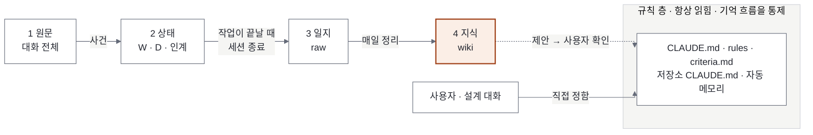
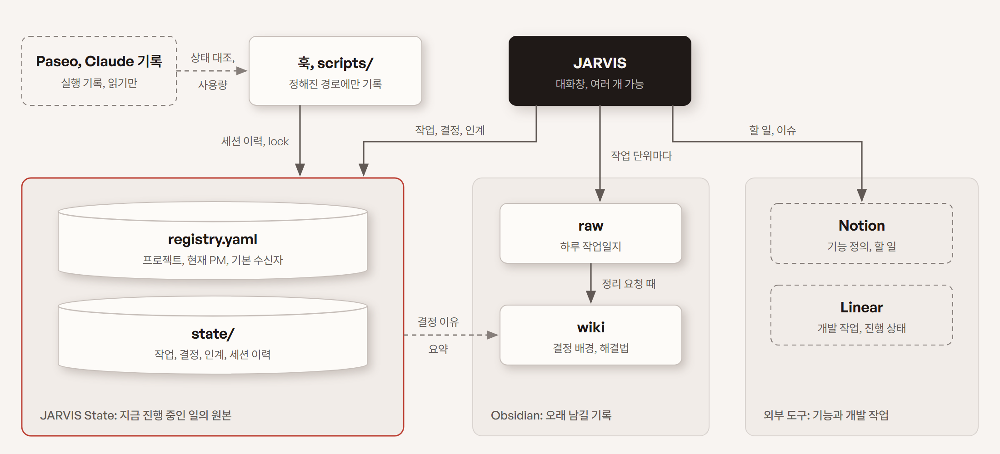
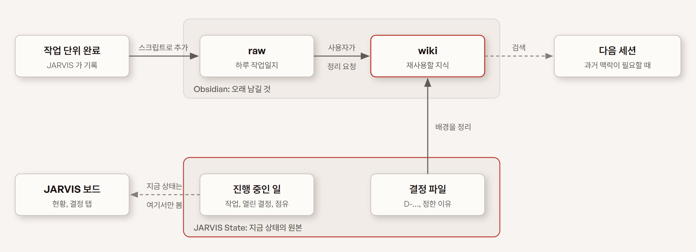

# 01. 상태와 기억 (State & Memory)

> **핵심 질문:** 세션이 바뀌고 창이 닫혀도 무엇이 어디에, 어떤 형식으로 남고, 다음 세션은 무엇을 읽는가?
> **버전:** v1.0 · 2026-11-10 · 옛 01(상태·기억 관리)과 04(기억 구조)를 한 문서로 합침
> **실행 지침:** `CLAUDE.md`, `rules/` 는 이 문서를 운영 규칙으로 줄인 것이다. 둘이 다르면 이 문서를 고치고 규칙에 반영한다.

## 요약

JARVIS·PM·Worker 의 세션은 언제든 바뀐다. 이 문서는 세션이 바뀌어도 일이 이어지도록 무엇을, 어디에, 어떤 형식으로, 누가 남기는지를 정한다.

기억은 네 단계로 나눈다. 한 단계는 한 장소에 있고, 기록은 앞 단계에서 뒤 단계로만 올라간다. 규칙(어떻게 행동하나)은 기억(무엇이 있었고 무엇을 배웠나)과 따로 둔다. 규칙은 기억 흐름을 통제하는 층이고 대부분 설계 대화로 직접 정한다. 지식은 규칙을 제안만 하고, 정하는 것은 사용자다.



### 핵심 원칙

1. 상태는 세션 밖에 둔다. 진행 상황은 `registry.yaml`·`state/`·작업일지에 남기고, 대화 원문으로 복원하지 않는다.
2. 정보마다 원본은 하나다. 같은 정보를 두 곳에 원본으로 두지 않고, 다른 곳에는 요약과 링크만 둔다.
3. 앞으로만 흐른다. 원문 → 상태 → 일지 → 지식 순서로 올라가고, 위키를 고쳐서 상태를 바꾸지 않는다. 건너뛰지도 않는다. 대화에서 곧바로 지식으로 가지 않는다.
4. 지식은 규칙을 바꾸지 못한다. 후보를 제안하고, 사용자가 정한다.
5. 논리적 JARVIS 는 하나, 대화창은 여러 개다. 모든 창이 같은 상태를 고치고, 겹치면 안 되는 쓰기만 `jarvisctl` 이 잠금 안에서 처리한다.
6. 모르는 값은 추정하지 않는다. 확인 못 한 값은 `null` 로 두고, 인계 노트와 상태 파일이 다르면 상태 파일이 맞다.

## 1. 기억 4단계와 규칙 층

| 단계 | 장소 | 담는 것 | 다음 단계로 올리는 계기 | 읽히는 때 | 수명 |
|---|---|---|---|---|---|
| 1 원문 | `~/.claude/projects/<폴더>/*.jsonl`, `~/.codex/sessions/`, `~/.paseo/agents/` | 대화 전체, 에이전트 메타 정보 | 훅·`jarvisctl` 이 사건을 뽑아 상태로 | 빠진 정리를 복구할 때만 | Claude 30일, Codex 무기한 |
| 2 상태 | `JARVIS/state/`, `JARVIS/registry.yaml` | 지금 진행 중인 사실: 작업(W), 결정(D), 인계 노트, 세션 이벤트, 점유, 운영 반영 대기 | 작업이 끝날 때 일지 한 건. 세션 종료 때 빠진 것 채움 | 자동화 판단, 세션 시작 | 끝나면 이력으로 남김(지우지 않음) |
| 3 일지 | `projects/worklog/raw/YYYY-MM-DD.md` (OneDrive) | 끝난 일, 정한 것과 이유. 건마다 W·D 번호 | 매일 정리가 지식으로 | 정리할 때, 검색 | 영구. 덧붙이기만 |
| 4 지식 | `projects/worklog/wiki/` | 프로젝트별 개요·결정·해결법, 목차 | (끝). 규칙 층에 제안만 한다 | 시작 때 목차 요약, 질문 때 검색 | 영구. 정리 때 갱신 |

| 규칙 층 | 장소 | 담는 것 | 들어오는 길 | 읽히는 때 | 관리 |
|---|---|---|---|---|---|
| 규칙 | `JARVIS/CLAUDE.md`·`rules/`·`criteria.md`, 프로젝트 저장소 `CLAUDE.md`, Claude 자동 메모리 | 행동을 바꾸는 짧은 문장: 판단 기준, 일하는 방식, 기억 흐름 자체의 규칙 | 설계 대화로 직접 / 지식의 제안을 사용자가 승인 | 항상 | git 버전 관리(자동 메모리 제외). 사용자가 바꿀 때까지 |

뒤 단계로 갈수록 양은 줄고 수명은 길어진다. 원문은 가장 크고 30일 뒤 지워지며, 규칙은 가장 짧고 세션이 뜰 때마다 읽힌다.

### 용어

| 용어 | 뜻 |
|---|---|
| State(상태) | 지금 무엇이 진행 중인지에 대한 구조화된 사실. `state/` 와 `registry.yaml` 을 합쳐 JARVIS State 라고 부른다. 자동화(훅·`jarvisctl`·대시보드)가 읽고 판단하므로 형식이 정해져 있다 |
| Memory(기억) | 사람이 읽는 지식. 결정의 배경, 재사용할 해결법, 회고. Obsidian 보관함(`projects/worklog`)에 일지(`raw/`)와 지식(`wiki/`)으로 둔다. 자동 판단의 근거로 쓰지 않는다 |
| 인계 노트 | 세션이 바뀔 때 다음 세션이 이어 가는 데 필요한 열린 일만 적은 노트. 상태 쪽(`state/handoff/`)에 두지만, 상태 파일과 다르면 상태 파일이 우선한다 |
| 일지 | 작업 단위마다 4~5줄로 남긴 기록. 폴더 이름은 `raw` 지만 대화 원문이 아니다 |
| 위키 | 일지를 주제별로 정리한 노트. Karpathy 의 LLM Wiki 방식(원자료 `raw/`, 정리본 `wiki/`, 목차 `index.md`, 이력 `log.md`, 규칙 `AGENTS.md`) |
| 자동 메모리 | Claude Code 가 작업 폴더마다 `~/.claude/projects/<폴더>/memory/` 에 두고 그 폴더 세션이 매번 읽는 메모. 규칙 층에 속한다 |
| 판단 기준 | 사용자가 "기준으로 남겨" 라고 한 것. JARVIS 가 사용자 대신 정할 때의 근거. `criteria.md` |
| Source of Truth(원본) | 어떤 정보에 대해 "여기 적힌 값이 맞다" 고 정한 단 하나의 위치 |

실행 기록(Paseo 에이전트 기록, Claude 세션 transcript)은 세션 자체가 남기는 원본이다. JARVIS 는 읽기만 하고 고치지 않는다.

## 2. 전체 저장 구조

<picture>
  <source media="(prefers-color-scheme: dark)" srcset="images/state-storage-dark.png">
  
</picture>

실선은 쓰기, 점선은 읽어서 반영하는 방향이다. 쓰는 쪽은 JARVIS 와 훅·스크립트 둘뿐이고, PM 과 Worker 는 메시지로 JARVIS 에게 넘긴다. 저장소는 네 묶음이다.

- JARVIS State(`registry.yaml`, `state/`): 실행 상태의 원본. 자동화가 읽고 판단한다.
- Obsidian 보관함(`projects/worklog`): 작업일지 원본(`raw/`)과 정리된 지식(`wiki/`).
- 외부 도구(Notion, Linear): 기능 정의와 개발 작업의 원본.
- 실행 기록(Paseo, Claude transcript): 읽기만 한다.

| 질문 | 답하는 곳 |
|---|---|
| 지금 이 프로젝트의 PM 세션은 누구인가? | `registry.yaml` 의 `coordinator` |
| PM 에게 무엇을 맡겼고 어디까지 왔나? | `state/tasks/W-*.md` |
| 사용자가 무엇을 왜 정했나? | `state/decisions/D-*.md` (배경은 wiki `decisions/`) |
| 다음 세션이 이어 가려면 무엇을 알아야 하나? | `state/handoff/<역할>/latest.md` |
| 이 일에서 무엇을 배웠나? | `worklog/wiki/` |

### Source of Truth

| 정보 | 원본 | 다른 곳에 남기는 것 |
|---|---|---|
| 프로젝트 목록, 현재 PM 에이전트 ID, 기본 수신 JARVIS ID | `registry.yaml` (`jarvisctl` 로만 바꿈) | 대시보드 표시 |
| 위임한 작업(W)의 상태·보고 | `state/tasks/W-*.md` | wiki 요약, Notion 할일 체크리스트 |
| 사용자·기준으로 정한 결정(D) | `state/decisions/D-*.md` | wiki `decisions/` 에 이유 정리 |
| 최신 인계 맥락 | `state/handoff/<역할>/latest.md` | 없음 |
| 세션 교체·종료 이력, 사용량 | `state/sessions.jsonl`, `state/sessions/` | 없음 |
| 공유 자원 점유, 운영 반영 대기 | `state/occupancy.json`, `state/releases.json` | 대시보드 |
| 작업일지(W 하나에 한 건) | `worklog/raw/YYYY-MM-DD.md` | wiki |
| 프로젝트 지식, 결정 배경, 재사용할 해결법 | `worklog/wiki/<프로젝트>/`(개요·decisions·해결법) | — |
| 판단 기준 | `criteria.md` | 시작 맥락 |
| 프로젝트 전체 규칙 | 프로젝트 저장소 `CLAUDE.md` | — |
| 그 폴더에서 일하는 방식 | Claude 자동 메모리(`feedback`·`reference`) | — |
| 할 일, 일정 | Notion 할일 DB | — |
| 프로젝트 ↔ Linear Project 연결 | `registry.yaml` `linear_project` | — |
| 기능 정의 | Notion 기능 페이지 | Linear 상위 이슈 설명에 링크 |
| 개발 작업 단위·진행 상태 | Linear 이슈 | W 작업 파일 `linear:` 필드 |
| Linear 쓰기 실패 | `state/linear_pending.jsonl` | — |
| 에이전트 실제 상태, 대화 원문 | Paseo, Claude transcript | 요약만, 원문 복제 안 함 |

## 3. 2단계 상태: 파일과 형식

### 3.1 디렉터리 구조

```text
C:/Users/<나>/
├── JARVIS/                          # JARVIS 루트. 저장소 자체가 Claude 플러그인 `jarvis`
│   ├── CLAUDE.md                    # JARVIS 실행 지침
│   ├── criteria.md                  # 사용자가 확인한 판단 기준
│   ├── registry.yaml                # (git 제외)
│   ├── rules/                       # coordinator.md, worker.md
│   ├── hooks/                       # 플러그인 훅
│   ├── scripts/                     # jarvisctl.py, linear.py, recall.py(기억 찾기)
│   ├── skills/                      # git-message, recall, session-end
│   ├── tools/qmd/                   # 로컬 검색 엔진 qmd 시범 (설치물·색인은 git 제외)
│   ├── docs/                        # 정책 문서, 그림
│   └── state/                       # (git 제외)
│       ├── tasks/                   # W-YYYYMMDD-NN.md
│       ├── decisions/               # D-YYYYMMDD-NN.md
│       ├── handoff/
│       │   ├── manager/             # JARVIS 교체용
│       │   │   ├── latest.md
│       │   │   ├── YYYYMMDD-HHmmss.md # 이전 노트
│       │   │   └── transfer.json    # 기본 수신자를 넘길 때만
│       │   └── <프로젝트>/          # PM 교체용
│       │       ├── latest.md
│       │       ├── YYYYMMDD-HHmmss.md
│       │       └── rotating.lock    # 교체 중에만 있음 (jarvisctl 이 배타적으로 만듦)
│       ├── sessions.jsonl           # 세션 이벤트 이력
│       ├── sessions/<에이전트ID>.json # 마지막 사용량 Snapshot
│       ├── sessions/<에이전트ID>.hook.json # SessionStart 표식(nonce)
│       ├── sessions/reconciled.json # 이미 알린 닫힘
│       ├── linear_pending.jsonl     # Linear 쓰기 실패 → retry
│       ├── occupancy.json
│       └── releases.json
└── projects/
    ├── <프로젝트>/                  # 프로젝트 소스 (PM·Worker 작업 폴더)
    └── worklog/                     # = OneDrive/worklog, Obsidian Vault 루트
        ├── raw/                     # 일지. 스크립트로만 추가
        ├── scripts/worklog.ps1      # 일지 추가 스크립트
        └── wiki/                    # 지식
            ├── index.md · log.md
            ├── 공통/                # 개요.md · decisions/ · 해결법/
            ├── <프로젝트>/          # 개요.md · decisions/ · 해결법/
            └── _보관/
```

프로젝트별 폴더로 나누지 않는다. 파일마다 `project` 칸이 있다. 인계 노트만 `handoff/<프로젝트>/` 로 나뉜다. 백업하지 않는다(D-20261109-04). 남길 가치가 있는 것은 일지와 위키로 올라가기 때문이다.

### 3.2 `registry.yaml`

```yaml
jarvis: <기본 수신 JARVIS Paseo 에이전트 ID>   # 아침 보고·주인 없는 보고를 받는 창 (쓰기 권한과 무관)
projects:
  nipa:
    name: "NIPA"
    root: "C:/Users/<나>/projects/nipa"
    coordinator: <현재 PM Paseo 에이전트 ID>
    linear_project: KSM      # Linear Project 이름
    pm_title: "nipa-pm"      # PM 세션 제목
```

- 프로젝트 키(`nipa`)가 PM 의 영구 식별자다. 에이전트 ID 는 바뀐다.
- 바꾸는 명령: 등록 `jarvisctl register`, 필드 `set <프로젝트> <name|root|pm_title|linear_project> <값>`, PM `switch`, 기본 수신자 `claim-jarvis`. Edit·Write 로 고치지 않는다(훅이 막음).

### 3.3 작업 카드 W: `state/tasks/W-YYYYMMDD-NN.md`

맡긴 일 하나의 진행 기록이다. 사용자가 일을 시키면 JARVIS 가 `jarvisctl new-task <프로젝트> --title … --request "<요청 원문>"` 으로 만든다(번호는 잠금 안에서 발급). JARVIS 가 직접 하는 일(문서, 보드, 규칙)도 `jarvis` 프로젝트로 W 를 만든다. 대화 중에 일이 덧붙으면 같은 W 의 경과로, 성격이 다른 일이면 새 W 로.

```
---
id: W-20261106-01
project: nipa                 # registry.yaml 의 프로젝트 키, 또는 jarvis(JARVIS 자기 일)
title: <한 줄>
status: assigned              # assigned 배정 → working 진행 → question 판단 대기 → done 끝 / cancelled 취소
jarvis: <에이전트 ID>          # 이 일을 맡긴 JARVIS 창 (new-task 가 채움). PM 의 보고는 이 창으로 간다
coordinator: <에이전트 ID>     # 배정할 때의 PM
workers: []                   # Worker ID (Paseo 라벨 jarvis.task 로도 찾음)
linear:                       # Linear 이슈 PRO-n (있을 때)
feature:                      # 기능 ID <프로젝트>:<슬러그> (있을 때)
assigned_at: 2026-11-06T19:12:00+09:00
updated_at: 2026-11-06T19:13:00+09:00
done_at:
verified: none                # confirmed(PM 이 직접 확인) | reported(보고만) | none
release: none                 # none | dev_only(운영 반영 대기) | released
---
## 요청
<사용자 요청 원문>

## 보고
<마지막 [보고] 원문>

## 경과
- 19:12 배정
- 19:13 보고
```

상태는 `jarvisctl task <W> --status … --note …` 로 바꾼다. `[진행]`·`[질문]`·`[보고]` 를 받을 때마다 `status`, `updated_at`, `경과` 를 고친다. `done`·`cancelled` 가 되면 `--worklog --result … --check … --next …` 를 붙여 작업일지 한 건을 같이 남긴다(5.1).

### 3.4 결정 카드 D: `state/decisions/D-YYYYMMDD-NN.md`

정해야 했던 판단 하나의 기록이다. PM 의 `[질문]`, 또는 JARVIS 운영 판단(`jarvis` 프로젝트)에서 `jarvisctl new-decision <프로젝트> --question … --task W-… --option … --recommended ①` 으로 만들고 `jarvisctl decide D-… --decision … [--by criteria --criterion n] [--reason …]` 으로 확정한다. 지우지 않는다.

```
---
id: D-20261106-01
task: W-20261106-02
project: nipa
status: open                  # open(지금 결정 필요) | waiting(until 까지 미룸) | decided | dropped(필요 없어져 닫음)
decided_by:                   # user | criteria
criterion:                    # criteria.md 항목 번호(decided_by: criteria 일 때)
options: ["① 근거 조건 붙여 유지", "② 수치 제거"]
recommended: "①"
raised_at: 2026-11-06T19:20:00+09:00
until:                        # waiting 일 때 날짜, 또는 "사용자가 다시 말할 때"
decided_at:
decision:
---
## 질문
## 결정과 이유
```

- `jarvisctl` 이 만들 때 `key:`(질문 문장 해시)와 `jarvis:`(만든 창)를 더 채우고, `decide` 가 `decided_by`·`decided_at`·`decision`·`decided_in`(확정한 창)을 채운다.
- 같은 프로젝트·같은 작업·같은 질문(`key`)의 열린 결정이 있으면 `new-decision` 이 그것을 돌려준다.
- 기준(`criteria.md`)으로 정하면 바로 `decided`, `decided_by: criteria`. 사용자가 "나중에" 라고 하면 `waiting`. 설명을 더할 때는 `jarvisctl decision-note D-… "<한 줄>"`.
- 작업을 `done`·`cancelled` 로 닫을 때 그 작업의 `open` 결정이 남아 있으면 사용자에게 "정하기 / 미루기 / 필요 없음" 을 묻는다. "필요 없음" 이면 `dropped`.
- PM 이 프로젝트 기준으로 정한 것은 이 파일을 만들지 않고 작업 파일의 `보고` 에만 남긴다.

W 가 끝나면 일지로 가고, 오래 남길 D 는 위키 결정 노트가 된다. 같은 방향의 D 가 반복되면 규칙 층에 기준으로 제안된다.

### 3.5 인계 노트 `state/handoff/<역할>/`

세션이 바뀔 때 다음 세션이 이어 가는 데 필요한 열린 일만 적는다.

| | JARVIS(`manager/`) | PM(`<프로젝트>/`) |
|---|---|---|
| 쓰는 때 | 사용자가 "세션 종료" 라고 할 때(6.2) | PM 교체(컨텍스트 기준 초과 → `[인계요청]` → `[인계노트]`) |
| 쓰는 쪽 | 그 JARVIS 창이 직접 | PM 이 `[인계노트]` 메시지로 보내고 JARVIS 가 파일로(PM 은 JARVIS 폴더를 못 고친다) |
| 쓰지 못할 때 | 보관 버튼으로 바로 닫음 → 아무것도 남지 않음 | PM 이 갑자기 죽음 → 새 PM 이 상태 파일과 Worker 결과로 이어 감 |

내용 규칙:

- 열린 일만 쓴다: 답을 기다리는 질문, 미룬 결정, 진행 중인 W 의 다음 행동, 운영 반영 대기, 커밋 안 한 변경, 주의할 점.
- 끝난 일은 쓰지 않는다(일지의 몫). 다음 행동에 영향을 줄 때만 짧게 적는다.
- 60줄 이하. 상태 파일·결정 파일에 이미 있는 것은 경로만. 대화를 요약하지 않는다.
- 여러 JARVIS 창이 있으면 덮어쓰지 않고 합친다: 지금 `latest.md` 에서 아직 유효한 항목을 옮겨 적은 뒤 새로 쓴다.

파일 처리: 새 노트는 임시 파일에 써서 `jarvisctl handoff <manager|프로젝트> <파일>` 로 둔다. 기존 `latest.md` 는 `YYYYMMDD-HHmmss.md`(같은 초면 `-2`)로 옮겨지고 지우지 않는다. 이 명령은 끝난 W·D 를 적은 줄(`stale`)과 옛 노트에만 있던 열린 W·D(`dropped_open`)를 알려 주므로, 나오면 고쳐서 다시 둔다. 인계 노트와 상태 파일이 다르면 상태 파일이 맞고, PM 노트에서 다른 줄은 노트 끝 `## JARVIS 확인` 에 JARVIS 가 적는다.

PM 노트 형식:

```markdown
## 지금 상태
## 진행 중·미완료      # W-…: 어디까지 / 다음 행동
## 최근 결정           # 결정 파일에 없는 것만
## 열린 문제·위험
## 다음 할 일
## 참조 경로
## JARVIS 확인         # 상태 파일과 다른 점 (JARVIS 가 덧붙임)
```

Manager 노트 형식:

```markdown
## 프로젝트별 현황      # 프로젝트 키 · 현재 PM ID · 열린 작업 수
## 사용자와 진행 중인 대화 # 답을 기다리는 질문, 미룬 결정
## 운영 반영 대기
## 최근 정한 것         # criteria.md 에 아직 안 올린 것
## 주의
```

### 3.6 `state/sessions.jsonl`

세션 이벤트 이력. 한 줄이 한 이벤트다.

```json
{"event_id":"3f9c…","timestamp":"2026-11-09T15:00:00+09:00","event":"rotation","project_id":"nipa","old_agent_id":"…","new_agent_id":"…","context_tokens_before":864356,"total_cost_usd_before":63.90,"reason":"context","result":"switched"}
{"event_id":"8775…","timestamp":"…","event":"closed","project_id":"nipa","agent_id":"…","closed_by":"jarvis","how":"archive","source":"hook:agent_guard"}
```

| 필드 | 값 |
|---|---|
| `event_id` | 12자리 무작위 ID (중복 판별) |
| `event` | `rotation`(`jarvisctl switch`) · `closed`(archive·kill 직후, 또는 대조가 닫힌 PM 을 발견) · `session_end`(PM 쪽 SessionEnd 훅, 보관 때는 안 불릴 수 있음) · `pre_compact` · `jarvis_claim`(기본 수신자 전환) · `lock_takeover` |
| `reason` | `context` · `crash` · `manual` · `new` |
| `result` | `switched` · `failed:<단계>` · `archived` |
| `closed_by` | `jarvis` · `pm` · `unknown` (대조로는 누가 닫았는지 모름) |
| `how` | `archive` · `kill` (closed 이벤트), 대조는 `archived` · `missing` · `closed` |
| `source` | 기록한 곳: `jarvisctl` · `hook:<이름>` · `reconcile` |

모르는 값은 `null`. 추정값을 넣지 않는다. 여러 훅이 동시에 써도 줄이 섞이지 않게 `sessions.jsonl.lock` 으로 잠그고 한 줄씩 추가한다.

### 3.7 `state/sessions/`

- `<에이전트ID>.json`: PM 의 마지막 사용량. Stop 훅이 임시 파일에 쓰고 이름을 바꿔(원자적) 덮어쓴다.

  ```json
  {"agent_id":"…","project_id":"nipa","role":"pm","observed_at":"2026-11-09T15:00:00+09:00",
   "context_tokens":864356,"source":"transcript","claude_session_id":"…"}
  ```

  `context_tokens` 는 transcript 마지막 assistant `usage` 의 `input_tokens + cache_read_input_tokens + cache_creation_input_tokens + output_tokens` 이고, Paseo `contextWindowUsedTokens` 와 같은 값이다. `observed_at` 이 6시간보다 오래되면 교체 판단에 쓰지 않는다.
- `<에이전트ID>.hook.json`: SessionStart 훅이 세션마다 남기는 표식(nonce). 새 PM 의 `[준비]` 가 진짜 훅을 거쳤는지 대조하는 데 쓴다.
- `reconciled.json`: 이미 알린 PM 닫힘 목록. 같은 닫힘을 두 번 알리지 않는다.

### 3.8 `state/occupancy.json`, `state/releases.json`, `state/linear_pending.jsonl`

프로젝트끼리 겹칠 수 있는 공유 자원(dev 서버 플로우, 공용 DB 등)의 점유:

```json
{"updated_at": "...", "items": [
  {"resource": "langflow-dev:WF4", "project": "nipa", "task": "W-…", "agent": "<에이전트 ID>",
   "since": "...", "until": "...", "note": "..."}
]}
```

`jarvisctl occupy <자원> --project … --task W-… --agent <PM ID> --until …` 과 `vacate <자원> --task W-…` 로만 바꾼다. 확인과 등록이 한 잠금 안이다. 점유한 PM 이 archive·삭제됐고 그 PM 의 Worker 도 모두 닫혔을 때만 다음 `occupy` 가 그 점유를 회수하고 결과에 `reclaimed` 로 알린다. 파일을 읽지 못하면 허가·해제를 거절한다.

dev 에만 반영하고 운영 반영을 기다리는 변경:

```json
{"items": [
  {"task": "W-…", "project": "nipa", "what": "WF4 A2 프롬프트", "env": "dev",
   "since": "...", "status": "pending", "released_at": ""}
]}
```

`[보고]` 의 "운영 반영 대기" 에 항목이 있으면 `pending` 으로 더하고, 사용자가 운영 반영을 마쳤다고 하면 `released` 로 바꾼다.

`linear_pending.jsonl` 은 실패한 Linear 쓰기 목록이다. `scripts/linear.py` 가 남기고 `linear.py pending`·`retry` 로 다시 시도한다.

### 3.9 파일 잠금

모든 잠금은 `<파일>.lock` 을 배타적으로 만들고 `<pid> <토큰>` 을 적는다. 잡은 프로세스가 죽었을 때만 남이 치우고, 풀 때는 자기 토큰일 때만 지운다. registry 전환과 결정 확정은 CAS(읽은 값이 그대로일 때만 바꾸기)로 한다.

## 4. 쓰기 권한과 동시성

JARVIS 대화창은 동시에 여러 개일 수 있고 모두 같은 상태 파일을 고친다. 창끼리 겹치면 안 되는 쓰기만 `scripts/jarvisctl.py` 로 모아 잠금 안에서 한다.

| 주체 | 쓸 수 있는 것 | 강제 방법 |
|---|---|---|
| JARVIS 창(어느 것이든) | `state/` 의 기존 작업 파일, `criteria.md`, `rules/`, 작업일지, Notion 할일 | — |
| JARVIS 창, 겹치면 안 되는 쓰기 | 새 작업·결정 파일(번호 발급), 결정 확정, `registry.yaml`, `occupancy.json` | 훅 `jarvis_only_write` 가 Edit·Write 를 막고 `jarvisctl` 로 안내 |
| PM, Worker | 프로젝트 폴더. JARVIS 폴더와 `jarvisctl` 은 못 씀 | 훅 `jarvis_only_write`, `jarvisctl` 의 호출자 역할 검사 |
| 훅 스크립트, `scripts/` | `state/sessions*`, lock, `linear_pending`, registry(`jarvisctl`) | 쓰는 경로를 코드로 고정 |
| Paseo 밖 사용자 세션 | 작업 폴더가 JARVIS 폴더면 전부(직접 복구용) | 겹치면 안 되는 쓰기 검사는 Paseo 세션에만 적용. 작업 폴더가 JARVIS 밖이면 폴더 검사에 걸려 JARVIS 파일 Edit·Write 가 막힌다 |

여러 창이 동시에 일할 때 지키는 규칙:

- 번호 발급: 새 작업·결정 파일은 `jarvisctl new-task`·`new-decision` 이 잠금 안에서 번호를 정해 만든다.
- 결정 확정: `jarvisctl decide` 가 `open`·`waiting` → `decided` 를 CAS 로 처리한다. 성공한 창만 PM 에게 답을 보낸다. 실패하면 다른 창이 이미 정한 것이니 그 결정을 사용자에게 알리고 따른다.
- 공유 자원 점유: `occupancy.json` 은 `jarvisctl occupy`·`vacate` 로만 바꾼다.
- PM 교체 lock 과 기본 수신자 넘김(`transfer.json`)도 잠금 안에서 한다.
- 작업의 주인: 작업 파일의 `jarvis:` 는 그 일을 맡긴 창이다. PM 의 보고는 그 창으로 간다. 다른 창이 맡긴 일의 보고를 받으면(보낸 창이 닫혀 기본 수신자로 온 경우) 그 작업 파일에 그대로 기록하고 사용자에게 알린다.
- registry 의 `jarvis:` 는 기본 수신자(아침 정리 보고, 맡긴 창이 닫힌 보고, PM 이 보낼 곳을 모를 때 받는 창)이고 쓰기 권한과는 관계없다.

창끼리 사용자와 나눈 대화를 모른다는 위험은 코드로 막을 수 없다. 지켜야 할 지시는 결정 파일이나 `criteria.md` 에 남긴다.

`jarvis_only_write` 는 두 가지를 본다. ① 폴더 검사: 세션의 작업 폴더가 JARVIS 폴더 밖이면 JARVIS 파일 쓰기를 막는다(역할과 무관, Paseo 밖 세션도 해당). ② 겹치는 쓰기 검사: Paseo 세션이면 JARVIS 창이라도 `registry.yaml`·`occupancy.json`·결정 파일 수정과 새 작업 파일 생성을 막는다. 이 훅은 Edit·Write 도구만 막는다. Bash·PowerShell·Python 으로 쓰는 것은 막지 못하므로 규칙(`rules/`, `CLAUDE.md`)으로 금지한다. 설정(`jarvis_dir`)이 비어 있으면 아무것도 막지 않고, 훅 입력이 깨졌을 때도 통과시킨다(세션을 멈추지 않는 쪽을 택함).

역할별로 남기는 상태:

| 역할 | 남기는 상태 | 남기는 방법 |
|---|---|---|
| JARVIS | registry, 작업·결정 파일, Manager 인계 노트, 점유·운영 반영 대기, 작업일지, Notion 할일 | 직접 쓰기 또는 `jarvisctl`. W 상태는 `jarvisctl task`, 작업일지는 W 를 닫을 때 `--worklog` |
| PM | 진행·보고 내용, 인계 노트 내용 | 메시지(`[보고]`·`[인계노트]` 등)로 JARVIS 에게 보내고 JARVIS 가 기록 |
| Worker | 작업 결과 | `[완료]` 로 PM 에게. Paseo 라벨 `jarvis.task` 로 W 와 묶임 |
| 훅·스크립트 | 세션 이벤트, PM 사용량, 교체 lock, Linear 실패 큐 | 정해진 경로에만 코드로 기록 |

## 5. 3·4단계: 일지와 지식

<picture>
  <source media="(prefers-color-scheme: dark)" srcset="images/state-memory-dark.png">
  
</picture>

Obsidian 은 장기 지식을 읽고 정리하는 데 쓴다. 지금 상태(진행 중인 작업, 열린 결정, 운영 반영 대기, 점유)는 Obsidian 에 사본을 두지 않고 JARVIS 보드(`dashboard/`)에서 본다. 보드는 JARVIS State 를 직접 읽는다.

| 남긴다 | 필요하면 남긴다 | 남기지 않는다 |
|---|---|---|
| 확정한 결정과 이유, 승인 결과 | 상세 회고, 아키텍처 논의 | 중간 추론, 단순 대화 |
| 구현·테스트 결과와 증거 | 반복되는 실패 패턴 | 비밀번호·토큰·키 |
| 풀리지 않은 문제 | | 검증 안 한 LLM 요약 |
| 세션 교체 이유 | | 대화 원문 |

### 5.1 일지

- 작업 단위는 W 하나다. W 가 `done`·`cancelled` 가 되면 `jarvisctl task <W> --status done --worklog --result … --check … --next … [--decision D-…]` 가 일지에 한 건 남긴다. 질문(`ask`)처럼 단순 질의응답은 W 를 만들어도 일지에 남기지 않는다.
- 한 건의 형식(`worklog.ps1`). 머리말에 W 번호, 결정이 있으면 D 번호를 적는다.

  ```
  ### 14:23 | Claude | nipa | 완료 | ksm-odw-analysis 자체 검토 (W-20261109-02)
  - 결과: …
  - 확인: …
  - 다음: …
  - 결정: … (D-…)
  ```

- 일지 밖에서 생긴 지식(인계 노트의 "최근 정한 것", 사용자의 "기억해")은 세션 종료 때 일지에 한 줄로 넣는다. 그래서 정리 작업은 일지만 보면 된다.
- 프로젝트별로 나누지 않는다. 날짜별 한 파일에 덧붙이고, 머리말의 프로젝트 칸으로 걸러 본다.
- 기존 기록은 고치거나 지우지 않는다. 정정이 필요하면 새 기록을 더하고 작업명에 `정정:` 을 붙인다. 토큰·비밀번호는 쓰지 않는다.

### 5.2 지식

프로젝트별로 나누는 유일한 단계다. 지식은 프로젝트 단위로 읽히기 때문이다.

| 종류 | 내용 | 갱신 |
|---|---|---|
| 개요 | 목표, 지금 단계, 구성(시스템·저장소), 반복되는 문제, 주의점, 주요 결정 링크. 한 화면 안. 누가 무엇을 하는지 같은 지금 상태는 넣지 않는다(상태는 대시보드에서 본다) | 정리 때마다 고쳐 씀 |
| 결정 | 맥락 → 선택지 → 결정 → 이유 → 그 뒤 결과. D 번호와 일지 링크 | 결정 하나에 노트 하나. 뒤집히면 새 노트를 만들고 서로 링크 |
| 해결법 | 증상 → 원인 → 해결 → 확인 방법. 일지 링크 | 같은 문제가 또 나오면 덧붙임 |
| 목차(`index.md`) | 노트 한 줄씩, 프로젝트별, 최근 결정 순 | 정리 때마다 |
| 이력(`log.md`) | 언제, 어느 일지 범위를, 어느 노트에 반영했나 | 정리 때마다 |

- 노트 머리에 종류, 프로젝트, 갱신일, 출처(일지·W·D)를 둔다.
- 새 노트를 만들기 전에 같은 주제의 노트를 찾아 고친다.
- 원본(일지·상태)에 없는 이유를 추측해 쓰지 않는다. 확인되지 않으면 `확인 필요` 로 둔다.

정리 작업(일지 → 지식)은 하위 에이전트 `wiki-curator` 가 맡는다. 절차와 노트 형식의 원본은 `worklog/AGENTS.md` 다.

- 입력: `log.md` 이후의 일지. 일지의 W·D 번호를 따라가 상태 파일에서 요청·보고·선택지·이유를 확인한다.
- 출력: 위키 노트, `index.md`, `log.md` 한 줄, 규칙 제안 목록(5.3).
- 주기: 매일 07:00 Paseo schedule. 같은 범위는 두 번 반영하지 않는다(`log.md` 범위로 이어 감). 월요일 07:05 에는 점검만 돈다: 서로 모순되는 노트, 오래 안 고친 개요, 끊긴 링크, 고아 노트, 근거가 된 결정이 뒤집힌 규칙을 찾아 보고한다.
- 결과는 기본 수신 JARVIS 창에 `[보고]` 로 온다. 사용자가 "오늘 작업 정리해줘" 라고 해도 같은 일이 돈다.

### 5.3 규칙 층으로 들어오는 길

규칙은 기억 단계가 아니다. 1~4단계가 어떻게 도는지(작업 단위, 세션 종료, 정리 주기)도 규칙이 정한다.

| 규칙 종류 | 자리 | 고치는 쪽 |
|---|---|---|
| JARVIS 운영 규칙, 기억 흐름 규칙 | `JARVIS/CLAUDE.md`, `rules/`, `docs/` | JARVIS(사용자와 설계 대화 뒤) |
| JARVIS 가 사용자 대신 정할 때의 기준 | `JARVIS/criteria.md` | JARVIS(사용자 승인 뒤) |
| 그 프로젝트 전체가 지킬 규칙 | 프로젝트 저장소 `CLAUDE.md` | PM(JARVIS 가 `[배정]`. 프로젝트 파일은 JARVIS 가 직접 고치지 않음) |
| 그 폴더에서 일하는 방식 | 자동 메모리(`feedback`·`reference`) | 그 폴더 세션 |

들어오는 길은 둘이다.

1. 직접 설계: 사용자와 대화로 정하고 해당 파일을 고친다. git 으로 남고, 일지에도 한 줄 남긴다. 사용자가 대화 중에 "기억해", "기준으로 남겨" 라고 하는 것도 여기에 속한다.
2. 지식의 제안: 정리 작업이 위키를 정리하다 후보를 찾아 보고 끝에 붙인다. 후보는 같은 방향의 D 가 두 번 이상 나온 것, 일지 "결정" 에 사용자가 "앞으로는", "항상" 처럼 일반 원칙으로 말한 것, 같은 해결법이 두 번 이상 쓰인 것이다. 형식은 `제안: <한 줄 규칙> → <자리> / 근거: D-…, 일지 링크 / 반복 n회`. JARVIS 가 "기준으로 남길까요?" 라고 묻고, 승인된 것만 반영한 뒤 일지에 `규칙 추가: … (근거 …)` 를 남긴다.

- 지식은 규칙을 직접 바꾸지 않는다. 늘 읽히는 규칙이 잘못 들어가면 같은 실수가 반복되고, 늘 컨텍스트를 차지하기 때문이다.
- 자동 메모리는 일하는 방식만 담는다. 프로젝트 사실은 낡으므로 일지를 거쳐 위키로 간다.
- 자동 메모리는 작업 폴더별이라 하위 폴더 Worker(예: `projects/nipa/ksm-odw-analysis`)는 상위 폴더 메모리를 읽지 못한다. 프로젝트 전체 규칙을 저장소 `CLAUDE.md` 에 두는 이유다.

## 6. 세션 시작과 종료 때 기억이 오가는 길

### 6.1 새 세션이 읽는 것

새 세션은 대화 원문을 다시 넣지 않는다. 시작 때는 무엇이 있는지만 짧게 넣고, 내용은 필요할 때 찾는다. SessionStart 훅(`hooks/session_context.py`)이 `startup`·`resume`·`compact`·`clear` 모두에서 넣으므로 대화가 압축되거나 다시 열려도 복원된다.

| 세션 | 시작 때 자동으로 넣는 것(중요한 순) | 분량 |
|---|---|---|
| JARVIS 창 | 기본 수신자·PM 현황·닫힌 PM → 인계 노트 → 열린 W·D → `criteria.md` → 최근 결정 제목 5개, 위키 밀림 경고 | 30줄 안 |
| PM | `rules/coordinator.md` 전문 → 그 프로젝트 인계 노트(60줄까지) → 열린 W, `open`·`waiting` D 경로 → 위키 `<프로젝트>/개요.md` → 그 프로젝트 결정·해결법 제목 목록. 교체 중이면 lock 경고와 이전 PM ID | 40줄 안 |
| Worker | 넣지 않음. PM 지시와 저장소 `CLAUDE.md` | — |

그 밖의 과거는 기억 찾기 스킬(`recall`, `scripts/recall.py`)로 찾는다. 순서는 `criteria.md` → 위키(결정 → 해결법 → 개요) → 일지 → 원문(30일 안)이고, 답에 출처 링크를 단다. 기본은 키워드 검색이다. `--qmd` 를 붙이면 JARVIS 폴더 안에만 설치한 로컬 검색 엔진 qmd 로 찾는다(시범. 키워드 순위는 동작, 의미 검색은 임베딩 모델을 받은 뒤).

### 6.2 세션 종료

영구 지식(작업일지·인계 노트·기준)은 사용자가 그 JARVIS 창에 "세션 종료"(또는 "창 닫자", "마무리하고 닫아")라고 할 때만 남긴다(2026-11-09 사용자 결정). Paseo 보관 버튼은 세션을 즉시 멈추고, 보관 전 이벤트가 없어 닫히는 창이 스스로 정리할 기회가 없다. 그래서 보관 버튼으로 바로 닫은 창은 아무것도 남기지 않는다. 원문이 30일 안에 있으면 "그 창 정리해 줘" 로 복구할 수 있다.

순서(`session-end` 스킬):

1. 일지: 이 창의 W 를 점검한다. 끝난 W 는 `jarvisctl task <W> --status done --worklog …` 로 닫고, 이어 갈 W 는 인계 노트로 넘긴다. 정한 것과 이유, 사용자가 "기억해" 라고 한 것은 일지에 한 줄 남긴다(`worklog.ps1 -Decision D-…`). 미룬 결정은 `jarvisctl decide D-… --status waiting`.
2. 인계 노트: 3.5 의 Manager 형식으로 쓰고 `jarvisctl handoff manager <파일>`.
3. 기준: 사용자가 기준으로 남기자고 했는데 `criteria.md` 에 없는 것을 더한다.
4. 남긴 것을 사용자에게 세 줄로 알린다.
5. 닫기: 기본 수신자가 아니면 그 창이 `archive_agent` 로 자기 보관. 기본 수신자면 훅이 자기 보관을 막으므로 `jarvisctl transfer-jarvis --to next` 를 하고 사용자가 보관 버튼을 누른다. 다음에 뜨는 창이 `claim-jarvis` 로 이어받는다.

### 6.3 언제 무엇이 일어나나

| 계기 | 하는 일 | 남는 곳 |
|---|---|---|
| 사용자가 일을 시킴 | W 생성 | 2 상태 |
| PM 의 `[질문]`, JARVIS 운영 판단 | D 생성, 기준이나 사용자로 확정 | 2 상태 |
| W 가 `done`·`cancelled` | 일지 한 건(W·D 번호) | 3 일지 |
| 사용자가 "세션 종료" | 일지 빈칸 채움, 인계 노트, 기준, 닫기 | 2·3·규칙 |
| PM 교체 | PM 인계 노트 | 2 상태 |
| 매일 07:00 | 정리 작업 | 4 지식, 규칙 제안 |
| 월요일 07:05 | 위키 점검 | 보고 |
| 사용자가 "기억해"·"기준으로", 설계 대화로 규칙을 정함 | 규칙 층에 바로 + 일지 한 줄 | 규칙·3 |
| 사용자가 규칙 제안을 승인 | 규칙 층에 반영 + 일지 한 줄 | 규칙·3 |
| 사용자가 Paseo 보관 버튼으로 바로 닫음 | 아무것도 남기지 않음 | (없음) |

## 7. 프로젝트별로 나누는 기준과 보존

| 단계 | 나누나 | 이유 |
|---|---|---|
| 1 원문 | 이미 나뉨 | 작업 폴더별로 쌓인다 |
| 2 상태 | 나누지 않음 | `project` 칸으로 거른다. 폴더를 나누면 번호 발급과 잠금이 복잡해진다 |
| 3 일지 | 나누지 않음 | 날짜별 한 파일에 덧붙이는 것이 장점이다. 하루에 여러 프로젝트를 오간다 |
| 4 지식 | 나눔 | 프로젝트별로 읽힌다(PM 주입, 검색 범위) |
| 규칙 층 | 이미 나뉨 | 저장소 `CLAUDE.md`·자동 메모리는 폴더별, `criteria.md`·`rules/` 는 공통 |

- 원문: Claude 30일. 늘리지 않기로 했다(nipa 폴더만 817MB).
- 상태: git·백업 밖. PC 가 망가지면 진행 중인 사실은 잃는다. 끝난 일은 일지에 있다.
- 일지·위키: OneDrive 동기화. 일지는 `worklog.ps1` 이 파일 잠금으로 덧붙이고, 위키는 정리 작업만 고치므로 충돌 위험이 낮다.
- 정리 작업은 LLM 이 요약하므로 틀릴 수 있다. 원본 링크를 반드시 달고, 규칙으로 올릴 때는 사용자가 확인한다.
- Paseo 의 보관(archive)은 지우는 것이 아니라 숨기는 것이라, 보관해도 메타 정보와 대화 원문이 남고 Unarchive 로 되살릴 수 있다.
- claude-mem 은 넣지 않는다. 원본이 하나 더 생긴다. 의미 검색이 필요하면 qmd 시범으로 본다.
