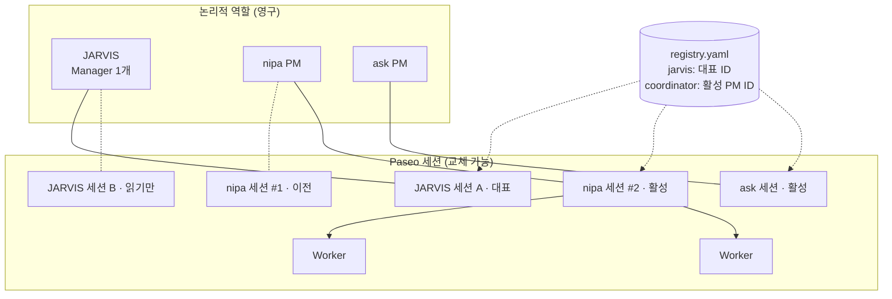
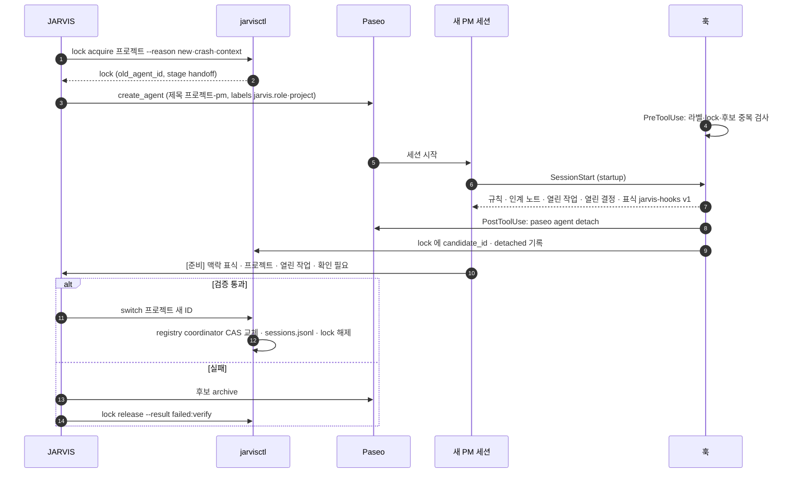
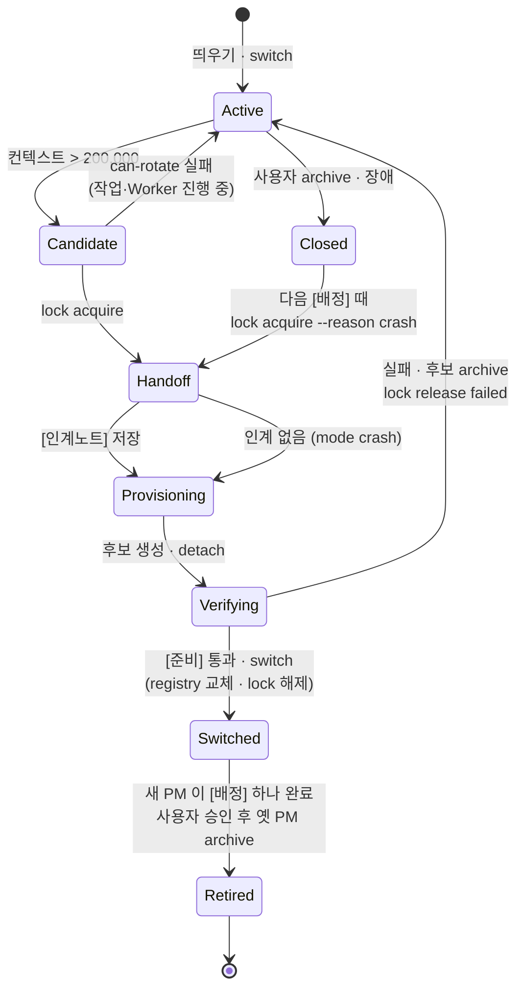
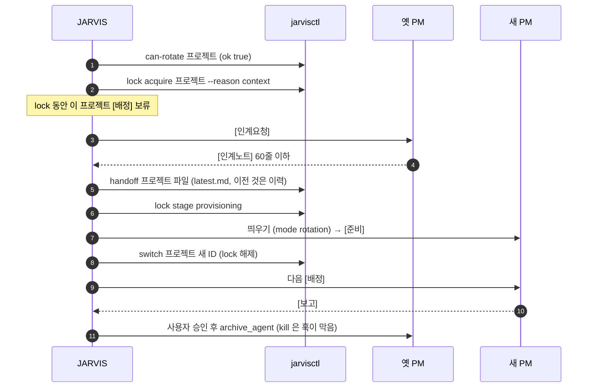
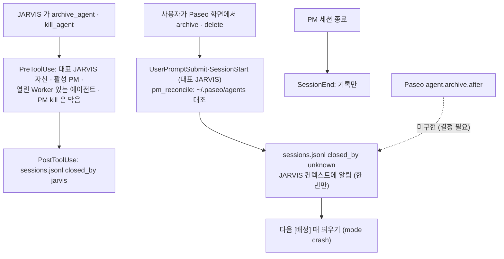

# 02. Agent Lifecycle Management

> **핵심 질문:** Agent 와 세션을 어떻게 생성·교체·복구할 것인가?
> **버전:** v0.2 · 2026-11-09 · 구현 반영 (Codex 검토 1차 반영)
> **관련:** [01 State & Memory](01_State_Memory_Management.md) · [03 Work Lifecycle](03_Work_Lifecycle_Management.md) · 상세 근거 [JARVIS_Agent_Lifecycle_Persistence_Policy.md](JARVIS_Agent_Lifecycle_Persistence_Policy.md)
> **구현:** `hooks/`(Claude 훅), `scripts/jarvisctl.py`(상태 전환), 실행 지침 `CLAUDE.md` "PM 띄우기"·"PM 세션 교체", `rules/coordinator.md`

## 1. 핵심 원칙

**역할은 영구, 세션은 교체 가능.** JARVIS 와 프로젝트 PM(Coordinator)은 논리적 역할로 계속 있고, 그 역할을 수행하는 Paseo 에이전트(세션)는 컨텍스트·장애·사용자 조작에 따라 바뀐다. 상태는 세션 밖(01)에 있으므로 세션을 바꿔도 일이 이어진다.

**판단은 JARVIS(LLM), 전환은 코드.** 언제 바꿀지는 JARVIS 가 정하고, lock·registry 전환·기록은 `jarvisctl` 이 원자적으로 한다. 훅은 규칙을 어기는 도구 호출을 막고 사건을 기록한다.

## 2. 식별자와 역할 판정

| 식별자 | 예 | 영구성 | 어디서 |
|---|---|---|---|
| 프로젝트 키 = PM 역할 ID | `nipa` | 영구 | `registry.yaml` |
| Paseo 에이전트 ID = 세션 ID | `4344eec9-…` | 교체됨 | Paseo, `registry.yaml` |
| Claude 세션 ID | `3107af3a-…` | 세션과 같이 | Paseo `persistence.sessionId`, transcript 파일명 |
| 작업 ID | `W-20261108-14` | 영구 | `state/tasks`, Worker 라벨 `jarvis.task` |
| 역할 라벨 | `jarvis.role: pm`, `jarvis.project: nipa` | 세션에 붙음 | PM 생성 시 필수(훅이 강제) |
| 부모 라벨 | `paseo.parent-agent-id` | Paseo 가 자동으로 붙임 | Worker → PM ID |

훅(`hooks/jarvis_state.py` `role_of`)은 세션 환경변수 `PASEO_AGENT_ID` 로 역할을 정한다.

| 역할 | 조건 |
|---|---|
| `jarvis` (대표) | `registry.jarvis` 와 같음 |
| `pm` | registry 의 `coordinator` 와 같음(활성), 또는 라벨 `jarvis.role=pm`(후보·이전) |
| `worker` | 부모가 PM |
| `jarvis_other` (보조) | JARVIS 폴더에서 뜬 다른 Paseo 세션(schedule 로 뜬 세션 제외) |
| `none` | 그 밖(사용자 세션, Paseo 밖 세션) — 훅이 아무것도 안 함 |

판단은 라벨·registry 로 한다. 제목(`nipa-pm`, 옛 `nipa-coord`)은 보여 주는 용도다.

**부모 관계(확인함):** 에이전트가 `create_agent` 로 만든 에이전트는 Paseo 에서 그 에이전트의 subagent(부모 라벨)가 된다. JARVIS 가 만든 PM 이 JARVIS 의 자식이면 JARVIS 를 닫을 때 영향을 받을 수 있으므로, PM 생성 직후 PostToolUse 훅이 `paseo agent detach <PM ID>` 로 떼어 낸다(시험: 부모 라벨만 빠지고 세션은 그대로). PM 이 만든 Worker 는 부모 라벨을 유지한다(PM 이 결과를 받는 경로).

## 3. 세 층 분리

| 층 | 내용 | 바꾸는 주체 |
|---|---|---|
| **정의** | registry 프로젝트 항목(name, root, linear_project), `rules/coordinator.md`, 프로젝트 CLAUDE.md | 사용자 · JARVIS(등록할 때만) |
| **띄우기 (Provisioning)** | 세션 하나를 만들고 맥락을 넣고 검증하고 활성화하는 공통 절차 | JARVIS + 훅 + `jarvisctl` |
| **수명주기 (Lifecycle)** | 언제 바꾸나, 인계, 전환, 닫기, 복구 | JARVIS + `jarvisctl` |

새 프로젝트(`new`)·닫힌 PM 재생성(`crash`)·교체(`rotation`)가 모두 같은 띄우기를 쓴다. 띄우기 없이 registry 를 바꾸는 길은 없다(`jarvisctl switch` 가 lock 과 후보를 요구).

## 4. 띄우기 (Provisioning)

**initialPrompt (이번 세션의 목적):** 프로젝트 키, root, 보고받을 JARVIS ID, `mode`, "`[준비]` 로 답하라", 그리고 훅이 안 돌 때를 대비한 `rules/coordinator.md` 경로 한 줄.

**SessionStart 훅 (항상 같은 규칙과 현재 상태):** `rules/coordinator.md` 전문, 인계 노트(`state/handoff/<프로젝트>/latest.md`, 80줄까지), 열린 작업, `open`·`waiting` 결정 경로, Linear Project, lock 이 있으면 교체 중 경고와 이전 PM ID. `startup`·`resume`·`compact`·`clear` 모두에서 넣는다.

**`[준비]` 검증:** ① `맥락: jarvis-hooks v1#<nonce>` 표식이 `jarvisctl hook-check <ID>` 와 같음(훅이 세션마다 새 nonce 를 `state/sessions/<ID>.hook.json` 에 남긴다. 규칙 파일에는 없는 값이라 모델이 지어낼 수 없다) ② 프로젝트 키·작업 폴더 ③ 열린 작업을 빠짐없이 ④ Worker 를 띄우거나 파일을 고치지 않음. 표식은 SessionStart 훅이 돌았다는 증거이고, 생성·닫기 가드가 정상이라는 증명은 아니다. 가드는 설치 통합 시험(11절)으로 확인한다.

**`switch` 가 확인하는 것:** lock 의 후보와 같음, 라벨 `jarvis.role=pm`·`jarvis.project`, 작업 폴더 = registry root, 부모 라벨 없음(detach 됨), 교체(`context`·`manual`)면 진행 중 작업 없음·옛 PM 실행 중 아님·옛 PM 의 열린 Worker 없음. registry 는 `registry.yaml.lock` 잠금 안에서 다시 읽고 비교해 바꾼다. 바꾼 뒤 lock 에 `stage: switched` 를 남기므로, 기록 단계에서 끊겨도 같은 명령을 다시 실행하면 이어서 끝난다.

**`[준비]` 전달:** detach 하면 PM 의 끝남 알림은 JARVIS 에게 가지 않는다(nipa 교체 시험에서 확인). 그래서 PM 이 `send_agent_prompt` 로 `[준비]` 를 직접 보내고, 안 오면 JARVIS 가 `get_agent_activity` 로 마지막 답을 본다. 다른 보고도 원래 자동 알림에 기대지 않는다(`rules/coordinator.md`).

**후보 PM 의 권한:** registry 에 연결되기 전 PM 은 Worker 를 만들 수 없다(훅). `[배정]` 은 `switch` 뒤에만 보낸다.

## 5. PM 수명주기

### 5.1 상태

lock 은 `switch` 에서 풀린다. 옛 PM 정리(Retired)는 lock 과 무관한 후속 단계라 새 `[배정]` 을 막지 않는다.

### 5.2 교체 조건 (`jarvisctl can-rotate`)

1. 컨텍스트 > **200,000** 토큰 (`JARVIS_ROTATE_TOKENS` 로 바꿀 수 있음)
2. PM 이 idle, 그 프로젝트 작업 중 `assigned`·`working`·`question` 없음
3. 부모가 그 PM 인 Worker 가 모두 닫힘(archive 또는 closed). PM 은 결과를 확인한 Worker 를 archive 한다(`rules/coordinator.md`)
4. `state/handoff/<프로젝트>/rotating.lock` 없음

컨텍스트 값: Paseo `lastUsage.contextWindowUsedTokens` → Stop Snapshot(6시간 안) → transcript 마지막 usage(`input + cache_read + cache_creation + output`). 모르면 교체하지 않는다.

### 5.3 교체 순서

## 6. 닫힘 감지

- 대조는 registry 의 활성 PM 이 `archivedAt` 이 있거나 기록이 사라졌는지 본다. 누가 닫았는지 모르면 `closed_by: unknown`. 같은 닫힘은 `state/sessions/reconciled.json` 으로 한 번만 알린다.
- 사용자가 화면에서 바로 닫으면 인계 노트를 받을 수 없다. 마지막 `latest.md` 와 작업 파일로 복원하고, 새 PM 은 SessionStart 맥락의 "이전 PM" 으로 옛 Worker 결과를 먼저 확인한다.
- 훅·대조는 새 PM 을 만들거나 registry 를 바꾸지 않는다. 기록과 알림만 한다.
- Paseo 플러그인 `agent.archive.after`(이벤트 이름 확인, 페이로드 미확인)는 대조와 같은 일을 즉시 할 수 있으나 TypeScript 신뢰·비샌드박스 설치가 필요해 보류했다(`state/decisions` 에 결정 대기).

## 7. 훅 목록 (`hooks/hooks.json`, 플러그인 `jarvis`)

모든 훅은 모든 세션에서 불리지만 역할이 맞지 않으면 바로 끝난다. 관측용 훅(SessionStart·Stop·SessionEnd·PreCompact·UserPromptSubmit)은 예외가 나면 조용히 통과한다(세션을 막지 않음). 보호 훅 `agent_guard` 의 PreToolUse 는 Paseo 관리 세션에서 예외가 나면 막는다(고장 난 가드가 통과시키지 않게). `jarvis_only_write` 는 판단이 끝난 차단만 exit 2 로 막는다. 같은 lock 에 PM 생성이 동시에 두 번 오면 PreToolUse 가 lock 안에 `reserving` 을 잡아 하나만 통과시킨다(180초).

| 훅 | 스크립트 | 대상 | 하는 일 |
|---|---|---|---|
| SessionStart (startup·resume·compact·clear) | `session_context.py` | PM · 대표 JARVIS · 보조 JARVIS | PM: 규칙·상태 주입 / 대표: 현황·닫힌 PM / 보조: 읽기만 경고 |
| UserPromptSubmit | `pm_reconcile.py` | 대표 JARVIS | 닫힌 PM 대조·알림 |
| Stop | `pm_usage.py` | PM | 사용량 Snapshot |
| PreToolUse (paseo create·archive·kill) | `agent_guard.py` | JARVIS · PM | 중복 PM, 후보·교체 중 Worker 생성, 활성 PM·대표 닫기, PM kill, 남의 Worker 닫기 차단. PM 의 Worker 는 `jarvis.task` 필수 |
| PostToolUse (같은 matcher) | `agent_guard.py` | JARVIS · PM | PM detach, lock 후보 기록, 닫음 기록 |
| PreCompact · SessionEnd | `session_event.py` | PM | 기록만 |
| PreToolUse (Edit·Write) | `jarvis_only_write.py` | PM · Worker · 보조 JARVIS | JARVIS 폴더 쓰기 차단 |
| PreToolUse (Bash) | `git-message-style.py` | 모두 | 커밋 문구 검사(기존) |

Claude 로만 PM 을 띄우므로 Codex 훅은 범위 밖이다. Codex Worker 에는 훅이 걸리지 않는다(Worker 규칙은 첫 지시로 전달).

## 8. JARVIS(Manager) 수명주기

- 논리적 JARVIS 는 하나. 세션은 여럿일 수 있지만 **쓰기 권한은 `registry.jarvis` 의 세션 하나**다. 보조 세션은 Edit·Write(훅)·에이전트 생성/닫기(훅)가 막힌다.
- 대표 전환은 `jarvisctl claim-jarvis <새 ID>` 하나로만 한다. 허용 조건: 대표가 없음 · 옛 대표가 닫힘(archive·closed) · 옛 대표가 `transfer-jarvis --to <새 ID|next>` 로 넘김. 셋 다 아니면 거절한다(탈취 방지). registry 의 `jarvis:` 값이 읽은 값과 같을 때만 바꾼다(CAS).
- 계획된 교체: 옛 JARVIS 가 `state/handoff/manager/latest.md` 작성(`jarvisctl handoff manager`) → `transfer-jarvis --to next` → 새 JARVIS 가 `claim-jarvis` → PM 들에게 `[인계]` → 사용자 승인 후 옛 JARVIS archive.
- 장애: 사용자가 옛 JARVIS 를 archive 하고 새로 띄우면 `claim-jarvis` 가 허용된다.
- 교체 기준은 PM 의 200,000 을 따르지 않는다. 사용자가 정할 때 바꾼다.
- JARVIS 가 완전히 멈추면 스스로 복구하지 못한다. 사용자가 새로 띄운다.

## 9. Worker 연속성

- Worker 는 라벨 `jarvis.task=<W-ID>` 와 부모 라벨로 W·PM 에 묶인다(Paseo 기록에 남음, PM 세션이 바뀌어도 찾을 수 있음).
- Worker 결과는 마지막 글 `[완료]` 로 남고, 끝남 알림은 Worker 를 만든 PM 세션으로 간다. 그래서 열린 Worker 가 있으면 교체하지 않는다(`can-rotate`, `switch` 도 확인).
- PM 은 결과를 확인한 Worker 를 archive 하고 보고에 ID 를 적는다.
- 장애(mode crash)로 바뀐 경우 새 PM 이 옛 PM 의 Worker 를 찾아 `[완료]` 를 확인하고, 실제 파일·브랜치를 보고 중복 작업을 피한다.

## 10. 실패와 복구

| 상황 | 감지 | 조치 |
|---|---|---|
| 이미 교체 중 | `lock acquire` 실패 | 기다리거나 `lock show` 로 상태 확인 |
| `[인계노트]` 안 옴 | 시간 초과 | lock 유지, 띄우기(crash) |
| `[준비]` 실패 | JARVIS 검증 | 후보 archive, `lock release --result failed:verify`, registry 그대로 |
| `switch` 실패 | CAS 불일치·후보 닫힘·Worker 열림 | registry 그대로, 원인 확인 |
| `switch` 뒤 기록·알림 실패 | — | 되돌리지 않음. 새 PM 이 활성. 빠진 기록만 채움 |
| 교체 도중 JARVIS 새로 뜸 | lock 있음 | `lock show` 의 stage·candidate 로 이어 할지 사용자에게 |
| 사용자가 PM archive | 대조 | 기록·알림, 다음 [배정] 때 crash 띄우기 |
| PM 중복 | create 가드 | 생성 차단. 이미 있으면 registry 쪽만 활성, 나머지는 대시보드 "이전 PM" |
| Paseo 재시작으로 사용량 없음 | `lastUsage` 없음 | Snapshot → transcript |
| 훅 미실행 | `[준비]` 표식 없음 | 규칙 파일 직접 읽게 함 |

### 잠금과 재개 (Codex 검토 3회 반영)

- 모든 파일 잠금(`<파일>.lock`)은 `<pid> <토큰>` 을 적는다. 잡은 프로세스가 죽었을 때만 남이 치우고, 풀 때는 자기 토큰일 때만 지운다.
- `switch` 는 검증 → registry 전환 → `stage: switched` → 기록 → lock 삭제를 프로젝트 lock 의 잠금 하나 안에서 한다. registry 가 이미 후보를 가리키면 `lock release` 는 거절되고 `switch` 재실행이 마무리한다.
- PM 생성 예약(`reserving`)이 만료되면, 그 사이 만들어진 같은 프로젝트 PM 이 Paseo 에 있는지 먼저 보고, 있으면 새로 만들지 않고 `lock candidate` 로 쓰거나 archive 하게 한다. 늦게 온 생성 결과는 현재 후보를 덮지 않고 `extra_created` 에 남는다.
- 열린 Worker 확인은 Paseo 기록을 모두 읽었을 때만 "없음" 으로 본다. 하나라도 못 읽으면 보류한다.
- Linear retry 는 항목을 하나씩 토큰으로 예약하고, 끝난 결과는 토큰이 그대로일 때만 반영한다.

## 11. 단계

| 단계 | 내용 | 상태 |
|---|---|---|
| 1 | 훅 6개·`jarvisctl`·테스트, `CLAUDE.md`·`rules` 반영, `-pm` 제목·라벨 | 완료 (Codex 검토 2회 반영) |
| 2 | `jarvis` 플러그인 설치, 시험 에이전트로 훅 확인 | 완료: 시험 PM 에서 SessionStart 주입·표식, Stop Snapshot, Paseo archive 시 SessionEnd, 대조 알림 1회 확인. 생성·닫기 가드와 detach 는 플러그인 설치 뒤 뜬 JARVIS 세션에서 확인 필요(설치 전 세션에는 훅이 없음) |
| 3 | 대표 JARVIS 전환(`registry.jarvis` 갱신 완료), 보조 JARVIS 세션 정리 | 정리는 사용자 승인 |
| 4 | nipa 실제 교체 → `nipa-pm` | 완료(2026-11-09): 87.8만 → 6.8만 토큰, 표식 일치, detach 확인. 옛 PM archive 는 사용자 승인 대기 |
| 5 | Paseo 플러그인 `agent.archive.after` | 결정 대기 |
| 6 | 대시보드: 이전 PM·그 Worker 를 프로젝트 방에 "이전" 으로 | 완료 |
