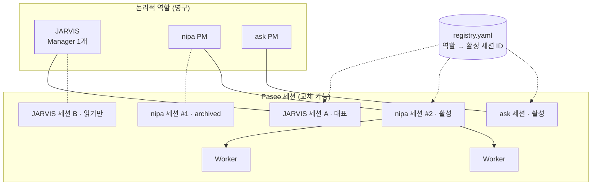
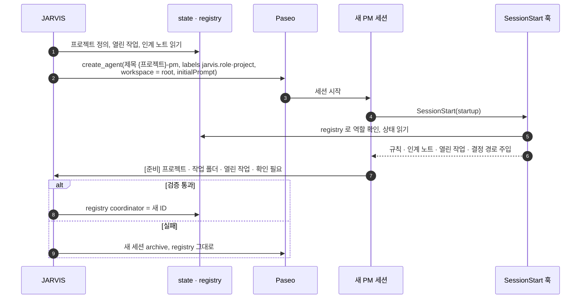
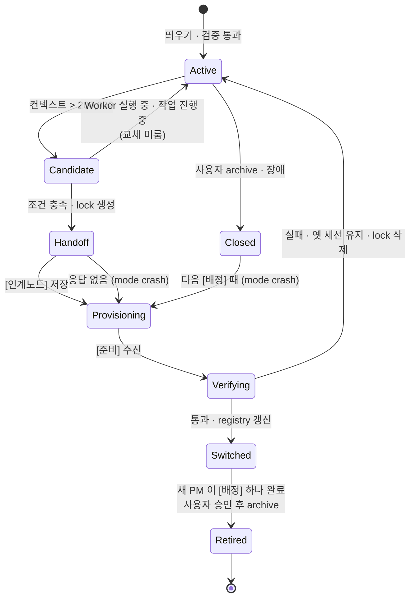
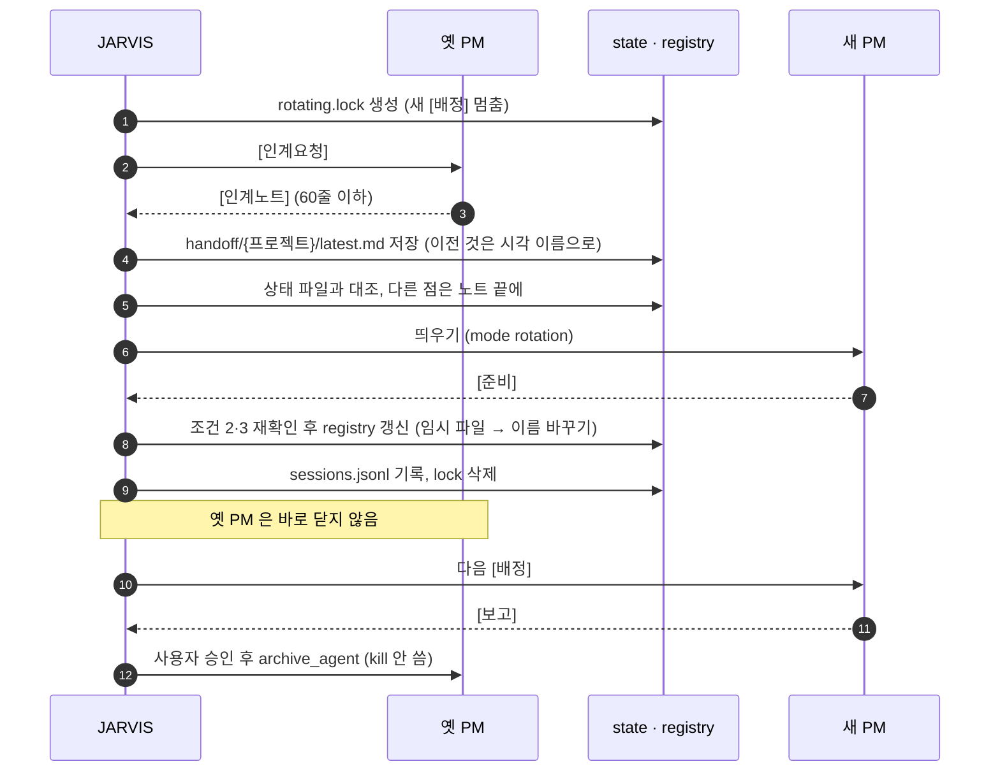
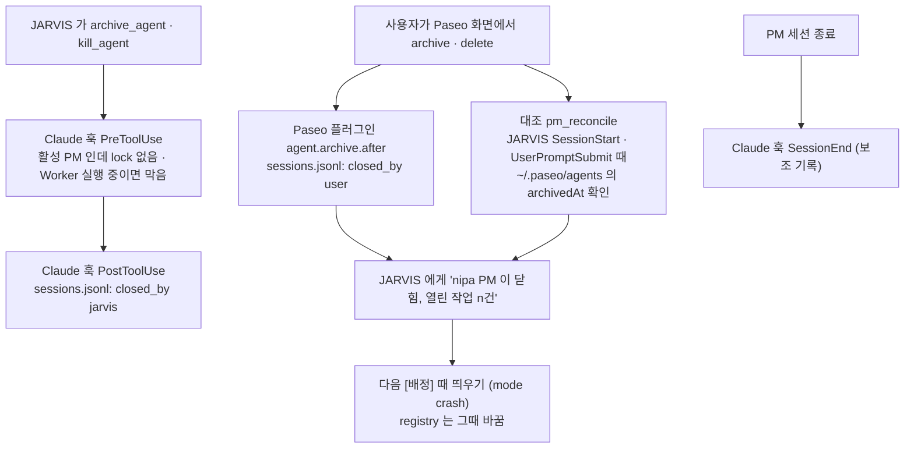

# 02. Agent Lifecycle Management

> **핵심 질문:** Agent 와 세션을 어떻게 생성·교체·복구할 것인가?
> **버전:** v0.1 · 2026-11-09 · 초안
> **관련:** [01 State & Memory](01_State_Memory_Management.md) · [03 Work Lifecycle](03_Work_Lifecycle_Management.md) · 상세 근거 [JARVIS_Agent_Lifecycle_Persistence_Policy.md](JARVIS_Agent_Lifecycle_Persistence_Policy.md)

## 1. 핵심 원칙

**역할은 영구, 세션은 교체 가능.** JARVIS 와 프로젝트 PM 은 논리적 역할로 계속 있고, 그 역할을 수행하는 Paseo 에이전트(세션)는 컨텍스트·장애·사용자 조작에 따라 바뀐다. 상태는 세션 밖(01)에 있으므로 세션을 바꿔도 일이 이어진다.

## 2. 식별자

| 식별자 | 예 | 영구성 | 어디서 |
|---|---|---|---|
| 프로젝트 키 = PM 역할 ID | `nipa` | 영구 | `registry.yaml` |
| Paseo 에이전트 ID = 세션 ID | `4344eec9-…` | 교체됨 | Paseo, `registry.yaml` |
| Claude 세션 ID | `3107af3a-…` | 세션과 같이 | Paseo `persistence.sessionId`, transcript 파일명 |
| 작업 ID | `W-20261108-14` | 영구 | `state/tasks` |
| 역할 라벨 | `jarvis.role: pm`, `jarvis.project: nipa` | 세션에 붙음 | PM 생성 시 `create_agent` labels **(계획)** |
| 부모 라벨 | `paseo.parent-agent-id` | Paseo 가 자동으로 붙임 | Worker → PM ID |

- 세션이 자기 역할을 아는 방법: Paseo 가 띄운 세션의 환경변수 `PASEO_AGENT_ID` 를 registry 와 비교한다(확인함).
- 판단은 라벨·registry 로 한다. 제목(`nipa-pm`, 옛 `nipa-coord`)은 보여 주는 용도다.
- JARVIS 가 만든 PM 에는 부모 라벨이 없다. JARVIS 를 archive 해도 PM 은 살아 있다(확인함).

## 3. 세 층 분리

| 층 | 내용 | 바꾸는 주체 |
|---|---|---|
| **정의** | registry 프로젝트 항목(name, root), `rules/coordinator.md`, 프로젝트 CLAUDE.md | 사용자 · JARVIS(등록할 때만) |
| **띄우기 (Provisioning)** | 세션 하나를 만들고 맥락을 넣고 검증하는 공통 절차 | JARVIS |
| **수명주기 (Lifecycle)** | 언제 바꾸나, 인계, 전환, 닫기, 복구 | JARVIS |

수명주기는 새 세션이 필요하면 직접 만들지 않고 **띄우기**를 부른다. 새 프로젝트·닫힌 PM 재생성·교체가 모두 같은 띄우기를 쓴다.

## 4. 띄우기 (Provisioning)

입력: 프로젝트 키, `mode`(`new` · `rotation` · `crash`), 인계 노트(있으면).

**initialPrompt 에 직접 넣는 것** (이번 세션의 목적): 프로젝트 키, root, 보고받을 JARVIS ID, `mode`, 인계 노트 전문, "`[준비]` 로 답하라".

**SessionStart 훅이 넣는 것** (항상 같은 규칙과 현재 상태): `rules/coordinator.md`, `rules/worker.md` 경로, 열린 작업 목록, `open`·`waiting` 결정 경로, 인계 노트 경로. 압축(`compact`)·재개(`resume`) 때도 다시 넣는다.

훅이 실패해도 `[준비]` 검증에서 걸리므로 registry 는 바뀌지 않는다.

**`[준비]` 검증 항목:** 프로젝트 키와 작업 폴더가 맞다 · 열린 작업을 빠짐없이 짚는다 · Worker 를 새로 띄우지 않았다 · 파일을 고치지 않았다.

## 5. PM 수명주기

### 5.1 상태

### 5.2 교체 조건 (모두 맞아야 함)

1. 컨텍스트 > **200,000** 토큰. 값은 `get_agent_status.lastUsage.contextWindowUsedTokens`, 없으면 `state/sessions/<ID>.json`(최신일 때만). 둘 다 없으면 교체하지 않는다.
2. PM 이 `idle`, 그 프로젝트 작업 중 `assigned`·`working`·`question` 없음.
3. 부모가 그 PM 인 Worker(`paseo.parent-agent-id`)가 모두 `closed`.
4. `state/handoff/<프로젝트>/rotating.lock` 없음.

200,000 은 처음 값이다. `sessions.jsonl` 로 비용·교체 횟수를 보고 조정한다.

### 5.3 교체 순서

## 6. 닫힘 감지

PM 이 닫히는 경로는 둘이고, 잡는 방법이 다르다.

- 사용자가 화면에서 바로 닫으면 인계 노트를 받을 수 없다. 마지막 `latest.md` 와 작업 파일로 복원한다. 맥락을 넘기려면 JARVIS 에게 "nipa PM 정리해" 라고 하면 5.3 순서로 닫는다.
- Paseo 훅은 알림이다. 막지 못하고, 빠질 수 있다. 그래서 대조를 함께 둔다.
- 훅·플러그인은 새 PM 을 만들거나 registry 를 바꾸지 않는다. 기록과 알림만 한다.

## 7. 훅 목록

모든 훅은 모든 세션에서 불리지만, `PASEO_AGENT_ID` 로 역할을 확인해 맞지 않으면 바로 끝난다.

| 훅 | 종류 | 대상 | 하는 일 | 상태 |
|---|---|---|---|---|
| Claude `SessionStart` (startup·resume·compact) | 수명주기 | PM | 규칙·상태·인계 경로 주입 | 계획 |
| Claude `SessionStart`·`UserPromptSubmit` | 수명주기·동작 | JARVIS | Paseo 기록 대조(닫힌 PM 감지) | 계획 |
| Claude `Stop` | 동작 | PM | 사용량 Snapshot 기록 | 계획 (산출 방식 확인함) |
| Claude `PreToolUse(mcp__paseo__create_agent)` | 동작 | JARVIS, PM | PM 중복 생성 막기, lock 중 Worker 생성 막기 | 계획 |
| Claude `Pre/PostToolUse(archive_agent·kill_agent)` | 동작 | JARVIS | 활성 PM 보호, 닫음 기록 | 계획 |
| Claude `SessionEnd`·`PreCompact` | 수명주기 | PM | 기록만 | 계획 |
| Claude `PreToolUse(Edit·Write)` `jarvis_only_write` | 동작 | JARVIS 외 | JARVIS 폴더 쓰기 막기 | 코드 있음, 미설치 |
| Paseo `agent.archive.after`·`agent.close.after` | 수명주기 | Paseo 데몬 | 사용자 archive 기록 | 이벤트 이름 확인, 페이로드 미확인 |
| Paseo `agent.create.before` | 동작 | Paseo 데몬 | 화면·CLI 로 만드는 PM 중복 막기 | 검토 |

Claude 훅은 `jarvis` 플러그인(`hooks/hooks.json`)에, Paseo 훅은 별도 Paseo 플러그인(TypeScript)에 둔다. Coordinator 는 Claude 로만 띄우므로 Codex 훅은 범위 밖이다.

## 8. JARVIS(Manager) 수명주기

- 논리적 JARVIS 는 하나. 세션은 여럿일 수 있지만 **쓰기 권한은 `registry.jarvis` 의 세션 하나**다(01 의 6절).
- 교체 기준은 PM 의 200,000 을 따르지 않는다. 처음에는 사용자가 정할 때 바꾼다.
- 교체 순서:
  1. 옛 JARVIS 가 `state/handoff/manager/latest.md` 작성(01 의 5.3 형식)
  2. 새 JARVIS 가 뜨면 `CLAUDE.md` "새로 떴을 때" 를 따른다: registry·criteria·열린 작업·열린 결정·manager 인계 읽기
  3. `registry.jarvis` 를 자기 ID 로 바꿈
  4. 살아 있는 PM 마다 `[인계] JARVIS 가 바뀜. 이제 보고·질문은 <새 ID> 로`
  5. 옛 JARVIS 는 사용자 승인 후 archive
- JARVIS 가 완전히 멈추면 스스로 복구하지 못한다. 사용자가 새로 띄운다.

## 9. Worker 연속성

- Worker 결과는 마지막 글 `[완료]` 로 남고, 끝남 알림은 **Worker 를 만든 PM 세션**으로 간다.
- 그래서 Worker 가 하나라도 열려 있거나 결과를 PM 이 아직 확인하지 않았으면 PM 을 교체하지 않는다.
- PM 을 archive 할 때 자식 Worker 에 영향이 있는지 모르므로, 자식이 모두 `closed` 일 때만 archive 한다.

## 10. 실패와 복구

| 상황 | 감지 | 조치 |
|---|---|---|
| `[인계노트]` 안 옴 | 시간 초과 | `latest.md` + 작업 파일로 띄우기(crash) |
| `[준비]` 검증 실패 | JARVIS 검증 | registry 유지, 새 세션 archive, lock 삭제, `failed:verify` |
| 교체 도중 JARVIS 새로 뜸 | `rotating.lock` 있음 | 이어 할지 사용자에게 묻기 |
| 사용자가 PM archive | Paseo 훅 · 대조 | 기록, 알림, 다음 [배정] 때 띄우기 |
| PM 중복 | create 가드 · 대조 | 생성 막기. 이미 있으면 registry 쪽만 활성, 나머지 사용자에게 |
| Paseo 재시작으로 사용량 비어 있음 | `lastUsage` 없음 | Stop Snapshot, 없으면 판단 보류 |

## 11. 단계

| 단계 | 내용 | 승인 |
|---|---|---|
| 1 | 훅 작성·테스트, `CLAUDE.md` 띄우기 절차 통합, `-pm` 제목·라벨 | — |
| 2 | `jarvis` 플러그인 설치, `agent-hub-ao` 끄기, 시험 에이전트로 훅 확인 | 필요 |
| 3 | 남은 JARVIS 세션 정리, `registry.jarvis` 갱신 | 필요 |
| 4 | nipa 교체 DRY RUN(registry·archive 빼고) → 실제 교체 → `nipa-pm` | 필요 |
| 5 | Paseo 플러그인으로 archive 이벤트 시험·설치 | 필요 |
| 6 | 대시보드: 이전 세션과 그 Worker 를 프로젝트 방에 "이전 세션"으로 표시 | dashboard 미커밋 변경 확인 후 |
