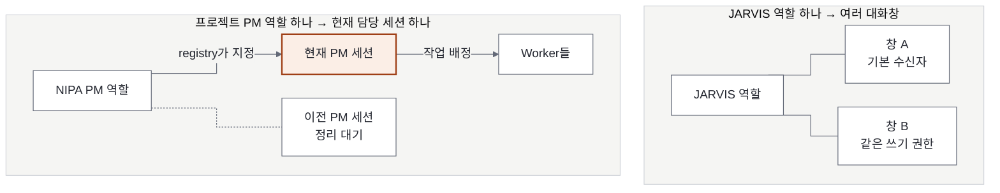
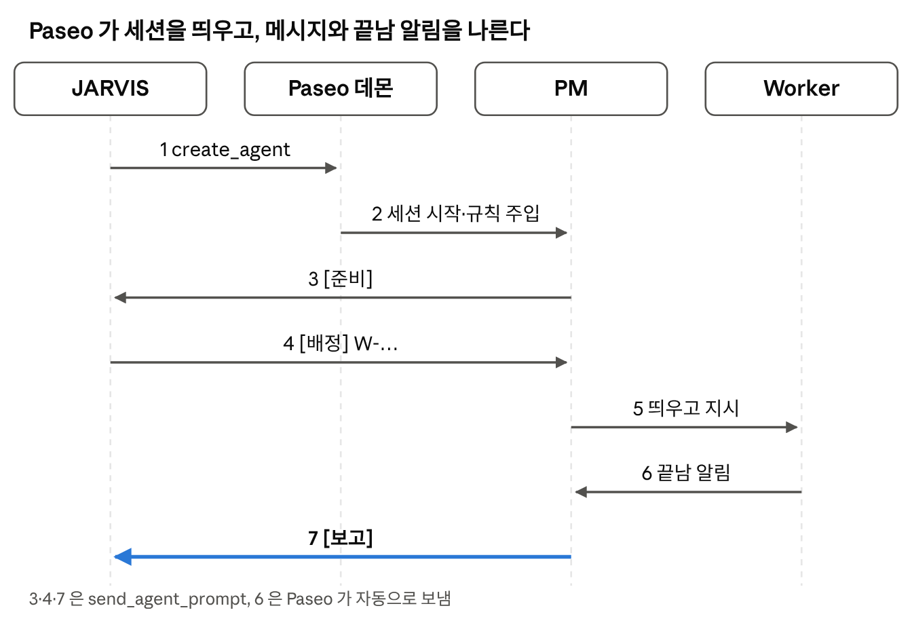
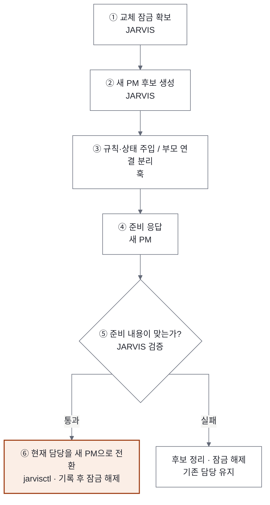
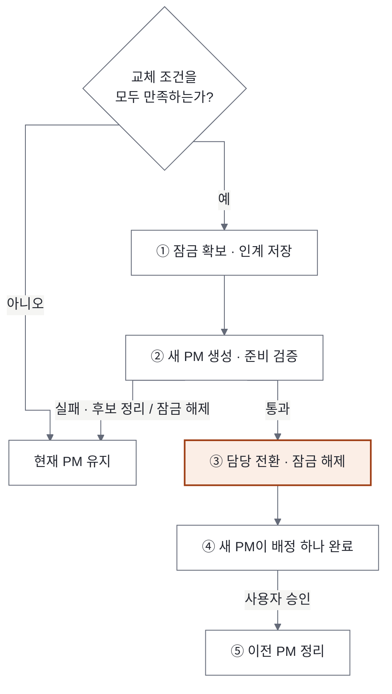
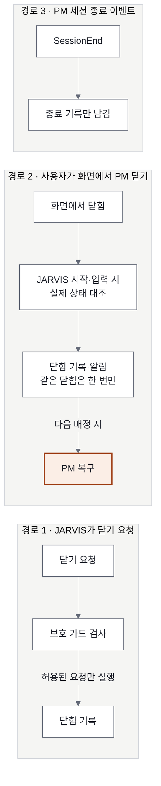
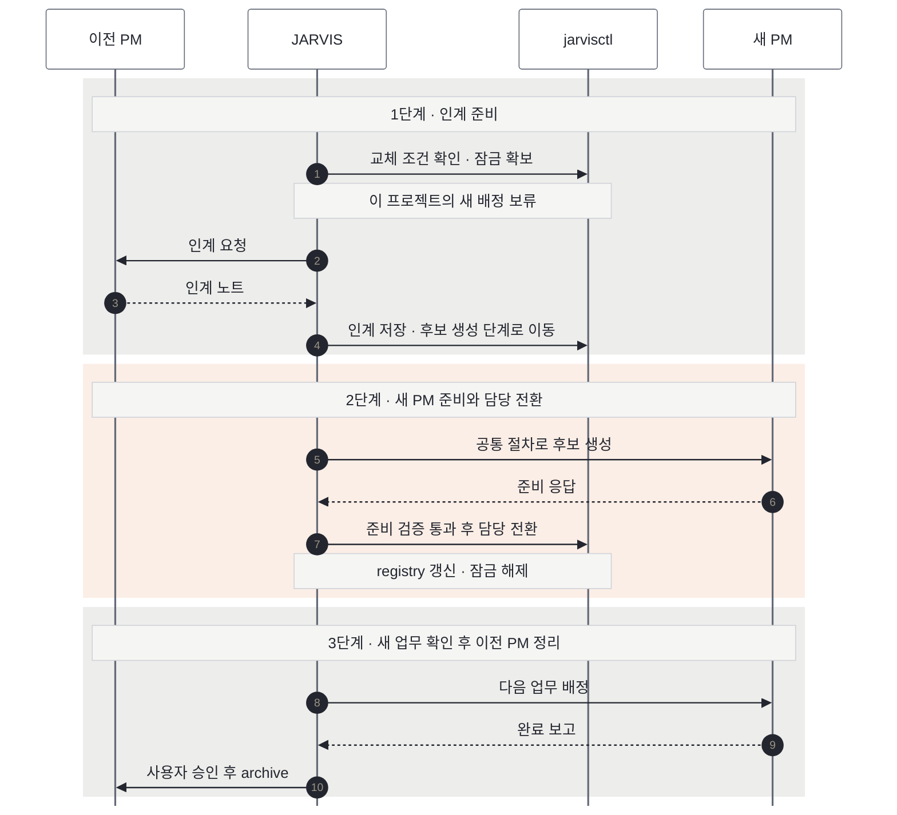

# 02. Agent Lifecycle Management (에이전트 수명주기 관리)

> **핵심 질문:** 논리적 Agent 와 실제 실행 세션을 어떻게 생성·교체·복구하는가?
> **버전:** v0.4 · 2026-11-09 · 구조 재정리(정책·구현 변경 없음)
> **관련:** [01 State & Memory](01_State_Memory_Management.md) · [03 Work Lifecycle](03_Work_Lifecycle_Management.md)
> **구현:** `hooks/`(Claude 훅), `scripts/jarvisctl.py`(상태 전환), 실행 지침 `CLAUDE.md` "PM 띄우기"·"PM 세션 교체", `rules/coordinator.md`

## 요약

### 목적

JARVIS 와 프로젝트 PM 은 오래 유지되는 역할이지만, 그 역할을 수행하는 Claude 세션은 컨텍스트가 커지거나 닫히면 바뀌어야 한다. 이 문서는 세션을 만들고(Provisioning), 맥락을 복원하고(Bootstrap), 교체·종료·복구하는(Lifecycle) 절차를 정한다.

### 핵심 원칙

1. 역할은 영구, 세션은 교체 가능. 프로젝트 키(`nipa`)가 PM 의 정체성이고, Paseo 에이전트 ID 는 바뀌는 실행 인스턴스다.
2. 판단은 JARVIS, 전환은 코드. 언제 바꿀지는 JARVIS(LLM)가 정하고, lock·registry 전환·기록은 `jarvisctl` 이 원자적으로 한다.
3. 모든 세션은 같은 절차로 만든다. 새 프로젝트·장애 복구·교체가 하나의 Provisioning 절차를 쓰고, `[준비]` 검증을 통과해야 registry 에 연결된다.
4. 일하는 중에는 바꾸지 않는다. 컨텍스트 때문에 하는 일반 교체(`context`·`manual`)는 진행 중 작업이나 열린 Worker 가 있으면 하지 않는다. PM 이 이미 닫힌 장애 복구(`crash`)와 새 프로젝트(`new`)는 예외다(5.2).
5. 훅은 규칙을 어기는 도구 호출을 막고 사건을 남긴다. 새 PM 을 만들거나 registry 를 바꾸는 일은 JARVIS 와 `jarvisctl` 이 한다.

### 범위

이 문서는 세션의 생성·교체·복구와 그것을 지키는 훅을 다룬다. 상태 파일의 형식과 쓰기 권한은 [01](01_State_Memory_Management.md), 작업·기능의 흐름과 완료 기준은 [03](03_Work_Lifecycle_Management.md) 이 정한다.

## 1. 논리적 Agent 와 실행 세션

논리적 Agent 는 오래 유지되는 역할이다. JARVIS(Manager) 하나와 프로젝트마다 PM(Coordinator) 하나가 있다. 이 역할은 세션이 바뀌어도 그대로다.

실행 세션 은 그 역할을 실제로 수행하는 Paseo 에이전트(Claude Code 세션)다. 컨텍스트가 커지거나, 장애가 나거나, 사용자가 닫으면 바뀐다.

이 둘을 나누기 위해 네 가지 개념을 구분한다.

| 개념 | 뜻 | 어디에 있나 |
|---|---|---|
| Agent Definition | 역할의 영구 정의: 프로젝트 키, 작업 폴더, PM 제목, 규칙 | registry 프로젝트 항목(name, root, pm_title, linear_project), `rules/coordinator.md`, 프로젝트 CLAUDE.md |
| Session Provisioning | 새 세션을 만들고, 검증하고, registry 에 연결하는 절차 | `CLAUDE.md` "PM 띄우기", `jarvisctl lock`·`switch` (3절) |
| Session Bootstrap | 새 세션에 역할 규칙과 영구 상태를 넣어 맥락을 복원하는 단계 | SessionStart 훅 `session_context.py` (3절) |
| Session Lifecycle | 언제 바꾸나, 인계, 교체, 종료, 복구 | `CLAUDE.md` "PM 세션 교체", `jarvisctl can-rotate` (4·5절) |

Definition 을 바꾸는 주체는 사용자와 JARVIS(`jarvisctl register`·`set`)다. Provisioning·Bootstrap·Lifecycle 은 JARVIS 가 훅과 `jarvisctl` 의 도움을 받아 진행한다. 새 프로젝트(`new`)·닫힌 PM 재생성(`crash`)·교체(`rotation`)가 모두 같은 Provisioning 을 쓰며, Provisioning 없이 registry 를 바꾸는 길은 없다(`jarvisctl switch` 가 lock 과 후보를 요구).

## 2. 세션 구조

논리적 JARVIS 하나는 여러 대화창으로 동시에 쓸 수 있다. 프로젝트 PM 은 활성 세션 하나와, 교체 뒤 정리 전까지 남는 이전 세션을 가질 수 있다. registry 는 어느 세션이 지금 그 역할을 맡는지를 가리킨다.

### 실행 기반: Paseo

JARVIS·PM·Worker 는 모두 Paseo 데몬이 실행하는 Claude Code 세션이다. `create_agent`·`send_agent_prompt` 같은 도구는 Claude Code 기본 기능이 아니라 데몬이 MCP 서버로 내주는 도구(`mcp__paseo__*`)다. 데몬은 화면 없이 뒤에서 도는 프로그램으로, 세션을 자식 프로세스로 띄워 입력과 출력을 쥐고 있다. 이 PC 에서 확인한 구성(2026-11-09):

| 구성 | 이 PC 에서 본 것 | 하는 일 |
|---|---|---|
| Paseo 앱 | `C:\Program Files\Paseo\Paseo.exe` (Electron 앱: 화면·GPU·네트워크 프로세스) | 사용자가 보는 창. 데몬을 자식 프로세스로 띄운다 |
| 데몬 | 같은 `Paseo.exe` 가 `resources\app.asar\dist\daemon\node-entrypoint-runner.js` 를 Node 스크립트로 실행(PID 24416) | 세션 실행·메시지 전달·끝남 알림·예약 실행. `127.0.0.1:6767`, `127.0.0.1:55912` 에서 대기 |
| 에이전트 세션 | 데몬의 자식 `claude.exe` 들. `--input-format stream-json --output-format stream-json`, `--permission-prompt-tool stdio`, `--resume=<세션 ID>` 로 실행 | JARVIS·PM·Worker 하나하나. 데몬이 표준 입출력으로 지시를 넣고 답과 권한 요청을 받는다 |
| 터미널 워커 | `~/.paseo/terminal-worker/…/terminal-worker.mjs` | 데몬이 여는 터미널 |
| 데이터 폴더 | `~/.paseo/`: `agents/`, `schedules/`, `finish-subscriptions.json`, `daemon.log`, `server-id`, `paseo.pid`, `config.json` | 에이전트 기록(제목·부모·라벨·Claude 세션 ID), 예약, 끝남 알림 구독, 로그 |

- 대시보드의 에이전트·흐름 탭은 `~/.paseo/agents/` 기록을 읽는다(`dashboard/jarvis_data.py`).
- 확인하지 않은 것: 두 포트 중 어느 쪽이 MCP 인지, Paseo 앱을 완전히 끄면 데몬과 세션이 함께 내려가는지(데몬의 부모가 앱 프로세스라 그럴 가능성이 높다).

#### 메시지가 전달되는 원리

한 에이전트가 `send_agent_prompt` 를 부르면 데몬이 받는 세션의 입력에 그 글을 새 차례로 넣는다. 받는 쪽에는 `<paseo-system kind="agent-message" source-agent-id=…>` 로 감싼 메시지로 보인다. 부모 세션은 자식이 차례를 끝낼 때 끝남 알림도 같은 방식으로 받는다. 머리말과 보고 형식 같은 메시지 규약은 [03 4절 "메시지 규약"](03_Work_Lifecycle_Management.md#메시지-규약) 이 정한다.

1. JARVIS 가 `create_agent` 로 PM 을 만든다(라벨 `jarvis.role: pm`). 훅이 PM 을 JARVIS 의 자식에서 떼어 낸다(`agent detach`, 아래 "부모 관계").
2. 데몬이 PM 세션을 띄우고, SessionStart 훅이 규칙·인계 노트·열린 작업을 넣는다(3절).
3. PM 이 `send_agent_prompt` 로 `[준비]` 를 보낸다. detach 된 PM 의 끝남 알림은 JARVIS 에게 가지 않으므로 직접 보낸다.
4. JARVIS 가 확인 뒤 `[배정] W-…` 를 보낸다.
5. PM 이 Worker 를 띄우고 지시한다. Worker 는 PM 의 자식으로 남는다.
6. Worker 가 차례를 끝내면 데몬이 부모인 PM 에게 끝남 알림을 보낸다.
7. PM 이 결과를 확인하고 `[보고]` 를 `send_agent_prompt` 로 보낸다. JARVIS 가 받는 자동 알림은 보조 신호이고, `[보고]` 가 아니면 끝난 것으로 보지 않는다.

Paseo 는 Claude 만이 아니라 여러 에이전트 CLI 를 감싸 같은 도구로 다룬다. 이 PC 에서 켜진 제공자는 Claude 와 Codex 다(2026-11-09 `list_providers`. Copilot·OpenCode·Pi·Oh My Pi·Antigravity·Muse Code 는 목록에 있으나 꺼짐). 그래서 Claude PM 이 `create_agent` 의 `provider` 에 `codex` 를 주어 Codex Worker 를 띄우고 메시지를 주고받을 수 있다. JARVIS 는 아직 Claude 만 쓴다. 권한 모드는 제공자마다 다르다(Claude: plan·default·acceptEdits·auto·bypassPermissions, Codex: auto·auto-review·full-access). Claude Code 자체의 세션 간 메시지(`SendMessage`)는 Claude 세션끼리만 되고 JARVIS 규칙에서는 쓰지 않는다.

#### Paseo 도구

| 묶음 | 도구 | JARVIS 에서 쓰는 곳 |
|---|---|---|
| 에이전트 만들기·정리 | `create_agent`, `archive_agent`, `kill_agent`, `update_agent` | PM·Worker 띄우기, 교체 뒤 옛 PM 정리(`kill_agent` 는 훅이 막음) |
| 지시·상태 | `send_agent_prompt`, `get_agent_status`, `get_agent_activity`, `list_agents`, `cancel_agent`, `set_agent_mode` | `[배정]` 보내기, 살아 있는지 확인, 마지막 답 보기 |
| 권한 | `list_pending_permissions`, `respond_to_permission` | PM·Worker 의 `[승인요청]` 허용 |
| 예약 실행 | `create_schedule`, `run_schedule_once`, `pause`·`resume`·`delete_schedule`, `schedule_logs`, `create_heartbeat` | 07:20 아침 할일 정리 |
| 워크스페이스 | `list_workspaces`, `create_workspace`, `archive_workspace`, `rename_workspace` | PM 작업 폴더 연결 |
| 터미널·스크립트 | `create_terminal`, `send_terminal_keys`, `capture_terminal`, `start`·`stop_workspace_script` | 아직 안 씀 |
| 조회 | `list_providers`, `list_models`, `list_profiles`, `list_hosts`, `inspect_provider` | 모델 고를 때 |

### 부모 관계

에이전트가 `create_agent` 로 만든 에이전트는 Paseo 에서 그 에이전트의 subagent(부모 라벨)가 된다(확인함). JARVIS 가 만든 PM 이 JARVIS 의 자식이면 JARVIS 를 닫을 때 영향을 받을 수 있으므로, PM 은 만든 직후 PostToolUse 훅이 `paseo agent detach <PM ID>` 로 떼어 낸다(시험: 부모 라벨만 빠지고 세션은 그대로). PM 이 만든 Worker 는 부모 라벨을 유지한다. 이 라벨이 PM 이 Worker 결과를 받는 경로이자 Worker 를 찾는 근거다.

### 역할 판정

훅과 `jarvisctl` 은 세션 환경변수 `PASEO_AGENT_ID` 로 역할을 정한다(`hooks/jarvis_state.py` `role_of`).

| 역할 | 조건 |
|---|---|
| `jarvis` (기본 수신자 창) | `registry.jarvis` 와 같음 |
| `pm` | registry 의 `coordinator` 와 같음(활성), 또는 라벨 `jarvis.role=pm`(후보·이전) |
| `worker` | 부모가 PM |
| `jarvis_other` (다른 JARVIS 창) | JARVIS 폴더에서 뜬 다른 Paseo 세션(schedule·검토 세션 제외). 권한은 `jarvis` 와 같다 |
| `none` | 그 밖(사용자 세션, Paseo 밖 세션). 역할 기반 훅은 아무것도 하지 않는다. 단 경로 기반 쓰기 훅 `jarvis_only_write` 의 폴더 검사는 역할과 무관하게 적용된다(01 6절) |

판단은 라벨과 registry 로 한다. 제목은 보여 주는 용도다. PM 제목은 registry `pm_title`(없으면 `<키>-pm`, 옛 `<키>-coord`)이고, 라벨이 빠진 옛 세션을 알아볼 때만 제목도 본다. Worker 제목은 `<영역>-<작업 이름>`(예: `wf3-쿼리확인`)이어야 하고, 작업 번호·순번만 있는 이름은 훅이 막는다.

## 3. Session Provisioning 과 Bootstrap

PM 세션 하나를 만드는 공통 절차다. 새 프로젝트·장애 복구·교체가 모두 이 절차를 쓴다.

JARVIS 가 lock 을 잡고 후보 세션을 만들면 훅이 그 세션에 맥락을 넣고(Bootstrap) JARVIS 에게서 떼어 낸다. 후보가 `[준비]` 로 답하면 JARVIS 가 검증하고, 통과하면 `switch` 가 registry 를 후보로 바꾸고 lock 을 푼다.

### 맥락을 넣는 두 경로

세션에 들어가는 정보는 두 곳으로 나뉜다.

- initialPrompt(이번 세션의 목적): 프로젝트 키, root, 보고받을 JARVIS ID, `mode`, "`[준비]` 를 보내라", 훅이 안 돌 때를 대비한 `rules/coordinator.md` 경로 한 줄.
- SessionStart 훅(항상 같은 규칙과 현재 상태): `rules/coordinator.md` 전문, 인계 노트(`state/handoff/<프로젝트>/latest.md`, 80줄까지), 열린 작업, `open`·`waiting` 결정 경로, Linear Project, lock 이 있으면 교체 중 경고와 이전 PM ID. `startup`·`resume`·`compact`·`clear` 모두에서 넣으므로 대화가 압축되거나 다시 열려도 복원된다.

### `[준비]` 검증

JARVIS 는 네 가지를 본다.

1. `맥락: jarvis-hooks v1#<nonce>` 표식이 `jarvisctl hook-check <ID>` 와 같은가. 훅은 세션마다 새 nonce 를 `state/sessions/<ID>.hook.json` 에 남기고, 이 값은 규칙 파일에 없어 모델이 지어낼 수 없다. 표식으로 알 수 있는 것은 SessionStart 훅이 돌았다는 사실까지다. 생성·닫기 가드는 10절의 설치 시험으로 따로 확인한다.
2. 프로젝트 키와 작업 폴더가 맞는가.
3. 열린 작업을 빠짐없이 짚는가.
4. Worker 를 띄우거나 파일을 고치지 않았는가.

### `[준비]` 전달

detach 하면 PM 의 끝남 알림은 JARVIS 에게 가지 않는다(nipa 교체 시험에서 확인). 그래서 PM 이 `send_agent_prompt` 로 `[준비]` 를 직접 보내고, 안 오면 JARVIS 가 `get_agent_activity` 로 마지막 답을 본다. 다른 보고도 자동 알림에 기대지 않는다(`rules/coordinator.md`).

### 후보 PM 의 권한

registry 에 연결되기 전의 PM 은 Worker 를 만들 수 없다(훅). `[배정]` 은 `switch` 뒤에만 보낸다.

## 4. Session Lifecycle 정책

### 4.1 PM 세션의 상태

장애 복구는 정상 교체와 시작 조건이 다르다.

lock 은 `switch` 에서 풀린다. 옛 PM 정리(Retired)는 lock 과 무관한 후속 단계라 새 `[배정]` 을 막지 않는다.

### 4.2 교체 조건

JARVIS 는 `[보고]` 를 받을 때마다 `jarvisctl can-rotate <프로젝트>` 를 본다. 아래가 모두 맞을 때만 교체한다.

1. 컨텍스트 > 200,000 토큰 (`JARVIS_ROTATE_TOKENS` 로 바꿀 수 있음)
2. PM 이 idle, 그 프로젝트 작업 중 `assigned`·`working`·`question` 없음
3. 부모가 그 PM 인 Worker 가 모두 닫힘(archive 또는 closed). PM 은 결과를 확인한 Worker 를 archive 한다(`rules/coordinator.md`)
4. `state/handoff/<프로젝트>/rotating.lock` 없음

컨텍스트 값을 모르면 교체하지 않는다. 처음 몇 번은 교체 전에 사용자 승인을 받는다.

### 4.3 Worker 연속성

PM 을 바꿔도 Worker 결과가 사라지지 않게 하는 규칙이다.

- Worker 는 라벨 `jarvis.task=<W-ID>` 와 부모 라벨로 W·PM 에 묶인다. Paseo 기록에 남으므로 PM 세션이 바뀌어도 찾을 수 있다.
- Worker 결과는 마지막 글 `[완료]` 로 남고, 끝남 알림은 Worker 를 만든 PM 세션으로 간다. 그래서 일반 교체는 열린 Worker 가 있으면 하지 않는다(`can-rotate`, `switch` 모두 확인). 장애 복구(`crash`)는 옛 PM 이 이미 닫혔으므로 이 검사를 건너뛰고, 새 PM 이 옛 Worker 결과를 회수한다(5.2).
- PM 은 결과를 확인한 Worker 를 archive 하고 보고에 ID 를 적는다.

### 4.4 닫힘 감지

PM 세션이 닫히는 경로는 셋이고, 잡는 방법이 다르다.

- 대조는 registry 의 활성 PM 이 `archivedAt` 이 있거나 기록이 사라졌는지 본다. 누가 닫았는지 모르면 `closed_by: unknown` 이다. 같은 닫힘은 `state/sessions/reconciled.json` 으로 한 번만 알린다.
- 훅과 대조는 새 PM 을 만들거나 registry 를 바꾸지 않는다. 기록과 알림만 한다.
- Paseo 플러그인 `agent.archive.after`(이벤트 이름 확인, 페이로드 미확인)는 대조와 같은 일을 즉시 할 수 있으나 TypeScript 신뢰·비샌드박스 설치가 필요해 보류했다(D-20261109-02).

## 5. PM 인계·교체·복구 시나리오

### 5.1 컨텍스트가 커져 교체할 때

옛 PM 은 인계 노트를 메시지로 보내고, 파일은 JARVIS 가 쓴다(PM 은 JARVIS 폴더를 고칠 수 없다). 인계 노트와 상태 파일이 다르면 상태 파일이 맞고, 다른 줄은 노트 끝 `## JARVIS 확인` 에 적는다. 옛 PM 은 새 PM 이 `[배정]` 하나를 마친 뒤 사용자 승인을 받아 archive 한다.

### 5.2 PM 이 갑자기 닫혔을 때 (장애 복구)

닫힘은 두 가지로 나눈다. 다음 `[배정]` 전에 `jarvisctl pm-check <프로젝트>` 가 어느 쪽인지 알려 준다.

- **프로세스만 닫힘**(archive 아님, `pm_state: closed`): 새로 띄우지 않고 이어 띄운다(2026-11-09 사용자 결정, lanekeeper 의 `claude respawn` 과 같은 생각). 닫힌 에이전트에 `send_agent_prompt` 를 보내면 Paseo 가 저장된 세션으로 다시 연다. 대화 맥락이 그대로 남고, SessionStart 훅(resume)이 규칙·인계 노트·열린 작업을 다시 넣는다. 컨텍스트가 기준(20만)을 넘었으면(`action: resume-rotate`) `[배정]` 대신 `[인계요청]` 을 보내 이어 띄우고 5.1 교체로 간다.
- **archive·삭제**(`archived`·`missing`): 사용자나 교체 절차가 일부러 닫은 것이라 이어 띄우지 않는다. 아래처럼 새로 띄운다.

새로 띄울 때 JARVIS 는 다음 `[배정]` 때 `lock acquire --reason crash` 로 Provisioning 을 시작한다. 새 PM 은 마지막 `latest.md` 와 작업 파일로 맥락을 복원하고, SessionStart 맥락의 "이전 PM" 으로 옛 PM 의 Worker 를 찾아 `[완료]` 를 먼저 확인한다. 실제 파일·브랜치를 보고 이미 된 일을 중복하지 않는다. 장애 복구 PM 은 같은 프로젝트 이전 PM 이 남긴 Worker 를 닫을 수 있다.

### 5.3 교체 도중 끊겼을 때

JARVIS 가 교체 도중 새로 뜨면 `jarvisctl lock show <프로젝트>` 의 `stage`·`candidate_id` 를 보고 이어 할지 사용자에게 묻는다. `switch` 가 registry 를 바꾼 뒤 끊겼다면 같은 `switch` 를 다시 실행하면 이어서 끝난다(9.3·9.4).

## 6. Manager 다중 창과 기본 수신자

- 논리적 JARVIS 는 하나지만 대화창은 동시에 여러 개 열 수 있다(2026-11-09 사용자 결정). 모든 창이 상태를 고치고, 겹치는 쓰기는 `jarvisctl` 이 잠금으로 막는다(01 6절).
- registry `jarvis:` 는 기본 수신자다. 아침 할일 정리 보고, 맡긴 창이 닫힌 PM 보고, PM 이 보낼 곳을 모를 때 받는다. 쓰기 권한과는 상관없다.
- 기본 수신자는 `jarvisctl claim-jarvis <새 ID>` 로만 바꾼다. 허용 조건은 기본 수신자가 없음, 그 창이 닫힘(archive·closed·missing), 그 창이 `transfer-jarvis --to <새 ID|next>` 로 넘김 중 하나다. 자기 자신만, JARVIS 창만 올릴 수 있다.
- 기본 수신자 창은 닫기 가드가 막는다. 다른 창이 먼저 claim 하거나 사용자가 Paseo 화면에서 닫으면 그 뒤 claim 이 허용된다.
- 창을 닫을 때(2026-11-09 사용자 결정): 영구 지식은 사용자가 그 창에 "세션 종료"라고 할 때만 남긴다. 순서는 작업일지 raw → Manager 인계 노트(`jarvisctl handoff manager`, 기존 `latest.md` 의 유효 항목 옮김) → `criteria.md` → 닫기. 닫기는 기본 수신자가 아니면 그 창이 `archive_agent` 로 자기 보관, 기본 수신자면 `transfer-jarvis --to next` 뒤 사용자가 보관 버튼을 누르고 새 창이 `claim-jarvis` → PM 들에게 `[인계]`. 세부 절차는 `CLAUDE.md` "세션 종료".
- 사용자가 "세션 종료" 없이 Paseo 보관 버튼으로 닫으면 아무것도 남기지 않는다. Paseo 플러그인 훅은 `agent.archive.after`(보관 뒤, 기다리지 않음)만 있고 보관 전 이벤트가 없어서, 닫히는 창이 스스로 정리할 기회가 없다. 대화 원문은 `~/.claude/projects/` 에 남지만 Claude 기본 설정으로 30일 뒤 지워진다.
- JARVIS 교체 기준은 PM 의 200,000 을 따르지 않는다. 사용자가 정할 때 바꾼다.
- JARVIS 창이 모두 멈추면 스스로 복구하지 못한다. 사용자가 새로 띄운다.

## 7. Hook 정책

모든 훅은 모든 세션에서 불리지만 역할이 맞지 않으면 바로 끝난다. 훅은 플러그인 `jarvis`(`hooks/hooks.json`)에 있다.

| 훅(실행 시점) | 스크립트 | 대상 | 하는 일 | 상태 |
|---|---|---|---|---|
| SessionStart (startup·resume·compact·clear) | `session_context.py` | PM · JARVIS 창 | PM: 규칙·상태 주입 / JARVIS: 기본 수신자·PM 현황·닫힌 PM | 구현·실측(PM 2회, JARVIS 창 시작) |
| UserPromptSubmit | `pm_reconcile.py` | JARVIS 창 | 닫힌 PM 대조·알림(처음 본 창 하나만) | 구현. 스크립트 직접 실행과 SessionStart 경로로 확인, UserPromptSubmit 경로는 실측 필요 |
| Stop | `pm_usage.py` | PM | 사용량 Snapshot | 구현·실측(시험 PM, nipa-pm) |
| PreToolUse (paseo create·archive·kill) | `agent_guard.py` | JARVIS · PM | 중복 PM, 다른 창이 진행 중인 교체에 PM 생성, 후보·교체 중 Worker 생성, 활성 PM·기본 수신자 닫기, PM kill, 남의 Worker 닫기 차단. PM 의 Worker 는 `jarvis.task` 라벨과 작업 위주 제목 필수 | 구현, PM 생성 가드 실측 필요 |
| PostToolUse (같은 matcher) | `agent_guard.py` | JARVIS · PM | PM detach, lock 후보 기록, 닫음 기록 | 구현, 자동 detach 실측 필요 |
| PreCompact · SessionEnd | `session_event.py` | PM | 기록만 | 구현. SessionEnd 실측, PreCompact 실측 필요 |
| PreToolUse (Edit·Write) | `jarvis_only_write.py` | PM · Worker · JARVIS 창 | PM·Worker 의 JARVIS 폴더 쓰기 차단. JARVIS 창의 `registry.yaml`·`occupancy.json`·결정 파일 직접 수정과 새 작업 파일 직접 생성 차단(jarvisctl 로) | 구현, 실측 필요 |
| PreToolUse (Bash) | `git-message-style.py` | 모두 | 커밋 문구 검사(기존) | 구현 |
| Paseo `agent.archive.after` | — | Paseo 데몬 | 사용자 archive 즉시 기록 | 미구현(결정 대기) |

훅이 예외로 실패할 때의 처리는 종류마다 다르다. 관측용 훅(SessionStart·Stop·SessionEnd·PreCompact·UserPromptSubmit)은 예외가 나면 조용히 통과한다(세션을 막지 않음). 보호 훅 `agent_guard` 의 PreToolUse 는 Paseo 관리 세션에서 예외가 나면 막는다(고장 난 가드가 통과시키지 않게). `jarvis_only_write` 는 판단이 끝난 차단만 exit 2 로 막는다.

PM 은 Claude 로만 띄우므로 Codex 훅은 범위 밖이다. Codex Worker 에는 훅이 걸리지 않고, Worker 규칙은 첫 지시로 전달한다.

## 8. 오류와 예외 처리

| 상황 | 감지 | 조치 |
|---|---|---|
| 이미 교체 중 | `lock acquire` 실패 | 기다리거나 `lock show` 로 상태 확인 |
| `[인계노트]` 안 옴 | 시간 초과 | lock 유지, 띄우기(crash) |
| `[준비]` 실패 | JARVIS 검증 | 후보 archive, `lock release --result failed:verify`, registry 그대로 |
| `switch` 실패 | CAS 불일치·후보 닫힘·Worker 열림 | registry 그대로, 원인 확인 |
| `switch` 뒤 기록·알림 실패 | — | 되돌리지 않음. 새 PM 이 활성. 빠진 기록만 채움 |
| 교체 도중 JARVIS 새로 뜸 | lock 있음 | `lock show` 의 stage·candidate 로 이어 할지 사용자에게 |
| 다른 JARVIS 창이 교체 진행 중 | lock `owner` 가 다른 창 | 이어 하지 않음. 그 창이 닫혔으면 넘겨받고, 열려 있으면 사용자에게 묻고 `--takeover` |
| 사용자가 PM archive | 대조 | 기록·알림, 다음 [배정] 때 crash 띄우기 |
| PM 프로세스만 닫힘(archive 아님) | 대조(`closed`) | 기록·알림, 다음 [배정] 을 그대로 보내 이어 띄움. 컨텍스트가 기준을 넘었으면 `[인계요청]` 으로 이어 띄워 교체(`pm-check`) |
| PM 중복 | create 가드 | 생성 차단. 이미 있으면 registry 쪽만 활성, 나머지는 대시보드 "이전 PM" |
| Paseo 재시작으로 사용량 없음 | `lastUsage` 없음 | Snapshot → transcript |
| 훅 미실행 | `[준비]` 표식 없음 | 규칙 파일 직접 읽게 함 |

## 9. 기술 구현 명세

### 9.1 식별자

| 식별자 | 예 | 영구성 | 어디서 |
|---|---|---|---|
| 프로젝트 키 = PM 역할 ID | `nipa` | 영구 | `registry.yaml` |
| Paseo 에이전트 ID = 세션 ID | `4344eec9-…` | 교체됨 | Paseo, `registry.yaml` |
| Claude 세션 ID | `3107af3a-…` | 세션과 같이 | Paseo `persistence.sessionId`, transcript 파일명 |
| 작업 ID | `W-20261108-14` | 영구 | `state/tasks`, Worker 라벨 `jarvis.task` |
| 역할 라벨 | `jarvis.role: pm`, `jarvis.project: nipa` | 세션에 붙음 | PM 생성 시 필수(훅이 강제) |
| 부모 라벨 | `paseo.parent-agent-id` | Paseo 가 자동으로 붙임 | Worker → PM ID |

### 9.2 `jarvisctl` 의 PM 교체 명령

| 명령 | 하는 일 |
|---|---|
| `can-rotate <프로젝트>` | 4.2 의 교체 조건 점검(JSON) |
| `lock acquire <프로젝트> --reason new·crash·context·manual` | 교체 lock 을 배타적으로 생성(`owner` = 호출한 창) |
| `lock show·stage·candidate·release <프로젝트>` | lock 조회·단계·후보 지정·해제. 조회 외에는 소유 창만(`--takeover` 로 넘겨받기) |
| `switch <프로젝트> <새 ID>` | 검증 → registry 전환 → 기록 → lock 해제(재실행 안전) |
| `handoff <프로젝트·manager> <파일>` | 인계 노트를 `latest.md` 로, 이전 것은 이력으로 |
| `hook-check <에이전트 ID>` | SessionStart 훅이 남긴 표식(nonce) |
| `usage <에이전트 ID>` | 컨텍스트 토큰 |
| `transfer-jarvis --to <ID·next>`, `claim-jarvis <새 ID>` | 기본 수신자 넘기기·맡기 |

컨텍스트 값은 Paseo `lastUsage.contextWindowUsedTokens` → Stop Snapshot(6시간 안) → transcript 마지막 usage(`input + cache_read + cache_creation + output`) 순으로 찾는다.

### 9.3 `switch` 가 확인하는 것

- lock 의 후보와 같음, 라벨 `jarvis.role=pm`·`jarvis.project`, 작업 폴더 = registry root, 부모 라벨 없음(detach 됨).
- 교체(`context`·`manual`)면 진행 중 작업 없음, 옛 PM 실행 중 아님, 옛 PM 의 열린 Worker 없음.
- registry 는 `registry.yaml.lock` 잠금 안에서 다시 읽고 비교해 바꾼다(CAS). 바꾼 뒤 lock 에 `stage: switched` 를 남기므로, 기록 단계에서 끊겨도 같은 명령을 다시 실행하면 이어서 끝난다.

### 9.4 잠금과 재개

- 모든 파일 잠금(`<파일>.lock`)은 `<pid> <토큰>` 을 적는다. 잡은 프로세스가 죽었을 때만 남이 치우고, 풀 때는 자기 토큰일 때만 지운다.
- `switch` 는 검증 → registry 전환 → `stage: switched` → 기록 → lock 삭제를 프로젝트 lock 의 잠금 하나 안에서 한다. registry 가 이미 후보를 가리키면 `lock release` 는 거절되고 `switch` 재실행이 마무리한다.
- PM 생성이 동시에 두 번 오면 PreToolUse 가 lock 안에 `reserving` 을 잡아 하나만 통과시킨다(180초). 예약이 만료되면 그 사이 만들어진 같은 프로젝트 PM 이 Paseo 에 있는지 먼저 보고, 있으면 새로 만들지 않고 `lock candidate` 로 쓰거나 archive 하게 한다. 늦게 온 생성 결과는 현재 후보를 덮지 않고 `extra_created` 에 남는다.
- 교체 lock 의 `owner` 가 아닌 창은 stage·candidate·release·switch 를 할 수 없다. owner 창이 닫혔으면 자동으로, 열려 있으면 `--takeover` 로만 넘겨받고 `lock_takeover` 이벤트를 남긴다.
- 기본 수신자 넘김(`transfer.json`)의 작성과 claim 의 소비는 registry 잠금 안에서 하고, claim 은 자기가 읽은 토큰의 넘김만 지운다.
- 열린 Worker 확인은 Paseo 기록을 모두 읽었을 때만 "없음" 으로 본다. 하나라도 못 읽으면 보류한다.
- Linear retry 는 항목을 하나씩 토큰으로 예약하고, 끝난 결과는 토큰이 그대로일 때만 반영한다(03).

## 10. 구현 상태와 남은 검증

| 단계 | 내용 | 상태 |
|---|---|---|
| 1 | 훅 6개·`jarvisctl`·테스트, `CLAUDE.md`·`rules` 반영, `-pm` 제목·라벨 | 완료 (Codex 검토 반영) |
| 2 | `jarvis` 플러그인 설치, 시험 에이전트로 훅 확인 | 완료: 시험 PM 에서 SessionStart 주입·표식, Stop Snapshot, Paseo archive 시 SessionEnd, 대조 알림 1회 확인. PM 생성·닫기 가드와 자동 detach 는 플러그인 설치 뒤 뜬 JARVIS 세션에서 PM 을 만들 때 확인 필요 |
| 3 | JARVIS 여러 창: 번호 발급·registry 를 jarvisctl 로, 기본 수신자 개념 | 완료(2026-11-09). 남은 옛 JARVIS 창 정리는 사용자 승인 |
| 4 | nipa 실제 교체 → `nipa-pm` | 완료(2026-11-09): 87.8만 → 6.8만 토큰, 표식 일치, detach 확인(수동). 옛 PM archive 는 사용자 승인 대기 |
| 5 | Paseo 플러그인 `agent.archive.after` | 결정 대기(D-20261109-02) |
| 6 | 대시보드: 이전 PM·그 Worker 를 프로젝트 방에 "이전" 으로 | 완료 |
