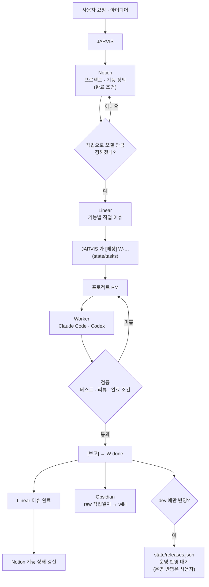
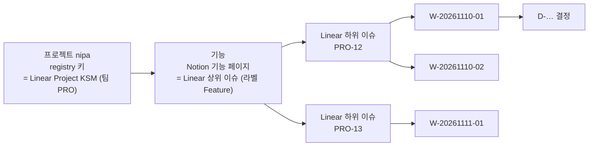
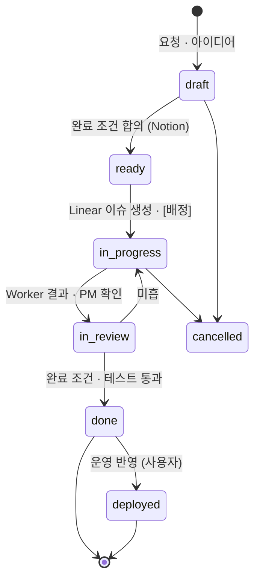

# 03. Work Lifecycle Management

> **핵심 질문:** 프로젝트·기능·작업을 어떻게 관리하고 완료할 것인가?
> **버전:** v0.2 · 2026-11-09 · 초안 (Linear API 읽기 확인)
> **관련:** [01 State & Memory](01_State_Memory_Management.md) · [02 Agent Lifecycle](02_Agent_Lifecycle_Management.md) · 원안 `Integrated_Work_Lifecycle_Management.md`(IWLM v0.1)
> **범위:** Notion · Linear · Obsidian · JARVIS state. 배포 이력(Jira)은 사용자가 수작업으로 남기며 이 문서에서 다루지 않는다.

## 1. 도구별 역할

| 도구 | 역할 | 질문 | 지금 |
|---|---|---|---|
| **Notion** | 프로젝트·기능 정의, 개인 할일·일정 | 무엇을, 왜, 어떤 완료 조건으로 | 할일 DB 사용 중(`notion-todo` 스킬, 아침 정리 schedule). 기능 정의 DB 없음 |
| **Linear** | 개발 작업 단위 | 무엇을, 어떤 순서로, 어디까지 했나 | API 읽기 확인. 워크스페이스 `smdevelopr-project`, 팀 `PRO`(이슈 8개), 프로젝트 KSM·agnetx·lxhousis. **nipa = Linear Project `KSM`** (사용자 결정 2026-11-09) |
| **JARVIS state** | PM 에게 맡긴 위임 단위(W)와 결정(D) | 지금 누가 무엇을 하고 있나 | 사용 중 |
| **Obsidian (worklog)** | 결정 배경, 해결법, 회고 | 다음에 무엇을 알아야 하나 | raw 사용 중, wiki 정리 멈춤 |

**원칙:** 같은 내용을 두 번 쓰지 않는다. 원본 하나에 쓰고 나머지에는 링크와 상태만 둔다. Obsidian 노트만 보고 작업 상태를 판정하지 않는다.

## 2. 전체 흐름



## 3. 식별자와 연결



| 단위 | 식별자 | 원본 | Linear 에서 | 관계 |
|---|---|---|---|---|
| 프로젝트 | `nipa` | `registry.yaml` | Project. registry `linear_project` 로 연결(nipa → `KSM`) | 영구 |
| 기능 | `<프로젝트>:<기능 슬러그>` | Notion 기능 페이지(정의) | 상위 이슈, 라벨 `Feature`, 설명에 Notion 링크 | 프로젝트 1 : N |
| 작업 | `PRO-n` | Linear | 하위 이슈, 라벨 `Bug`·`Improvement` 등 | 기능 1 : N |
| 위임 | `W-YYYYMMDD-NN` | `state/tasks` | 이슈 코멘트에 W-ID | 이슈 1 : N (한 이슈를 여러 번 맡길 수 있음) |
| 결정 | `D-YYYYMMDD-NN` | `state/decisions` | — | 위임 1 : N |

팀은 지금 `PRO` 하나뿐이라 프로젝트 구분은 Linear **Project** 로 한다. 이슈 키는 모두 `PRO-n` 이다. JARVIS 프로젝트 키와 Linear Project 이름이 다를 수 있으므로(nipa ↔ KSM) 이름으로 짝짓지 않고 registry 의 `linear_project` 로만 연결한다.

**연결 정보 저장 위치:** `registry.yaml` 에 넣지 않는다(실행 상태 파일이라 짧게 유지). 대신
- W 작업 파일 앞부분에 `linear: PRO-12`, `feature: nipa:anomaly-detection` 필드를 더하고
- 기능 ↔ Notion URL ↔ Linear 상위 이슈는 `state/features/<프로젝트>.yaml` 에 둔다 **(제안)**.

```yaml
# state/features/nipa.yaml (제안)
- feature_id: nipa:anomaly-detection
  notion_url: <Notion 기능 페이지>
  linear_parent: PRO-11
  linear_issues: [PRO-12, PRO-13]
  status: in_progress
```

이름이 같다고 자동으로 짝짓지 않는다. 연결은 위 필드로만 한다.

## 4. 상태 전이

### 4.1 기능·작업 단계



### 4.2 지금 상태 값과의 대응

새 상태 체계로 갈아엎지 않고, 지금 쓰는 값에 대응시킨다.

| 단계 | Notion 기능 | Linear 이슈 | JARVIS W 작업 `status` | `release` |
|---|---|---|---|---|
| draft | 초안 | Backlog | — | — |
| ready | 확정 | Todo | — | — |
| in_progress | 진행 | In Progress | `assigned` · `working` · `question` | — |
| in_review | 진행 | In Review | `working` (PM 확인 중) | — |
| done | 완료 | Done | `done` | `none` 또는 `dev_only` |
| deployed | 운영 | Done | `done` | `released` |
| cancelled | 보류 | Canceled · Duplicate | `cancelled` | — |

- Linear 상태는 팀 `PRO` 의 실제 값이다: Backlog, Todo, In Progress, In Review, Done, Canceled, Duplicate.
- `done` 과 `deployed` 는 다르다. dev 에만 반영하면 `release: dev_only` 이고 `state/releases.json` 에 대기로 남는다. 운영 반영과 배포 기록은 사용자가 한다.

## 5. 역할별 책임

| 주체 | 한다 | 하지 않는다 |
|---|---|---|
| **JARVIS** | 요청 접수, Notion 기능·할일 쓰기, Linear 이슈 만들기·닫기, PM 에게 [배정], 결정 처리, 작업일지 | 프로젝트 코드 읽기·고치기, 결과 재검증 |
| **PM** | 기능을 작업으로 나누는 **안** 제시, Worker 배치·검증, [보고] | Notion·Linear 직접 쓰기, JARVIS state 쓰기 |
| **Worker** | 맡은 작업 구현·테스트, `[완료]` 보고 | 범위 밖 작업, push·배포·삭제 |

외부 도구(Notion·Linear) 쓰기는 JARVIS 하나로 모은다. PM 이 나눈 작업 안은 `[보고]` 로 받아 JARVIS 가 Linear 에 만든다. 이렇게 하면 중복 생성과 권한 분산을 막는다. 나중에 PM 에게 Linear 쓰기를 열지는 운영해 보고 정한다.

## 6. 판단과 승인

판단 기준은 이 문서 소관이다. 실행 규칙은 `CLAUDE.md` "판단" 절과 `criteria.md`.

1. `criteria.md` 에 기준이 있으면 JARVIS 가 그대로 정하고 근거를 남긴다.
2. 아래는 **항상 사용자에게** 묻는다: git push·병합·태그 push, 운영 배포·Langflow 운영 반영, DB 데이터·스키마 변경, 서버 저장 설정 변경, 삭제·되돌리기 어려운 명령, 이미 돌린 평가 질문 재실행, 비용이 큰 일.
3. 사용자가 정하면 결정 파일(D)에 이유와 함께 남기고, 기준으로 남길지 묻는다.

## 7. 완료 기준과 증거

- 테스트·확인 근거 없이 `done` 처리하지 않는다.
- [보고] 에 "확인한 것" 과 "보고만 받은 것" 을 나눈다. JARVIS 는 이 구분을 그대로 사용자에게 전한다.
- 증거는 링크로 남긴다: 커밋·브랜치, MR/PR, 테스트 결과, 플로우 GET·DB 조회 결과, 산출 파일 경로.

## 8. 동기화 원칙

1. **출처:** 새 기능은 Notion, 새 작업은 Linear, 위임·결정은 JARVIS state, 지식은 Obsidian.
2. **링크 우선:** 원문을 복제하지 않고 제목·상태·URL·갱신 시각만.
3. **한 방향:** JARVIS state → Linear·Notion 상태 갱신 → Obsidian 요약. Notion·Linear 에서 사람이 바꾼 것은 자동으로 state 에 덮어쓰지 않고 JARVIS 가 확인 후 반영.
4. **중복 방지:** 만들기 전에 `state/features`·W 필드로 기존 이슈를 찾는다. 다시 시도할 때 같은 W-ID 를 쓴다.
5. **부분 실패:** Linear·Notion 갱신이 실패해도 W 작업은 `done` 으로 두고, 작업 파일 `## 경과` 에 실패를 적어 다음에 다시 한다.
6. **공개 범위:** 프롬프트, 토큰·비용, 내부 세션 ID 는 외부 도구에 올리지 않는다.

## 9. Linear 연결

- 연결: Linear GraphQL API(`https://api.linear.app/graphql`), 개인 API 키. JARVIS 만 쓴다(5절).
- 키 보관: 사용자 환경변수 `LINEAR_API_KEY`(설정함). 저장소·state·작업일지·문서에 쓰지 않는다.
- 프로젝트 연결: `registry.yaml` 의 `projects.<키>.linear_project`(nipa → `KSM`). 기존 이슈 8개는 그대로 둔다.
- 쓰기 동작(이슈 만들기·상태 바꾸기·코멘트)은 외부에 남는 일이므로 처음 몇 번은 사용자 확인 후 한다.
- 나중에 반복 동작이 정해지면 `skills/linear-work` 같은 스킬로 묶는다.

## 10. 결정 필요

| # | 질문 | 선택지 | 추천 |
|---|---|---|---|
| 1 | Linear 와 Notion 할일 DB 관계 | ① 개발 작업은 Linear, Notion 할일은 개인 할일·일정·루틴만 ② 둘 다 개발 작업 기록 | ① (작업 원본이 둘이 되지 않게). 확정 전까지 구현은 ① 기준, Notion 할일 흐름은 바꾸지 않음 |
| 2 | Linear 에서 기능 표현 | ① 상위 이슈 + `Feature` 라벨 ② Project Milestone | ① (이미 `Feature` 라벨 있음) |
| 3 | Notion 기능 정의 위치 | ① 프로젝트별 기능 DB 새로 ② 기존 프로젝트 페이지 아래 하위 페이지 | 파일럿 1개로 정함 |
| 4 | `state/features/` 도입 | 도입 · 보류 | 파일럿과 함께 도입 |
| 5 | 지금 Notion 할일에 들어 있는 NIPA 개발 작업 | Linear 로 옮김 · 그대로 둠 | 1 을 정한 뒤 |

## 11. 파일럿 체크리스트 (nipa)

- [ ] Notion 에 nipa 기능 1개를 완료 조건과 함께 정의
- [ ] 기능 1개를 Linear 이슈 2~3개로 나누고 W 작업과 연결
- [ ] PM 결과가 [보고] → W done → Linear Done → Notion 기능 상태로 이어짐
- [ ] PM 세션을 교체해도 W 필드의 Linear·기능 링크로 맥락이 이어짐 (02)
- [ ] 근거 없는 작업은 done 처리되지 않음
- [ ] dev 반영 작업이 `releases.json` 에 대기로 남음
