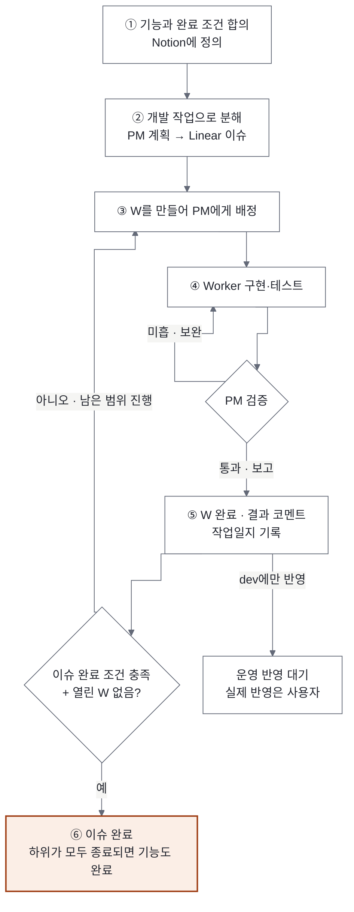
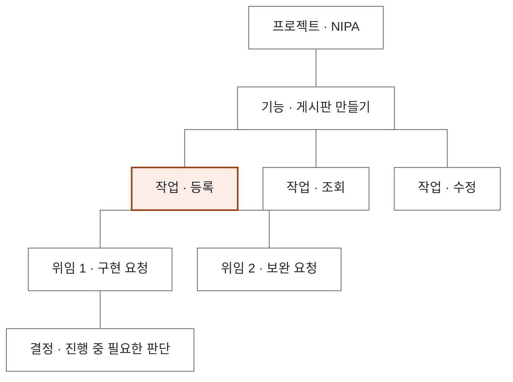
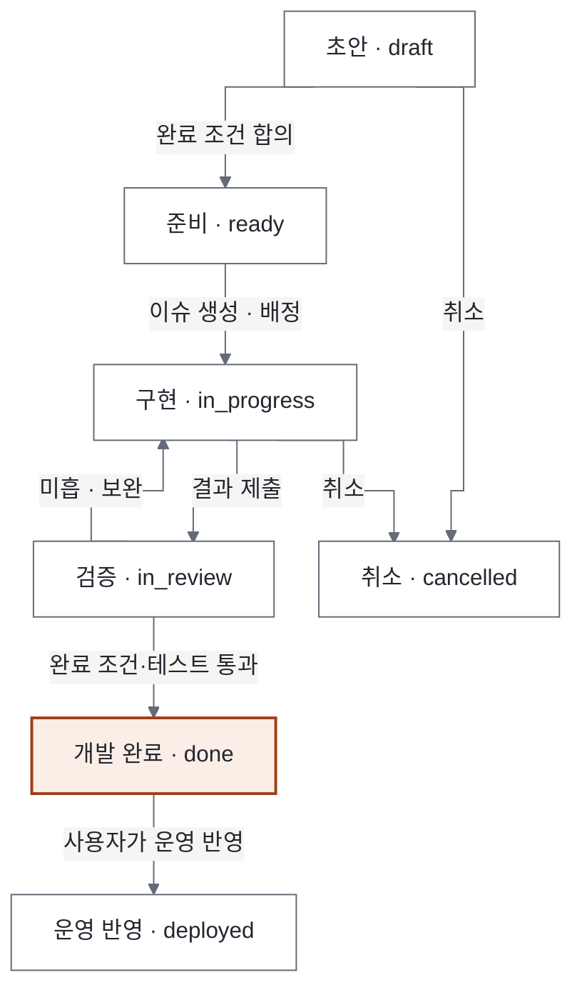

# 03. Work Lifecycle Management (업무 수명주기 관리)

> **핵심 질문:** 프로젝트·기능·작업을 어떻게 만들고, 실행하고, 완료하는가?
> **버전:** v0.4 · 2026-11-09 · 구조 재정리(정책·구현 변경 없음)
> **관련:** [01 State & Memory](01_State_Memory_Management.md) · [02 Agent Lifecycle](02_Agent_Lifecycle_Management.md) · 원안 `Integrated_Work_Lifecycle_Management.md`(IWLM v0.1, 사용자 업로드 문서로 저장소 밖)
> **범위:** Notion · Linear · Obsidian · JARVIS state. 배포 이력(Jira)은 사용자가 수작업으로 남기며 이 문서의 자동화 범위 밖이다.

## 요약

### 목적

사용자의 요청이 기능이 되고, 기능이 작업으로 나뉘고, 작업이 PM 에게 맡겨져 완료되기까지의 흐름을 정한다. 각 단계의 정보를 어느 도구에 두고, 언제 완료로 보는지가 핵심이다.

### 핵심 원칙

1. 도구마다 원본이 다르다. Notion 은 프로젝트·기능 정의, Linear 는 개발 작업, JARVIS State(`JARVIS/state/`)는 에이전트 위임과 결정, Obsidian(`projects/worklog/`)은 장기 지식이다.
2. 같은 내용을 두 번 쓰지 않는다. 원본 하나에 쓰고 나머지에는 링크와 상태만 둔다. 이름이 같다고 자동으로 짝짓지 않는다.
3. 외부 도구 쓰기는 JARVIS 하나로 모은다. PM·Worker 는 Notion·Linear 를 쓰지 않는다.
4. 완료는 증거로 판단한다. 근거 없이 `done` 처리하지 않고, W 하나가 끝났다고 이슈를 닫지 않는다.
5. `done` 과 `deployed` 는 다르다. 내부 완료와 운영 반영은 별개의 상태이며, 운영 반영은 사용자가 한다.

### 범위

이 문서는 업무 단위(프로젝트·기능·작업·위임), 상태 전이, 완료 기준, 외부 도구 동기화, 승인을 다룬다. 작업·결정 파일의 형식과 쓰기 권한은 [01](01_State_Memory_Management.md), PM 세션의 생성·교체는 [02](02_Agent_Lifecycle_Management.md) 가 정한다.

## 1. 전체 업무 수명주기



흐름은 다섯 단계다. 기능을 정의하고(Notion), PM 에게 분해안을 받아 작업을 만들고(Linear), 작업을 PM 에게 맡기고(JARVIS State), 결과를 검증해 이슈와 기능을 닫고, 배울 것을 Obsidian 에 남긴다. dev 에만 반영된 변경은 운영 반영 대기로 남는다.

## 2. 도구별 역할

| 도구 | 역할 | 답하는 질문 | 현재 |
|---|---|---|---|
| Notion | 프로젝트·기능 정의, 개인 할일·일정 | 무엇을, 왜, 어떤 완료 조건으로 | 할일 DB 사용 중(`notion-todo` 스킬, 아침 정리 schedule). 기능 정의 DB 없음 |
| Linear | 개발 작업 단위 | 무엇을, 어떤 순서로, 어디까지 했나 | 워크스페이스 `smdevelopr-project`, 팀 `PRO`, 프로젝트 KSM·agnetx·lxhousis. nipa = Linear Project `KSM` (사용자 결정 2026-11-09) |
| JARVIS State | PM 에게 맡긴 위임 단위(W)와 결정(D) | 지금 누가 무엇을 하고 있나 | 사용 중 |
| Obsidian (worklog) | 결정 배경, 해결법, 회고 | 다음에 무엇을 알아야 하나 | raw 사용 중, wiki 정리 멈춤 |
| Jira | 배포 이력 | — | 사용자 수작업. 자동화 범위 밖 |

Obsidian 노트만 보고 작업 상태를 판정하지 않는다. 상태의 원본은 Linear(작업)와 JARVIS State(위임·결정)다.

## 3. 프로젝트 → 기능 → 작업 → 위임

업무는 네 단계로 나뉜다. 위로 갈수록 오래 유지되고, 아래로 갈수록 잘게 나뉜다.



| 단위 | 식별자 | 원본 | Linear 에서 | 관계 |
|---|---|---|---|---|
| 프로젝트 | `nipa` | `registry.yaml` | Project. registry `linear_project` 로 연결(nipa → `KSM`) | 영구 |
| 기능 | `<프로젝트>:<기능 슬러그>` (예: `nipa:board`) | Notion 기능 페이지(정의) | 상위 이슈, 라벨 `Feature`, 설명에 Notion 링크 | 프로젝트 1 : N |
| 작업 | `PRO-n` (Linear Issue ID) | Linear | 하위 이슈, 라벨 `Bug`·`Improvement` 등 | 기능 1 : N |
| 위임 | `W-YYYYMMDD-NN` (W-ID) | `state/tasks` | 이슈 코멘트에 W-ID | 이슈 1 : N (한 이슈를 여러 번 맡길 수 있음) |
| 결정 | `D-YYYYMMDD-NN` | `state/decisions` | — | 위임 1 : N |

### 세 ID 의 관계

Feature ID(`nipa:board`)는 "무엇을 만드는가"를, Linear Issue ID(`PRO-10`)는 "어떤 개발 작업인가"를, W-ID 는 "그 작업을 PM 에게 몇 번째로 맡겼는가"를 가리킨다. 한 이슈가 한 번에 끝나지 않으면 W 가 여러 개 생긴다.

### 연결 규칙

팀이 `PRO` 하나뿐이라 이슈 키는 모두 `PRO-n` 이고, 프로젝트 구분은 Linear Project 로 한다. JARVIS 프로젝트 키와 Linear Project 이름이 다를 수 있으므로(nipa ↔ KSM) 이름으로 짝짓지 않고 registry 의 `linear_project` 로만 연결한다. 기능·이슈 단위 연결은 registry 에 넣지 않고 W 작업 파일의 `linear:`·`feature:` 필드에 둔다. 기능 ↔ Notion ↔ 상위 이슈를 묶는 `state/features/` 는 제안 단계이고 아직 도입하지 않았다(9.3).

## 4. 역할별 책임

| 주체 | 한다 | 하지 않는다 |
|---|---|---|
| JARVIS | 요청 접수, Notion 기능·할일 쓰기, Linear 이슈 만들기·닫기, PM 에게 [배정], 결정 처리, 작업일지 | 프로젝트 코드 읽기·고치기, 결과 재검증 |
| PM | 기능을 작업으로 나누는 안 제시(`[계획]`), Worker 배치·검증, [보고](이슈 완료 조건 포함) | Notion·Linear 직접 쓰기, JARVIS state 쓰기 (`rules/coordinator.md`) |
| Worker | 맡은 작업 구현·테스트, `[완료]` 보고 | 범위 밖 작업, push·배포·삭제 |

외부 도구 쓰기를 JARVIS 하나로 모으면 중복 생성과 권한 분산을 막을 수 있다. PM 이 나눈 작업 안은 `[계획]` 으로 받는다. `[계획]` 은 구현 전 분해안이고, `[보고]` 는 맡긴 일이 끝났다는 신호라 서로 구분한다. 나중에 PM 에게 Linear 쓰기를 열지는 운영해 보고 정한다.

## 5. 상태 전이와 완료 기준

### 5.1 기능·작업의 단계



새 상태 체계를 따로 만들지 않고, 지금 각 도구가 쓰는 값에 대응시킨다.

| 단계 | Notion 기능 | Linear 이슈 | JARVIS W 작업 `status` | `release` |
|---|---|---|---|---|
| draft | 초안 | Backlog | — | — |
| ready | 확정 | Todo | — | — |
| in_progress | 진행 | In Progress | `assigned` · `working` · `question` | — |
| in_review | 진행 | In Review | `working` (PM 확인 중) | — |
| done | 완료 | Done | `done` | `none` 또는 `dev_only` |
| deployed | 운영 | Done | `done` | `released` |
| cancelled | 보류 | Canceled · Duplicate | `cancelled` | — |

### 5.2 집계 규칙

- W `done` 은 이슈에 코멘트만 남긴다.
- 이슈 `Done` 은 PM `[보고]` 의 "이슈 완료 조건: 충족" 일 때만이다. 같은 이슈의 다른 W 가 열려 있으면 Done 으로 바꾸지 않는다.
- 상위 이슈(기능)는 하위가 모두 `Done`·`Canceled`·`Duplicate` 일 때만 Done 이다.
- W 가 `cancelled` 되면 이슈는 그대로 두고 사용자에게 다시 맡길지 묻는다.

### 5.3 `done` 과 `deployed`

`done` 은 내부 완료(완료 조건과 테스트 통과)이고, `deployed` 는 운영 반영이다. dev 에만 반영하면 `release: dev_only` 이고 `state/releases.json` 에 대기로 남는다. 운영 반영과 배포 기록(Jira)은 사용자가 한다. Linear 에서는 둘 다 `Done` 이므로, 운영 반영 여부는 `release` 필드와 `releases.json` 으로 구분한다.

### 5.4 완료 기준과 증거

- 테스트·확인 근거 없이 `done` 처리하지 않는다.
- [보고] 에 "확인한 것" 과 "보고만 받은 것" 을 나눈다. JARVIS 는 이 구분을 그대로 사용자에게 전한다.
- 증거는 링크로 남긴다: 커밋·브랜치, MR/PR, 테스트 결과, 플로우 GET·DB 조회 결과, 산출 파일 경로.

## 6. 운영 시나리오: 기능 하나를 끝내기까지

"게시판 만들기" 를 예로 든다(2026-11-09 파일럿에서 1~3 단계까지 실제로 만듦).

1. 기능 정의. 사용자가 기능을 요청하면 JARVIS 가 완료 조건을 함께 정하고 Notion 에 기능 행을 둔다. 완료 조건이 정해지지 않았으면 다음 단계로 가지 않는다.
2. 분해. 쪼개기가 필요하면 PM 에게 "작업 분해안만" 을 `[배정]` 하고 `[계획]` 을 받는다.
3. 이슈 만들기. JARVIS 가 Linear 에 상위 이슈(라벨 `Feature`, 예: PRO-9)와 하위 이슈(Create·Read·Update, 예: PRO-10~12)를 만든다. 같은 `--key` 로는 다시 만들지 않는다.
4. 구현 위임. 하위 이슈마다 `jarvisctl new-task` 로 W 작업을 만들고 `linear:`·`feature:` 를 적은 뒤 PM 에게 `[배정]` 한다. 이슈는 `In Progress` 로 바꾼다.
5. 보고와 집계. PM 의 `[보고]` 를 받으면 W 를 `done` 으로 바꾸고 이슈에 코멘트를 단다. 이슈 완료 조건이 충족됐고 그 이슈에 열린 W 가 없으면 이슈를 `Done` 으로, 하위가 모두 끝나면 상위 이슈와 Notion 기능 상태도 갱신한다.
6. 기록. 작업일지(raw)에 남기고, dev 에만 반영됐으면 운영 반영 대기에 올린다.

처음 몇 번의 Linear 쓰기(만들기·Done)는 사용자에게 확인받는다.

## 7. 외부 도구 동기화와 중복 방지

1. 출처: 새 기능은 Notion, 새 작업은 Linear, 위임·결정은 JARVIS State, 지식은 Obsidian.
2. 링크 우선: 원문을 복제하지 않고 제목·상태·URL·갱신 시각만.
3. 한 방향: JARVIS State → Linear·Notion 상태 갱신 → Obsidian 요약. Notion·Linear 에서 사람이 바꾼 것은 자동으로 state 에 덮어쓰지 않고 JARVIS 가 확인한 뒤 반영한다.
4. 중복 방지: 이슈를 만들 때 고유 키(W-ID 나 기능 ID)를 표식으로 남기고, 만들기 전에 같은 표식을 찾는다. 응답을 잃고 다시 시도해도 같은 이슈를 돌려준다. 코멘트도 같은 방식으로 중복을 막는다.
5. 부분 실패: Linear 쓰기가 실패하면 실패 목록에 남긴다. 작업 파일과 별도라 W 가 `done` 이어도 빠지지 않는다. JARVIS 가 새로 뜰 때와 하루 정리 때 다시 시도한다.
6. 공개 범위: 프롬프트, 토큰·비용, 내부 세션 ID 는 외부 도구에 올리지 않는다.

구체적인 명령(`linear.py create --key <W-ID|기능ID>`, `linear.py pending`·`retry`)과 표식 형식은 9절.

## 8. 승인과 예외 처리

판단 기준은 이 문서 소관이다. 실행 규칙은 `CLAUDE.md` "판단" 절과 `criteria.md` 에 있다.

1. `criteria.md` 에 기준이 있으면 JARVIS 가 그대로 정하고 근거를 남긴다.
2. 아래는 항상 사용자에게 묻는다: git push·병합·태그 push, 운영 배포·Langflow 운영 반영, DB 데이터·스키마 변경, 서버 저장 설정 변경, 삭제·되돌리기 어려운 명령, 이미 돌린 평가 질문 재실행, 비용이 큰 일.
3. 사용자가 정하면 결정 파일(D)에 이유와 함께 남기고(`jarvisctl decide`, 01), 기준으로 남길지 묻는다.

| 예외 | 처리 |
|---|---|
| 완료 조건이 정해지지 않은 기능 요청 | 사용자와 먼저 정한다 |
| W 가 `cancelled` | 이슈는 그대로 두고 다시 맡길지 사용자에게 묻는다 |
| Linear 쓰기 실패 | 실패 목록에 남기고 다시 시도(7절) |
| 그 사이 이슈 상태가 바뀜 | 되돌리지 않고 충돌로 남긴다(9.2) |
| Notion·Linear 에서 사람이 직접 바꿈 | 자동 반영하지 않고 JARVIS 가 확인 후 반영 |

## 9. 기술 구현 명세

### 9.1 Linear 연결

- API: Linear GraphQL API(`https://api.linear.app/graphql`), 개인 API 키. JARVIS 만 쓴다.
- 키 보관: 사용자 환경변수 `LINEAR_API_KEY`(설정함). 저장소·state·작업일지·문서에 쓰지 않는다. 사용자 환경변수라 기술적으로는 모든 세션이 읽을 수 있으므로 접근 제한은 규칙(`rules/`)으로 하고, 강제가 필요해지면 키를 JARVIS 만 읽는 위치로 옮긴다.
- 프로젝트 연결: `registry.yaml` 의 `projects.<키>.linear_project`(nipa → `KSM`). 기존 이슈는 그대로 둔다.
- 팀 `PRO` 의 상태 값: Backlog, Todo, In Progress, In Review, Done, Canceled, Duplicate. 라벨: Bug, Feature, Improvement.

### 9.2 `scripts/linear.py`

| 명령 | 하는 일 |
|---|---|
| `projects` | Linear Project 와 연결된 JARVIS 프로젝트 |
| `issues <프로젝트>` [`--state`] | 그 프로젝트 이슈 목록 |
| `get PRO-n` | 이슈 하나(하위 이슈 포함) |
| `create <프로젝트> --title … --key <W-ID·기능ID>` [`--parent PRO-n`] [`--label Feature`] [`--state Todo`] | 이슈 만들기. 설명 끝에 `<!-- jarvis:key=… -->` 표식을 넣고, 같은 표식이 있으면 그 이슈를 돌려줌 |
| `state PRO-n "<상태>"` [`--expect-from`] | 상태 바꾸기. 바꾸기 전 상태를 기억해, 다시 시도할 때 그 사이 바뀌었으면 되돌리지 않고 충돌로 남김 |
| `comment PRO-n "<글>"` [`--key`] | 코멘트. `--key` 가 같으면 다시 달지 않음 |
| `pending` · `retry` | 실패한 쓰기 목록과 재시도. retry 는 항목을 하나씩 토큰으로 예약하고, 토큰이 그대로일 때만 결과를 반영 |

쓰기 명령은 `--dry-run` 으로 보낼 내용만 볼 수 있다. 실패한 쓰기는 `state/linear_pending.jsonl` 에 항목 ID 와 함께 남는다. 같은 키의 동시 생성은 잠금으로 직렬화한다.

### 9.3 연결 정보 저장

- W 작업 파일 앞부분: `linear: PRO-10`, `feature: nipa:board`
- 기능 ↔ Notion URL ↔ Linear 상위 이슈: `state/features/<프로젝트>.yaml` (제안, 아직 도입 안 함)

```yaml
# state/features/nipa.yaml (제안)
- feature_id: nipa:board
  notion_url: <Notion 기능 행>
  linear_parent: PRO-9
  linear_issues: [PRO-10, PRO-11, PRO-12]
  status: in_progress   # 복사본. 원본은 Linear 이슈 상태, JARVIS 가 갱신
```

## 10. 파일럿과 미결정 사항

### 10.1 파일럿 (nipa)

- [x] Notion 에 nipa 기능 1개 정의: "게시판 만들기" 행(할일 DB, 본문에 이슈 제목만), 2026-11-09
- [x] 기능 1개를 Linear 이슈 2~3개로 나눔: PRO-9 아래 PRO-10·11·12(Create·Read·Update)
- [ ] 하위 이슈를 W 작업과 연결해 PM 에게 맡김
- [ ] PM 결과가 [보고] → W done → Linear Done → Notion 기능 상태로 이어짐
- [ ] PM 세션을 교체해도 W 필드의 Linear·기능 링크로 맥락이 이어짐 (02)
- [ ] 근거 없는 작업은 done 처리되지 않음
- [ ] dev 반영 작업이 `releases.json` 에 대기로 남음

### 10.2 결정 사항

| # | 질문 | 상태 |
|---|---|---|
| 1 | Linear 와 Notion 할일 DB 의 관계 | 결정 대기(D-20261109-03). 추천: 개발 작업은 Linear, Notion 할일은 개인 할일·일정·루틴만. 확정 전까지 구현은 이 기준, Notion 할일 흐름은 바꾸지 않음 |
| 2 | Linear 에서 기능 표현 | 결정됨(D-20261109-06): 상위 이슈 + `Feature` 라벨, 그 아래 작업 하위 이슈 |
| 3 | Notion 기능 정의 위치 | 결정됨(D-20261109-06): Notion 은 기능 단위. 파일럿은 할일 DB 의 기능 행에 이슈 제목만 둠. 별도 기능 DB 를 둘지는 확인 필요 |
| 4 | `state/features/` 도입 | 미결정. 추천: 파일럿과 함께 도입 |
| 5 | 지금 Notion 할일에 있는 NIPA 개발 작업을 Linear 로 옮길지 | 1 을 정한 뒤 |
