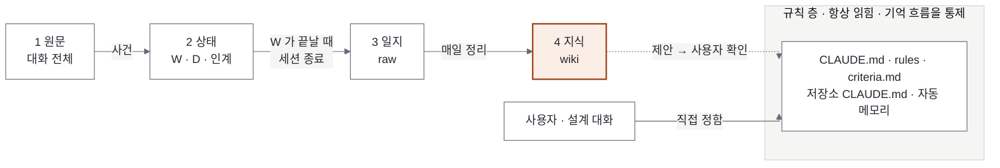

# 04. 기억 구조 (기억 4단계 + 규칙 층)

> **핵심 질문:** 세션이 바뀌고 창이 닫혀도, 무엇이 어디에 남고 다음 세션은 무엇을 읽는가?
> **버전:** v0.2 초안 · 2026-11-09 · 사용자와 JARVIS 가 대화로 정한 구조(v0.2: 규칙을 기억 단계에서 떼어 규칙 층으로)
> **상태:** 구조는 정해졌고 구현은 아직이다(10절). 기존 01·02·03 은 고치지 않았고, 이 문서와 다른 점은 11절에 모았다.

## 요약

기억은 네 단계로 나눈다. 한 단계는 한 장소에 있고, 기록은 앞 단계에서 뒤 단계로만 올라간다. 단계마다 올리는 계기가 하나씩 정해져 있다.

규칙(어떻게 행동하나)은 기억(무엇이 있었고 무엇을 배웠나)과 따로 둔다. 규칙은 기억 흐름의 끝이 아니라 그 흐름을 통제하는 층이고, 대부분 설계 대화로 직접 정한다. 지식은 규칙을 바꾸지 못하고 제안만 한다. 정하는 것은 사용자다.



기억은 뒤로 갈수록 작아지고, 추상적이 되고, 오래 간다. 원문은 가장 크고 30일 뒤 지워진다. 규칙은 가장 짧고 세션이 뜰 때마다 읽힌다.

## 1. 왜 바꾸나

2026-11-09 에 확인한 실제 상태다.

| 문제 | 실제 |
|---|---|
| 지식이 쓰이기만 하고 읽히지 않는다 | 새 세션이 Obsidian 을 읽는 장치(훅·스킬)가 없다 |
| 위키 정리가 멈췄다 | `wiki/log.md` 마지막 정리 2026-11-01. 사용자가 요청할 때만 돈다 |
| JARVIS 인계 노트가 한 번도 쓰이지 않았다 | `state/handoff/manager/` 가 비어 있다. "창을 옮길 때" 만 쓰게 되어 있었다 |
| 작업 단위가 모호하다 | "의미 있는 작업 단위" 를 에이전트가 판단해, 같은 날에도 일지에 남는 창과 안 남는 창이 있다 |
| 자동 메모리가 관리되지 않는다 | nipa 폴더 107건(프로젝트 사실 83, 일하는 방식 18, 참조 5). 01 문서에 언급이 없고 정리하는 쪽이 없다 |
| 판단 기준이 비어 있다 | `criteria.md` "(아직 없음)" |
| 원문이 사라진다 | Claude 대화 원문은 기본 30일 뒤 삭제(`cleanupPeriodDays` 미설정) |

## 2. 기억 4단계와 규칙 층

| 단계 | 장소 | 담는 것 | 다음 단계로 올리는 계기 | 읽히는 때 | 수명 |
|---|---|---|---|---|---|
| 1 원문 | `~/.claude/projects/<폴더>/*.jsonl`, `~/.codex/sessions/`, `~/.paseo/agents/` | 대화 전체, 에이전트 메타 정보 | 훅·`jarvisctl` 이 사건을 뽑아 상태로 | 빠진 정리를 복구할 때만 | Claude 30일, Codex 무기한 |
| 2 상태 | `JARVIS/state/`, `JARVIS/registry.yaml` | 지금 진행 중인 사실: W, D, 인계 노트, 세션 이벤트, 점유, 운영 반영 대기 | W 가 끝날 때 일지 한 건. 세션 종료 때 빠진 것 채움 | 자동화 판단, 세션 시작 | 끝나면 이력으로 남김(지우지 않음) |
| 3 일지 | `projects/worklog/raw/YYYY-MM-DD.md` (OneDrive) | 끝난 일, 정한 것과 이유. 건마다 W·D 번호 | 매일 정리가 지식으로 | 정리할 때, 검색 | 영구. 덧붙이기만 |
| 4 지식 | `projects/worklog/wiki/` | 프로젝트별 개요·결정·해결법, 목차 | (끝). 규칙 층에 제안만 한다 | 시작 때 목차 요약, 질문 때 검색 | 영구. 정리 때 갱신 |

| 규칙 층 | 장소 | 담는 것 | 들어오는 길 | 읽히는 때 | 관리 |
|---|---|---|---|---|---|
| 규칙 | `JARVIS/CLAUDE.md`·`rules/`·`criteria.md`, 프로젝트 저장소 `CLAUDE.md`, Claude 자동 메모리 | 행동을 바꾸는 짧은 문장: 판단 기준, 일하는 방식, 기억 흐름 자체의 규칙 | 설계 대화로 직접 / 지식의 제안을 사용자가 승인 | 항상 | git 버전 관리(자동 메모리 제외). 사용자가 바꿀 때까지 |

지켜야 할 것은 셋이다.

- 한 단계는 한 장소다. 같은 정보를 두 단계에 원본으로 두지 않는다.
- 앞으로만 흐른다. 위키를 고쳐서 상태를 바꾸지 않는다.
- 건너뛰지 않는다. 대화에서 곧바로 지식으로 가지 않는다.
- 지식은 규칙을 바꾸지 못한다. 후보를 제안하고, 사용자가 정한다(4.5).

## 3. 용어

### 3.1 W: 작업 카드

`state/tasks/W-YYYYMMDD-NN.md`. 맡긴 일 하나의 진행 기록이다. 사용자가 일을 시키면 JARVIS 가 `jarvisctl new-task <프로젝트>` 로 만든다(번호는 잠금 안에서 발급). JARVIS 가 직접 하는 일도 `jarvis` 프로젝트로 W 를 만든다.

| 칸 | 뜻 |
|---|---|
| `project` | 어느 프로젝트 일인가 |
| `status` | `assigned` 배정 → `working` 진행 → `question` 판단 대기 → `done` 끝 / `cancelled` 취소 |
| `jarvis` · `coordinator` · `workers` | 맡긴 JARVIS 창, 받은 PM, PM 이 띄운 Worker |
| `verified` | `confirmed` PM 이 직접 확인 / `reported` 보고만 받음 |
| `release` | 운영 반영이 남았나 |
| 본문 | 요청 원문, 마지막 `[보고]`, 시간 순 경과 |

### 3.2 D: 결정 카드

`state/decisions/D-YYYYMMDD-NN.md`. 정해야 했던 판단 하나의 기록이다. PM 의 `[질문]`, 또는 JARVIS 운영 판단(`jarvis` 프로젝트)에서 `jarvisctl new-decision` 으로 만들고 `jarvisctl decide` 로 확정한다. 지우지 않는다.

| 칸 | 뜻 |
|---|---|
| `status` | `open` 지금 정할 것 / `waiting` 미룸 / `decided` 정해짐 / `dropped` 필요 없어짐 |
| `options` · `recommended` | 선택지와 JARVIS 추천 |
| `decided_by` | `user` 사용자 / `criteria` 기준으로 |
| 본문 | 질문, 결정과 이유 |

W 와 D 는 2단계(상태)의 중심이다. W 가 끝나면 일지로 가고, 오래 남길 D 는 위키 결정 노트가 된다. 같은 방향의 D 가 반복되면 규칙 층에 기준으로 제안된다.

### 3.3 그 밖의 용어

| 용어 | 뜻 | 단계 |
|---|---|---|
| 인계 노트 | 세션이 바뀔 때 다음 세션이 이어 가는 데 필요한 열린 일만 적은 노트. `state/handoff/<manager·프로젝트>/latest.md` | 2 |
| 일지 | 작업 단위마다 4~5줄로 남긴 기록. 폴더 이름은 `raw` 지만 대화 원문이 아니다 | 3 |
| 위키 | 일지를 주제별로 정리한 노트. Karpathy 의 LLM Wiki 방식(원자료 `raw/`, 정리본 `wiki/`, 목차 `index.md`, 이력 `log.md`, 규칙 `AGENTS.md`) | 4 |
| 자동 메모리 | Claude Code 가 작업 폴더마다 `~/.claude/projects/<폴더>/memory/` 에 두고 그 폴더 세션이 매번 읽는 메모. claude-mem 과는 다르다(claude-mem 은 설치돼 있지 않음) | 규칙 층 |
| 판단 기준 | 사용자가 "기준으로 남겨" 라고 한 것. JARVIS 가 사용자 대신 정할 때 근거 | 규칙 층 |

## 4. 단계별 규칙

### 4.1 원문

에이전트가 쓰지 않는다. Paseo 의 보관(archive)은 지우는 것이 아니라 숨기는 것이라, 보관해도 메타 정보와 대화 원문이 남고 Unarchive 로 되살릴 수 있다. Claude 원문만 30일 뒤 지워진다.

### 4.2 상태

- 쓰는 쪽: `jarvisctl`(겹치면 안 되는 쓰기), 훅, JARVIS 창.
- 프로젝트별 폴더로 나누지 않는다. 파일마다 `project` 칸이 있다. 인계 노트만 `handoff/<프로젝트>/` 로 나뉜다.
- `sessions.jsonl` 에 실제로 쌓이는 이벤트: `closed`(`agent_guard` 가 archive·kill 직후, `pm_reconcile` 이 사용자가 Paseo 에서 닫은 현재 PM 을 발견했을 때), `session_end`(PM 쪽 SessionEnd 훅, 보관 때는 안 불릴 수 있음), `rotation`(`jarvisctl switch`), `jarvis_claim`. `closed` 에는 `closed_by`(`jarvis`·`pm`·`unknown`)와 `how`(`archive`·`kill`)가 붙는다.
- 백업하지 않는다(D-20261109-04). 남길 가치가 있는 것은 일지와 위키로 올라가기 때문이다.

### 4.3 일지

- 작업 단위는 W 하나다. W 가 `done`·`cancelled` 가 되면 일지에 한 건 남긴다. 질문(`ask`)처럼 단순 질의응답은 W 를 만들어도 일지에 남기지 않는다.
- 한 건의 형식은 지금 그대로다(`worklog.ps1`). 머리말에 W 번호를, 결정이 있으면 D 번호를 적는다.

  ```
  ### 14:23 | Claude | nipa | 완료 | ksm-odw-analysis 자체 검토 (W-20261109-02)
  - 결과: …
  - 확인: …
  - 다음: …
  - 결정: … (D-…)
  ```

- 일지 밖에서 생긴 지식(인계 노트의 "최근 정한 것", 사용자의 "기억해")은 세션 종료 때 일지에 한 줄로 넣는다. 그래서 정리 작업은 일지만 보면 된다.
- 프로젝트별로 나누지 않는다. 날짜별 한 파일에 덧붙이고, 머리말의 프로젝트 칸으로 걸러 본다.

### 4.4 지식

프로젝트별로 나누는 유일한 단계다. 지식은 프로젝트 단위로 읽히기 때문이다.

```text
worklog/wiki/
├── index.md            # 모든 노트를 한 줄 설명과 함께. 프로젝트별, 최근 결정 순
├── log.md              # 정리 이력: 언제, 어느 일지 범위를, 어느 노트에 반영했나
├── 공통/               # JARVIS 운영, 여러 프로젝트에 걸친 것
│   ├── 개요.md
│   ├── decisions/
│   └── 해결법/
└── <프로젝트>/          # nipa, odw-analysis, …
    ├── 개요.md
    ├── decisions/날짜-주제.md
    └── 해결법/주제.md
```

| 종류 | 내용 | 갱신 |
|---|---|---|
| 개요 | 목표, 지금 단계, 구성(시스템·저장소), 반복되는 문제, 주의점, 주요 결정 링크. 한 화면 안. 누가 무엇을 하는지 같은 지금 상태는 넣지 않는다(상태는 대시보드에서 본다) | 정리 때마다 고쳐 씀 |
| 결정 | 맥락 → 선택지 → 결정 → 이유 → 그 뒤 결과. D 번호와 일지 링크 | 결정 하나에 노트 하나. 뒤집히면 새 노트를 만들고 서로 링크 |
| 해결법 | 증상 → 원인 → 해결 → 확인 방법. 일지 링크 | 같은 문제가 또 나오면 덧붙임 |
| 목차 | 노트 한 줄씩 | 정리 때마다 |

- 노트 머리에 종류, 프로젝트, 갱신일, 출처(일지·W·D)를 둔다.
- 새 노트를 만들기 전에 같은 주제의 노트를 찾아 고친다.
- 원본(일지·상태)에 없는 이유를 추측해 쓰지 않는다. 확인되지 않으면 `확인 필요` 로 둔다.

**정리 작업**(일지 → 지식): `wiki-curator` 가 맡는다.

- 입력: `log.md` 이후의 일지. 일지의 W·D 번호를 따라가 상태 파일에서 요청·보고·선택지·이유를 확인한다.
- 출력: 위키 노트, `index.md`, `log.md` 한 줄, 규칙 제안 목록(4.5).
- 주기: 매일 아침 schedule. 같은 범위는 두 번 반영하지 않는다(`log.md` 범위로 이어 감).
- 점검(주 1회): 서로 모순되는 노트, 오래 안 고친 개요, 끊긴 링크, 고아 노트를 찾아 보고한다.

### 4.5 규칙 층

규칙은 기억 단계가 아니다. 1~4단계가 어떻게 도는지(작업 단위, 세션 종료, 정리 주기)도 규칙이 정한다.

| 규칙 종류 | 자리 | 고치는 쪽 |
|---|---|---|
| JARVIS 운영 규칙, 기억 흐름 규칙 | `JARVIS/CLAUDE.md`, `rules/`, `docs/` | JARVIS(사용자와 설계 대화 뒤) |
| JARVIS 가 사용자 대신 정할 때의 기준 | `JARVIS/criteria.md` | JARVIS(사용자 승인 뒤) |
| 그 프로젝트 전체가 지킬 규칙 | 프로젝트 저장소 `CLAUDE.md` | PM(JARVIS 가 `[배정]`. 프로젝트 파일은 JARVIS 가 직접 고치지 않음) |
| 그 폴더에서 일하는 방식 | 자동 메모리(`feedback`·`reference`) | 그 폴더 세션 |

들어오는 길은 둘이다.

1. 직접 설계: 사용자와 대화로 정하고 해당 파일을 고친다. git 으로 남고, 일지에도 한 줄 남긴다. 사용자가 대화 중에 "기억해", "기준으로 남겨" 라고 하는 것도 여기에 속한다.
2. 지식의 제안: 정리 작업이 위키를 정리하다 후보를 찾아 보고 끝에 붙인다. 후보는 같은 방향의 D 가 두 번 이상 나온 것, 일지 "결정" 에 사용자가 "앞으로는", "항상" 처럼 일반 원칙으로 말한 것, 같은 해결법이 두 번 이상 쓰인 것이다. 형식은 `제안: <한 줄 규칙> → <자리> / 근거: D-…, 일지 링크 / 반복 n회`. JARVIS 가 "기준으로 남길까요?" 라고 묻고, 승인된 것만 반영한 뒤 일지에 `규칙 추가: … (근거 …)` 를 남긴다.

- 지식은 규칙을 직접 바꾸지 않는다. 늘 읽히는 규칙이 잘못 들어가면 같은 실수가 반복되고, 늘 컨텍스트를 차지하기 때문이다.
- 자동 메모리는 일하는 방식만 담는다. 프로젝트 사실은 낡으므로 일지를 거쳐 위키로 간다.
- 자동 메모리는 작업 폴더별이라 하위 폴더 Worker(예: `projects/nipa/ksm-odw-analysis`)는 상위 폴더 메모리를 읽지 못한다. 프로젝트 전체 규칙을 저장소 `CLAUDE.md` 에 두는 이유다.
- 규칙이 맞지 않게 되면 사용자가 바꾸거나 지운다. 주 1회 점검에서 근거가 된 결정이 뒤집힌 규칙을 찾아 알린다.

## 5. 언제 무엇이 일어나나

| 계기 | 하는 일 | 남는 곳 |
|---|---|---|
| 사용자가 일을 시킴 | W 생성 | 2 |
| PM 의 `[질문]`, JARVIS 운영 판단 | D 생성, 기준이나 사용자로 확정 | 2 |
| W 가 `done`·`cancelled` | 일지 한 건(W·D 번호) | 3 |
| 사용자가 "세션 종료" | 일지 빈칸 채움, 인계 노트, 기준, 닫기(6절) | 2·3·규칙 |
| PM 교체 | PM 인계 노트 | 2 |
| 매일 아침 | 정리 작업 | 4, 규칙 제안 |
| 주 1회 | 위키 점검 | 보고 |
| 사용자가 "기억해"·"기준으로", 설계 대화로 규칙을 정함 | 규칙 층에 바로 + 일지 한 줄 | 규칙·3 |
| 사용자가 규칙 제안을 승인 | 규칙 층에 반영 + 일지 한 줄 | 규칙·3 |
| 사용자가 Paseo 보관 버튼으로 바로 닫음 | 아무것도 남기지 않음 | (없음) |

## 6. 세션 종료와 인계 노트

### 6.1 세션 종료

영구 지식은 사용자가 그 창에 "세션 종료"(또는 "창 닫자", "마무리하고 닫아")라고 할 때만 남긴다. 보관 버튼은 세션을 즉시 멈추고, Paseo 플러그인 훅에는 보관 뒤 이벤트(`agent.archive.after`, 기다리지 않음)만 있고 보관 전 이벤트가 없다. 그래서 정리는 반드시 닫기 전에 한다.

1. 일지: 이 창에서 끝낸 W 중 일지에 없는 것, 정한 것과 이유, "기억해" 를 남긴다. 열린 W 는 끝내거나 인계 노트로 넘긴다.
2. 인계 노트: 6.2 형식으로 `jarvisctl handoff manager <파일>`.
3. 기준: 사용자가 동의한 것을 `criteria.md` 에.
4. 남긴 것을 사용자에게 세 줄로 알린다.
5. 닫기: 기본 수신자가 아니면 `archive_agent` 로 자기 보관. 기본 수신자면 훅이 자기 보관을 막으므로 `transfer-jarvis --to next` 를 하고 사용자가 보관 버튼을 누른다. 새 창이 `claim-jarvis` 한다.

### 6.2 인계 노트

| | JARVIS | PM |
|---|---|---|
| 쓰는 때 | 세션 종료 | PM 교체(컨텍스트 20만 초과 → `[인계요청]` → `[인계노트]`) |
| 쓰는 쪽 | 그 JARVIS 창 | PM 이 보내고 JARVIS 가 파일로 |
| 쓰지 못할 때 | 보관 버튼으로 바로 닫음 | PM 이 갑자기 죽음 → 새 PM 이 상태와 Worker 결과로 이어 감 |

- 열린 일만 쓴다: 답을 기다리는 질문, 미룬 결정, 진행 중인 W 의 다음 행동, 운영 반영 대기, 커밋 안 한 변경, 주의할 점.
- 끝난 일은 쓰지 않는다(일지의 몫). 다음 행동에 영향을 줄 때만 짧게 적는다.
- 60줄 이하. 상태 파일에 있는 것은 경로만.
- JARVIS 창이 여러 개면 덮어쓰지 않고 합친다: 지금 `latest.md` 에서 아직 유효한 항목을 옮겨 적은 뒤 새로 쓴다(이전 노트는 시각 이름으로 남는다).

## 7. 새 세션이 읽는 것

내용이 아니라 지도를 준다. 처음에는 무엇이 있는지만 짧게 넣고, 내용은 필요할 때 찾는다.

| 세션 | 시작 때 자동으로 넣는 것(중요한 순) | 분량 |
|---|---|---|
| JARVIS 창 | 인계 노트 → 열린 W·D → `criteria.md` → 최근 결정 제목 5개, 위키 밀림 경고 | 30줄 안 |
| PM | 그 프로젝트 인계 노트 → 열린 W → `개요.md` → 그 프로젝트 결정·해결법 제목 목록 | 40줄 안 |
| Worker | 넣지 않음. PM 지시와 저장소 `CLAUDE.md` | — |

그 밖에는 기억 찾기 스킬로 찾는다. 순서는 `criteria.md` → 위키(결정 → 해결법 → 개요) → 일지 → 원문(30일 안)이고, 답에 출처 링크를 단다. 지금은 Grep 으로 찾고, 노트가 늘면 로컬 검색 엔진 qmd(키워드 + 의미 검색, MCP 제공)를 시험한다.

## 8. 프로젝트별로 나누는 기준

| 단계 | 나누나 | 이유 |
|---|---|---|
| 1 원문 | 이미 나뉨 | 작업 폴더별로 쌓인다 |
| 2 상태 | 나누지 않음 | `project` 칸으로 거른다. 폴더를 나누면 번호 발급과 잠금이 복잡해진다 |
| 3 일지 | 나누지 않음 | 날짜별 한 파일에 덧붙이는 것이 장점이다. 하루에 여러 프로젝트를 오간다 |
| 4 지식 | 나눔 | 프로젝트별로 읽힌다(PM 주입, 검색 범위) |
| 규칙 층 | 이미 나뉨 | 저장소 `CLAUDE.md`·자동 메모리는 폴더별, `criteria.md`·`rules/` 는 공통 |

## 9. 보존과 한계

- 원문: Claude 30일. 늘릴지는 정하지 않았다(nipa 폴더만 817MB).
- 상태: git·백업 밖. PC 가 망가지면 진행 중인 사실은 잃는다. 끝난 일은 일지에 있다.
- 일지·위키: OneDrive 동기화. 일지는 `worklog.ps1` 이 파일 잠금으로 덧붙인다.
- "세션 종료" 없이 닫은 창의 지식은 남지 않는다. 원문이 30일 안에 있으면 "그 창 정리해 줘" 로 복구할 수 있다.
- 정리 작업은 LLM 이 요약하므로 틀릴 수 있다. 원본 링크를 반드시 달고, 규칙으로 올릴 때는 사용자가 확인한다.

## 10. 구현 계획

| 순서 | 할 일 | 바뀌는 곳 | 상태 |
|---|---|---|---|
| A1 | 미커밋 변경 정리(이 창 변경과 다른 창 변경 분리) | git | 할 일 |
| A2 | 이 구조의 결정 D(`jarvis`)와 구현 W(`jarvis`) 생성 | `state/` | 완료(D-20261109-11, W-20261109-05) |
| B1 | 작업 단위 = W, 일지에 W·D 번호 | `CLAUDE.md`, `projects/AGENTS.md`, `worklog.ps1`(`-Task`·`-Decision`) | 완료 |
| B2 | W 상태 변경과 닫을 때 일지 기록(`jarvisctl task … --worklog`), `jarvis` 자기 프로젝트 | `scripts/jarvisctl.py` | 완료(테스트) |
| B3 | 세션 종료 보완(일지 한 줄, 열린 W 점검), 인계 노트 합치기 점검(`handoff` 의 `stale`·`dropped_open`), PM 인계노트 기준 | `CLAUDE.md`, `jarvisctl.py`, `rules/coordinator.md` | 완료(테스트) |
| C1 | 위키 형식과 정리 지침, 규칙 제안 | `worklog/AGENTS.md`, `wiki-curator` | 완료 |
| C2 | 지금 위키를 새 폴더로 옮기기, AO 실험 노트 삭제(사용자 승인) | `worklog/wiki/` | 완료(백업 `%TEMP%/claude_patch/wiki-backup-20261109`) |
| C3 | 밀린 정리 한 번(11-01 ~) | `worklog/wiki/` | 완료(새 노트: 개요 4, 결정 11, 해결법 7) |
| C4 | 매일 정리·주 1회 점검 schedule | Paseo schedule | 완료(07:00 매일, 월 07:05 점검. 밀린 9일 정리가 Sonnet 약 20만 토큰·9분) |
| E1 | 시작 때 주입 훅 | `hooks/session_context.py` | 완료(테스트, 새 세션 확인 필요) |
| E2 | 기억 찾기 스킬 | `skills/recall`, `scripts/recall.py` | 완료 |
| D1 | 규칙 제안 흐름(지식 → 사용자 확인 → 규칙 층), 자동 메모리 범위 | `CLAUDE.md`, 공통 규칙, `wiki-curator` | 완료(규칙 문장) |
| D2 | nipa 자동 메모리 107건 분류·이동 | 자동 메모리, 위키, nipa `CLAUDE.md` | 할 일(분류표 승인 후) |
| F1 | qmd 시범 | — | 나중 |
| F2 | 원문 보관 기간 | `~/.claude/settings.json` | 나중(결정 필요) |
| G | 기존 문서 맞추기(11절) | `docs/01·02·03`, README, `rules/` | 일부(01·02·CLAUDE·rules·공통 규칙 완료, 11절 남은 것) |

순서는 A → B → C → E → D → (며칠 운영) → G.

## 11. 기존 문서와 다른 점 (나중에 맞출 곳)

2026-11-09 맞춤 완료: `docs/01`(겹치는 절은 이 문서로 연결), `docs/02` 5.2·6절·8절, `CLAUDE.md`, `rules/coordinator.md`, 공통 `projects/AGENTS.md`, `worklog/AGENTS.md`, `wiki-curator`. 남은 것: `docs/02` 7절 훅 표(시작 주입 내용), `docs/03`(다른 창 작업 중이라 보류), `README.md`·`docs/README.md`, `docs/01` 그림 두 장(`state-storage`·`state-memory`, 오전 구조 기준) 다시 그리기. 아래 표는 처음 적은 목록이다.

| 문서 | 다른 점 |
|---|---|
| `docs/01` 1절 | State·Memory·Handoff 세 개념 → 이 문서의 기억 4단계와 규칙 층. W·D 설명 없음 |
| `docs/01` 2·3절 | 자동 메모리가 없음. 지식 자리가 여러 곳으로 나뉨 |
| `docs/01` 4절, 7.1 | 작업일지 계기가 "작업 단위" → W 가 끝날 때 |
| `docs/01` 5절 | 정리는 "사용자가 요청할 때" → 매일 정리, 점검, 승격, 시작 주입, 검색 |
| `docs/01` 7.3 | 시작 때 읽는 것 → 7절 |
| `docs/01` 8.1 | 위키 트리(`projects/`, `decisions/`) → 프로젝트별 폴더 |
| `docs/01` 8.4 | 인계 노트 쓰는 때(창을 옮길 때) → 세션 종료. 열린 일만, 여러 창 합치기 |
| `docs/01` 8.5 | `sessions.jsonl` 예시의 `closed_by: "user"`, `source: "paseo:…"` 는 실제와 다름. `how` 칸 없음 |
| `docs/01` 9절 | 백업은 "결정 대기" → 정해짐(③). 위키 정리 날짜 |
| `docs/02` 5·6절 | PM 인계·세션 종료 절차 중 노트 내용 규칙은 이 문서 6.2 로 |
| `docs/02` 7절 | 시작 주입 내용 추가 |
| `docs/03` | "⑤ W 완료 · 작업일지 기록" → W 닫기. 도구 표의 위키 상태 |
| `CLAUDE.md` 기록 절 | 지식 자리 표 → 기억 4단계 + 규칙 층 |
| `rules/coordinator.md` | 인계노트는 열린 일만, 새로 떴을 때 주입 내용 |
| `projects/AGENTS.md`, `worklog/AGENTS.md`, `wiki-curator` | 작업일지 계기, 위키 형식, 정리 주기 |
| `README.md`, `docs/README.md` | 지식 자리 설명, 문서 목록 |

## 12. 정할 것

| 항목 | 선택지 |
|---|---|
| Paseo 보관 기록 플러그인 | D-20261109-02 에서 보류로 정함. 이 구조에서도 필요 없다고 본다(세션 종료한 창만 지식을 남기므로). 바꿀 이유가 생기면 새 D 로 |
| 매일 정리 자동 실행 | 매일 토큰이 든다. 처음 3일은 결과를 사용자가 확인 |
| 원문 보관 기간 | 30일 유지 / 90일 등으로 늘림 |
| qmd 도입 | 노트가 늘고 한국어 의미 검색이 필요할 때 시험 |
