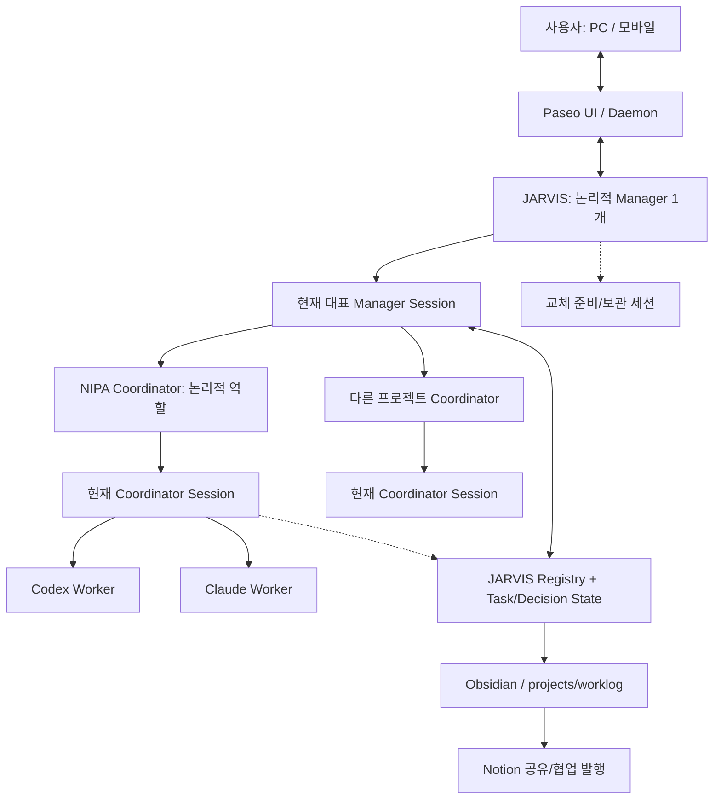
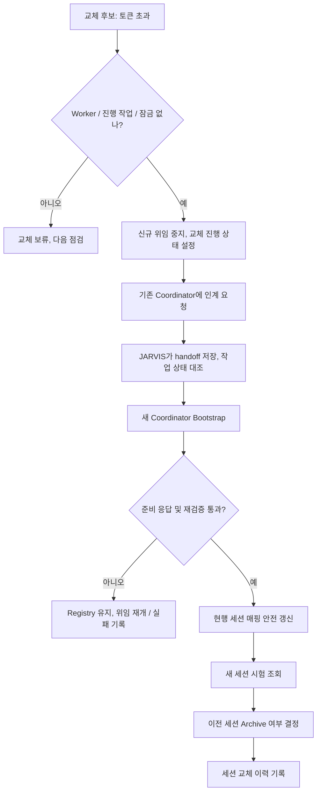

# JARVIS Agent Lifecycle & Persistence Policy

> **문서 성격:** Paseo 기반 JARVIS의 에이전트 운영 정책 및 단계별 구현 설계안  
> **작성일:** 2026-11-09  
> **상태:** 설계 초안 — 2026-11-09 JARVIS 실제 파일·Paseo 0.15.2·설치 플러그인과 대조해 사실 부분을 고침(16절 "대조 결과")  
> **대상:** Manager(JARVIS), 프로젝트별 Coordinator, Coding Workers  
> **최우선 원칙:** **논리적 에이전트는 지속시키고, 실행 세션은 교체 가능하게 하며, 중요한 상태는 세션 외부에 보존한다.**

---

## 1. 결정 요약

1. **논리적 Manager는 JARVIS 하나다.** 그러나 Claude/Paseo 대화 세션은 여러 개 존재할 수 있다. **활성 운영 대표(Active Controller)는 한 시점에 하나만 지정**하고, 나머지는 보조·읽기 전용·이전 세션으로 구분한다. 대표 세션이 하나라는 뜻이지 물리적 세션 수를 하나로 제한한다는 뜻은 아니다.
2. **Coordinator는 프로젝트별 논리적 역할**이다. `registry.yaml`의 프로젝트 키(예: `nipa`)가 지속적인 식별자이고 Paseo Agent ID는 교체 가능한 세션 식별자다.
3. **Coding Agent는 작업별 Worker**다. Codex와 Claude Code를 작업에 따라 생성·확장하되, 완료 전에는 작업 결과의 수신·검증 책임을 명확히 한다.
4. **영구 운영 상태의 기준 원본은 기존 JARVIS 파일**이다. `registry.yaml`, `state/tasks/`, `state/decisions/`를 활용한다. Obsidian은 파일 기반 작업 지식·장기 기억의 열람/편집 인터페이스로 사용한다. Notion은 공유·협업 및 선택적 발행 대상으로 사용한다.
5. **세션 생성(Session Provisioning), 세션 수명주기(Lifecycle), 기억/맥락 복원(Context Bootstrap), 작업 연속성(Task Continuity)을 분리**한다. 신규 프로젝트와 세션 교체는 동일한 Bootstrap 규칙을 재사용한다.
6. **Hook은 정책의 실행 보조 수단**이다. 기존 `jarvis_only_write.py`는 **설치해서 실제로 동작하게 하고**(현재 미설치), `SessionStart`, `Stop`, `PreToolUse(create_agent)`, Paseo `agent.archive.after`를 우선 검증한다. Hook 하나로 모든 실행 경로를 보호한다고 가정하지 않는다.
7. **기존 구조 우선 / 신규 상주 서비스·DB·Queue 최소화.** 처음에는 명시적 JARVIS 절차와 소수의 파일·Hook으로 운영하고, 문제가 관찰될 때만 실행기를 추가한다.

## 2. 핵심 용어와 범위

| 개념 | 의미 | 영구성 |
|---|---|---|
| **Logical Agent Identity** | JARVIS / `nipa` Coordinator 등 지속되는 관리 역할 | 영구 |
| **Agent Definition / Policy** | 책임, 권한, 작업 경로, 위임 규칙 (`CLAUDE.md`, `rules/`, 프로젝트 설정) | 버전 관리·지속 |
| **Paseo Agent / Session** | Claude Code 또는 Codex를 실제 구동하는 실행 인스턴스와 식별자 | 교체 가능 |
| **Active Controller** | 해당 논리적 역할을 대표하여 쓰기·위임 권한을 갖는 현행 세션 | 한 시점에 하나 |
| **Session Bootstrap** | 새 세션에 역할·프로젝트·인계·현재 작업 맥락을 주입하고 검증하는 절차 | 매 생성·재개 시 실행 |
| **State** | 프로젝트/작업/승인/실행 상태의 구조화된 사실 | 지속 |
| **Memory** | 확정 결정, 배경지식, 이유, 회고, 참조 위치 | 지속, 필요할 때 검색 |
| **Handoff** | 세션 교체를 위해 선별한 최신 인계 정보 | 교체 시 갱신 |
| **Archive** | Paseo의 Agent 아카이브 이벤트. 세션 런타임 종료와 자식 영향 가능 | 세션은 보존될 수 있으나 활성 역할 아님 |

### 중요한 구분: Manager 1개 vs Claude 세션 N개

- **JARVIS라는 논리적 Manager는 1개**이며, 동일한 프로젝트 목록·정책·작업 상태를 관리한다.
- JARVIS 역할을 수행하는 **Claude 세션은 A, B, C 여러 개 생성될 수 있다.** 예: A(현재 운영), B(교체 준비), C(과거 보관/진단).
- **동시에 활성 제어권을 가진 세션은 하나**로 제한한다. 새 세션을 생성하는 순간 두 세션이 잠시 공존할 수 있지만, 둘 다 작업 등록·승인·Coordinator 변경을 수행해서는 안 된다.
- 원한다면 별도 대화/상태 조회용 세션은 허용한다. 이 경우 파일 및 프로젝트 변경 권한은 기본적으로 읽기 전용으로 둔다.
- 초기에는 대표 세션 전환을 사용자 승인 또는 명시적 JARVIS 절차로 처리한다. 나중에 필요하면 파일 잠금/세대 번호 기반 원자적 제어를 추가한다.

## 3. 논리 아키텍처



> 점선은 **조회/참조**를 의미하며 Coordinator가 JARVIS `state/`에 직접 쓰는 권한을 부여한다는 뜻이 아니다. 권한 정책과 파일 시스템 수준 접근 통제는 별도로 검증한다.

### 계층별 책임

| 계층 | 장기 역할 | 세션 정책 | 상태 변경 주체 |
|---|---|---|---|
| **Manager / JARVIS** | 사용자 소통, 프로젝트 라우팅, 승인, 전역 정책, Coordinator 세션 교체 | 대표 세션 재사용, 필요 시 안전 교체 | **현행 대표 JARVIS만** JARVIS Registry/State 수정 |
| **Coordinator** | 프로젝트별 계획, Worker 관리, 결과 검증, JARVIS 보고 | 프로젝트별 1개 현행 세션, 일정 기준 교체 | 프로젝트 코드/허용 산출물; JARVIS 상태 수정은 요청으로 전달 |
| **Worker** | 구현, 테스트, 리뷰, 조사 | 작업별 동적 생성·종료 | 허용된 작업 디렉터리 / Worktree; 결과는 담당 Coordinator로 보고 |

## 4. 지속성: 무엇을 어디에 보존할 것인가

### 4.1 기준 정보와 읽기 모델 구분

| 정보 | **기준 원본(Source of Truth)** | Obsidian에서 | Notion에서 |
|---|---|---|---|
| 프로젝트 목록·현행 Agent ID | `registry.yaml` | 조회 링크 / 요약 | 필요한 프로젝트 목록만 발행 |
| W 작업 ID·상태·실행 결과 | `state/tasks/` | 프로젝트별 진행 현황 정리 | 외부 공유용 작업 상태 요약 |
| 확정된 의사결정 | `state/decisions/` | 상세 문서/링크/결정 배경 | 승인된 결정만 게시 |
| 세션 교체 및 사용량 이력 | `state/sessions.jsonl`, 필요 시 `state/sessions/` | 필요 시 분석/대시보드 링크 | 원칙적으로 동기화하지 않음 |
| 최신 인계 | `state/handoff/<project>/latest.md`, `state/handoff/manager/latest.md` | 조회/이력 참조 | 기본 비공개 |
| 프로젝트 지식·회고·작업일지 | `projects/worklog` (OneDrive, Obsidian Vault) | **주 편집·탐색 인터페이스** | 선택적 게시 |
| 실제 원본 대화 | Paseo/Provider 세션 기록, 접근 가능성·보존 정책 확인 | 요약 + 원본 참조 식별자 | 원본 대화 자동 발행 금지 |

**원칙:** Obsidian은 별도 DB가 아니라 Markdown 파일을 사용하는 지식 관리 UI다. `state/tasks/`와 Obsidian 문서를 양방향 자동 수정하면 충돌한다. 작업 상태는 **JARVIS State → Wiki 요약** 단방향으로 우선 운영한다.

### 4.2 Manager 영역과 Coordinator 영역의 분리

**Manager가 저장할 것 — 전역 (Global):**
- 프로젝트 식별자, 등록/보류/종료 상태, 현행 Coordinator 세션 연결
- 전체 작업 목록의 상태와 우선순위, 사용자 승인 대기, 중요 일정
- 여러 프로젝트에 영향을 주는 정책·우선순위·결정 이유
- JARVIS 대표 세션 교체 시 필요한 전역 인계

**Coordinator가 보고할 것 — 프로젝트별 (Project):**
- 프로젝트의 현재 목표와 주요 기술 결정, 열린 문제
- 각 W 작업의 의도·수행 결과·검증·후속 작업
- Worker가 사용한 브랜치/Worktree, PR/커밋 참조, 테스트 결과
- Coordinator 인계용 간결한 맥락

**저장 책임:** Coordinator는 자신의 프로젝트 작업 결과 및 요약을 메시지로 JARVIS에 보고한다. JARVIS가 기존 `state/`에 반영하고, Wiki로 요약·발행한다. `jarvis_only_write.py`의 실제 적용 범위는 설치와 권한 구성을 확인해야 한다.

### 4.3 제안 파일 경로 (기존 구조 재사용)

```text
C:/Users/SMDEVELOPER/
├── JARVIS/                         # JARVIS 루트(projects 밖). 저장소 자체가 Claude 플러그인 `jarvis`
│   ├── CLAUDE.md                   # Manager 규칙/최상위 정책
│   ├── registry.yaml              # 프로젝트 → 현재 PM Agent ID, jarvis: 대표 JARVIS ID (git 제외)
│   ├── rules/
│   │   ├── coordinator.md         # PM 역할·보고·인계 형식
│   │   └── worker.md
│   ├── hooks/                     # jarvis 플러그인 훅(jarvis_only_write.py 등)
│   ├── state/                     # git 제외
│   │   ├── tasks/                 # 기존 작업 기준 정보
│   │   ├── decisions/             # 기존 결정 기준 정보
│   │   ├── handoff/
│   │   │   ├── manager/           # JARVIS 교체용: latest.md + <YYYYMMDD-HHmm>.md 이력
│   │   │   └── <project>/         # PM 교체용: latest.md + 이력 + rotating.lock(교체 중에만)
│   │   ├── sessions.jsonl         # 교체·종료 이력
│   │   └── sessions/              # Stop 사용량 Snapshot
│   └── dashboard/                 # 기존 표시/조회 코드
└── projects/
    ├── nipa/                       # 프로젝트 소스
    └── worklog/                    # = OneDrive/worklog (바로가기). Obsidian Vault 루트
        ├── raw/                    # 일별 작업일지(스크립트로만 추가)
        └── wiki/
            ├── index.md
            ├── log.md
            ├── projects/
            │   └── nipa.md        # 프로젝트별 노트(폴더 아님)
            └── decisions/         # 결정·문제 해결 노트
```

> `wiki/manager/`, 프로젝트별 폴더는 현재 없다. 만들지 여부는 밀린 위키 정리(11-05 이후 멈춤) 뒤 결정한다. JARVIS `state/`와 Obsidian `wiki/`에 동일한 작업 상태를 **서로 다른 원본**으로 유지하지 않는다. OneDrive 동기화 시 충돌 파일이나 잠금 문제를 점검한다.

## 5. Notion 연동 정책

**권장 역할 구분:**
- **JARVIS State:** 자동화가 신뢰하는 현재 작업·세션의 기준 정보
- **Obsidian:** 내부 개발 지식, 자유로운 기록, 결정 배경, 상세 작업 이력
- **Notion:** 외부 또는 팀 공유용 프로젝트 페이지, 마일스톤, 업무 현황, 합의된 문서

### 최소 동기화 설계

1. 프로젝트마다 고정 `project_id`와 선택적 `notion_page_id`를 관리한다.
2. Obsidian 문서에 `project_id`, `updated_at`, `visibility`, `notion_page_id` 같은 메타데이터를 둘 수 있다(필요한 경우에만).
3. Notion으로는 **승인된 Wiki 요약/프로젝트 현황만 단방향 발행**한다. JARVIS의 내부 운영 로그, 원본 채팅, 비밀키, 자세한 세션 사용량은 기본 제외한다.
4. Notion에서 직접 변경할 내용의 종류를 명시한다. 초기는 **Notion 변경 → JARVIS 상태 자동 반영 금지**. 변경 요청은 리뷰 후 JARVIS가 기준 파일에 반영한다.
5. 동일한 Notion 페이지를 반복 생성하지 않도록 `notion_page_id`로 upsert 개념의 동작을 구현하고, 발행 시점·해시·실패 상태를 기록한다.
6. 연결할 Notion 워크스페이스와 페이지/데이터베이스 접근 권한, API 버전, 비밀정보 보관 정책을 확인한다. 실제 연결은 별도 단계이며 이 문서는 통합 정책만 정의한다.

### 동기화 대상 제안

| 항목 | Obsidian | Notion | 정책 |
|---|---|---|---|
| 프로젝트 개요 | 상세 | 요약 | 승인된 내용 발행 |
| 현재 진행·마일스톤 | 상세 / 링크 | 공유용 상태 | State에서 생성 |
| 기술 결정/회의 기록 | 전체 | 선택적 | 공개 범위 검토 |
| 원본 작업 로그 | 저장 | 미발행 | 민감 정보 보호 |
| Coordinator/Manager 세션 ID | JARVIS State | 미발행 | 운영 내부 정보 |
| 대화 원문, 토큰, 비용 | 별도 운영 기록 | 미발행 | 필요 시 내부 분석 |

## 6. 세션 생성과 세션 관리 분리

### 6.1 Agent Definition (정의)

- **Manager 정의:** `CLAUDE.md`, 전역 Registry/정책, 단일 운영 대표 원칙.
- **Coordinator 정의:** `registry.yaml`의 프로젝트 키, 프로젝트 경로, `rules/coordinator.md`, 프로젝트별 설정.
- **Worker 정의:** 역할/실행 정책/도구 접근/결과 보고 형식. 작업마다 다른 인스턴스 생성.

### 6.2 Session Provisioning / Bootstrap (생성·초기화)

**신규 Coordinator 등록과 기존 Coordinator 교체에 공통 적용**한다.

1. 프로젝트 키와 작업 경로, 역할/권한 및 허용 Provider 확인.
2. 프로젝트의 최근 상태 (`state/tasks/`, `state/decisions/`)를 읽거나 참조 경로 확정.
3. 교체 시 `state/handoff/<project>/latest.md` 확인. 신규 등록이면 생략.
4. 최소 초기 프롬프트 구성: `project_id`, 역할, 권한, 상태 요약, 반드시 읽을 파일의 **접근 가능한 경로**.
5. Paseo에서 새로운 Claude Coordinator 세션 생성. 생성된 Agent ID 반환·기록.
6. 부모–자식 관계 분리는 필요 없다. JARVIS 가 만든 PM 에는 `paseo.parent-agent-id` 가 없고, 옛 JARVIS 를 archive 해도 PM 이 살아 있었다(확인함). PM 이 만든 Worker 에는 부모 라벨이 있다.
7. 새 세션이 `[준비]`와 프로젝트 ID·경로·열린 작업 요약을 반환하는지 검증.
8. 검증에 성공한 뒤에만 현행 Coordinator ID를 연결한다.

**중요:** 초기 `create_agent` 프롬프트에 넣는 정보와 `SessionStart` Hook 주입을 중복해 장황하게 반복하지 않는다. Hook은 **항상 적용할 규칙 및 현재 상태의 참조**에, 초기 프롬프트는 **이번 세션의 목적과 검증 요청**에 집중한다. Hook 적용 실패 시에도 필수 권한·프로젝트 경로 검증은 누락되지 않아야 한다.

### 6.3 Session Lifecycle (유지·교체)

**Coordinator 초기 정책:**
- Paseo `get_agent_status.contextWindowUsedTokens`가 **200,000 초과**이면 교체 후보.
- 실행 중인 Worker가 없고, 결과 수신 대기 중인 Worker도 없고, Coordinator가 유휴이며, 교체 작업이 중복되지 않을 때만 전환.
- `lastUsage`는 Paseo 재시작 뒤 비어 있을 수 있다(확인함). 이때는 Stop Hook Snapshot(`observed_at` 포함)을 쓰고, 그것도 없거나 오래됐으면 **교체 판단 보류**하고 근거를 기록한다.
- 기준은 초기값이며 모델, 캐시, 실제 비용과 품질을 확인하면서 조정.

**Manager 초기 정책:**
- 단일 논리적 JARVIS를 유지하되, 현행 대표 Claude 세션의 장기 유지 자체를 목표로 삼지 않는다.
- Manager 교체 기준은 Coordinator의 20만 토큰 기준을 자동 상속하지 않는다. 우선 수동/승인 기반 교체, 축적된 상태·비용을 보고 별도 설정.
- Manager 교체 전에는 작업 지시·Registry 편집을 잠시 중지하고, 프로젝트별 활성 Coordinator와 미완료 작업을 외부 상태에서 재확인한다.
- 이전·신규 Manager 세션이 공존할 때는 **하나만 활성 쓰기/위임 주체**가 된다.

### 6.4 Coordinator 안전 교체 순서



- **교체 도중 새 Worker 생성 차단**은 가능하면 코드/권한 경계에서 강제하고, 그렇지 못하면 운영상 교체를 보류한다.
- Registry 갱신과 교체 기록이 어긋나지 않도록 임시 파일 기록 후 교체, 단일 실행자, 에러 처리 등을 실제 파일 환경에 맞게 검증한다.
- Archive는 하위 Agent 정리로 이어질 수 있으므로 해당 세션의 자식 Agent 관계를 확인한다.
- **Worker가 마지막 `[완료]` 메시지만 결과로 남기는 현재 흐름**에서는 Worker가 존재하거나 결과 확인이 안 된 상태에선 Coordinator 교체 금지.

## 7. 장기 기억과 컨텍스트 복원 정책

### 7.1 대화 원문을 그대로 매번 재주입하지 않는다

**복원 우선순위:**
1. **Identity & Policy:** 역할·권한·금지 사항
2. **Current State:** 프로젝트 목록·열린 작업·현재 Coordinator ID
3. **Recent Handoff:** 마지막 인계 노트 및 미해결 리스크
4. **Decisions:** 최근 중요 결정과 근거의 문서 경로
5. **Historical Search:** 필요 시 Obsidian Wiki/원본 기록에서 검색

### 7.2 Manager Memory vs Coordinator Memory

| 유형 | Manager (전역) | Coordinator (프로젝트) |
|---|---|---|
| 항상 필요한 맥락 | 프로젝트 목록, 활성 작업, 승인 대기, 정책 | 프로젝트 목표, 열린 작업, 역할 규칙 |
| 장기 기억 | 전역 결정, 프로젝트 우선순위, 공유 이슈 | 기술 결정, 아키텍처, 테스트·장애 지식 |
| 인계 파일 | `state/handoff/manager/latest.md` | `state/handoff/<project>/latest.md` |
| 상세 검색 경로 | `projects/worklog/wiki/index.md`, `wiki/decisions/` | `projects/worklog/wiki/projects/<project>.md`, `wiki/decisions/` |
| 원본 작업 상태 | `state/tasks/`, `state/decisions/` | JARVIS가 제공한 조회/인계/상태 참조 |

### 7.3 메모리 기록 조건

- **반드시 남김:** 확정 결정, 승인 결과, 구현/테스트 결과, 해결되지 않은 문제, 작업 소유자·참조 ID, 세션 교체 이유.
- **필요 시 남김:** 상세 회고, 장기 참고가 될 아키텍처 논의, 반복되는 실패 패턴.
- **자동으로 장기 기억에 남기지 않음:** 모든 중간 추론, 단순한 인사/반복 채팅, 비밀번호·토큰·비밀키, 무검증 LLM 요약.
- **검증 원칙:** 상태는 기존 구조화된 State를 우선, 문서형 요약은 출처·수정일·프로젝트 ID를 함께 남긴다.

### 7.4 최초 Manager 복원(Cold Start)

처음에는 별도 상주 Recovery Manager가 아니라 **Paseo에서 JARVIS를 시작하는 고정 Bootstrap 지시**를 사용한다.

1. JARVIS 규칙 (`CLAUDE.md`) 로드.
2. `registry.yaml`, `state/tasks/`, `state/decisions/` 확인.
3. 현행 Paseo Agent ID / Archived 여부 / 미완료 Worker 상태 재대조.
4. 필요 시 `state/handoff/manager/latest.md` 확인.
5. 대표 세션 여부 확인 후에만 새로운 작업을 위임.
6. 자신이 대표가 아니라면 읽기 전용 대기 또는 사용자 승인 요청.

**과제:** Manager가 완전히 중단된 상태에서는 JARVIS 자신의 LLM 규칙만으로 자동 복구가 시작되지 않는다. 초기에는 수동 재기동으로 충분하며, 완전 자동화가 필요하면 이후 외부 실행 주체를 추가한다.

## 8. Hook 정책 — 요청한 네 가지 + Paseo Archive

> **중요:** Claude Code Hook과 Paseo Plugin Hook은 별도 체계다. Claude Code Hook은 Claude Code 런타임/도구 호출 이벤트를 다루며, Paseo UI와 API에서 직접 수행하는 모든 동작을 자동 감시하지 않는다. 설치 위치와 Provider 적용 범위를 실제 환경에서 확인한다.

| Hook | 대상/설치 범위 | 목적 | 우선순위 | 확인할 제약 |
|---|---|---|---|---|
| **Claude `SessionStart`** (`startup`, `resume`, `compact`; 가능하면 `clear`, `fork`도 평가) | **Coordinator 세션만** | `coordinator.md`, 프로젝트 식별자, 최신 Handoff, 열린 작업/결정 참조를 컨텍스트에 주입 | **높음** | 프로젝트 폴더 전체에 설치하면 일반 Claude 세션/Worker에도 적용될 수 있음. Coordinator 식별 필터 필요. `SessionStart`는 새 세션 생성 자체를 대체하지 않음. |
| **Claude `Stop`** | Coordinator 세션만 | 응답 턴이 끝날 때 경량 사용량 Snapshot 저장 | **필수** | `Stop`은 **세션 종료가 아니라 응답 완료 이벤트**. 토큰 수는 transcript 마지막 usage 로 구함(검증됨, 8.2). 인터럽트/강제 종료에서 누락될 수 있으므로 `observed_at` 으로 최신성 확인. |
| **Claude `PreToolUse`** (Paseo `create_agent` 실제 MCP 도구명) | JARVIS, Coordinator | 중복 Coordinator 생성·교체 잠금 중 Worker 생성 차단 | **높음, 단 경로 검증 필수** | 실제 MCP tool 이름과 입력 스키마 확인 필요. **Paseo UI/SDK 직접 생성은 Claude Hook 밖일 수 있음.** 그 경로는 Paseo `agent.create.before` 또는 전용 생성 인터페이스에서 보완해야 함. |
| **기존 Claude `PreToolUse`** (`Edit|Write`, `jarvis_only_write.py`) | JARVIS 외 보호 대상 세션 | JARVIS 상태 파일 직접 쓰기 제한 | **필수, 설치 필요(현재 미동작)** | `Edit|Write`만 막으면 Bash/PowerShell/Python 등 다른 쓰기 경로가 남을 수 있음. 우회 테스트·실제 OS 권한으로 검증. |
| **Paseo `agent.archive.after`** | Paseo Daemon 플러그인 (Manager/Coordinator Agent ID 필터) | 사용자 UI 포함 예상치 못한 Archive를 감지하여 복구 필요 이벤트 기록 | **추가 권장** | **Archive 이후 알림**, 보통 이벤트 수행을 막거나 인계 완료를 보장하지 못함. 누락 시 재대조 필요. 직접 자동 재생성 금지. |

### 8.1 Claude `SessionStart` 상세 정책

- `startup`, `resume`, `compact`에서 **역할 식별에 성공한 Coordinator에만** 맥락을 출력한다.
- `clear`, `fork`에 대한 동작도 검토하되 실제 목적에 맞게 필터링한다.
- 규칙 전체와 수백 줄 작업 목록을 매번 그대로 붙이지 않는다. **핵심 고정 규칙 + 최신 상태 요약 + 접근 가능한 상세 참조 경로**만 출력한다.
- 인계/작업 파일이 없거나 실패하면 성공한 척하지 않고 경고를 출력하며, 위험한 위임을 시작하지 않도록 정책을 둔다.
- 최초 Session Bootstrap과 Hook 주입이 같은 정보의 중복 출력을 만들지 않도록 구분한다.
- 훅은 프로세스 재개·압축 뒤 컨텍스트 복원에 유리하지만, Claude Code 외의 Codex Worker에는 자동 적용되지 않는다.

### 8.2 Claude `Stop` 상세 정책

- 목표는 **사용량 관측의 내구성 향상**이지, Stop을 세션 종료/회복 이벤트로 쓰는 것이 아니다.
- 토큰 산출 방식은 확인했다. transcript(`~/.claude/projects/<cwd>/<sessionId>.jsonl`) 마지막 assistant `usage` 의 `input_tokens + cache_read_input_tokens + cache_creation_input_tokens` 에 `output_tokens` 를 더하면 Paseo `contextWindowUsedTokens` 와 같다(nipa PM: 864,191 + 165 = 864,356).
- 안정적인 토큰 값이 확보된다면 `state/sessions/<agent_id>.json`에 `observed_at`, `source`, `context_tokens`, `total_cost_usd` 등 **확인된 필드만** 기록한다.
- 최신 시각이 아니라면 자동 교체 판단에 사용하지 않는다. Paseo `get_agent_status`와 수치 차이도 확인한다.
- `Stop`이 턴마다 실행되므로 파일 쓰기 부하·동시성·중복 실행 방지를 고려한다.
- Paseo `lastUsage` 는 데몬 재시작 뒤 비므로 Stop Snapshot 을 **필수**로 둔다.

### 8.3 `PreToolUse(create_agent)` 상세 정책

- JARVIS에서 Coordinator 생성 시 프로젝트 Registry와 현행 ID를 조회한다. 유효한 현행 Coordinator가 있고 교체 절차가 아니라면 중복 생성을 차단한다.
- Coordinator에서 Worker 생성 시 해당 프로젝트의 교체 잠금 및 작업 권한을 확인한다.
- **모든 Project/Agent 생성 경로를 확인**해야 한다: Claude Code MCP 호출, Paseo UI 버튼, Paseo SDK/CLI, 다른 Provider 호출. Claude Hook은 자신이 관찰한 경로만 차단 가능하다.
- Paseo 전 경로의 생성 제한이 필요하다면 `agent.create.before`가 보완 후보지만, 제공 페이로드에 프로젝트 식별/라벨이 충분한지 검증해야 한다. 단순 title 패턴으로 판정하지 않는다.
- Worker 생성 금지를 전역으로 걸어 정상 업무를 막지 않도록 프로젝트별·역할별 범위를 분리한다.

### 8.4 기존 `jarvis_only_write.py`

- **현재 설치되어 있지 않다.** JARVIS 저장소는 Claude 플러그인 `jarvis`(0.2.0)인데 설치되지 않았고, 설치된 것은 옛 `agent-hub-ao`(0.5.0, `C:/Users/SMDEVELOPER/hub` 보호)다. `jarvis` 를 설치하고 `agent-hub-ao` 를 끈다(커밋 문구 훅 중복 방지). Coordinator가 직접 JARVIS `state/`를 바꾸지 못하도록 하는 정책을 담당한다.
- 대표 JARVIS 단일화(2절)도 이 훅으로 강제한다: `PASEO_AGENT_ID` 가 registry `jarvis:` 와 다른 JARVIS 세션은 `registry.yaml`·`state/` 쓰기를 막는다.
- 다만 **파일 저장 경로가 다양한 도구를 통해 우회되는지** 검증한다. Claude `Write/Edit`만 제어할 경우 `Bash`, Python 실행, 기타 파일 API는 별도 통제 대상이다.
- 실제 차단이 설치되지 않았다면 정책 문구만으로 보호된다고 간주하지 않는다. 적용된 settings, matcher, 대상 세션, 거부 로그를 확인한다.

### 8.5 Paseo `agent.archive.after`

- Paseo 0.15.2 앱 번들에 `agent.archive.after`, `agent.close.after`, `agent.create.before/after`, `agent.turn.before/after`, `agent.permission.before/after`, `agent.open.before` 이벤트 이름이 있다(확인함). 페이로드 필드는 시험 플러그인으로 확인 필요.
- Paseo 플러그인에서 Archive 이벤트를 감지한다. `agent.id`가 Registry의 현행 Manager 또는 Coordinator ID인지 대조한다.
- **기록:** `agent_id`, `project_id`(해당할 때), `archived_at`, 관측 시각, 복구 필요 플래그 또는 이벤트.
- **금지:** Hook에서 임의로 새 Coordinator를 생성, Registry를 교체, Archive 취소, 무조건 복구 실행.
- **후속:** JARVIS가 다음 실행·점검 시 Paseo 실제 상태와 Registry를 대조하고, 필요하면 사용자 승인하에 복원한다.
- `agent.archive.after`는 Archive 상태가 저장된 **이후** 실행되며 런타임 정리는 아직 진행 중일 수 있다. 알림형 Hook은 작업이 완료될 때까지 Paseo가 기다리지 않는다.
- Manager나 Coordinator가 의도적으로 교체되며 Archive된 경우를 구분하기 위한 교체 진행 표시/이력 대조가 필요하다.

### 8.6 꼭 필요한 추가 Hook이 있는가?

**1단계 필수 신규 Hook을 더 늘릴 필요는 없다.** 현재 후보를 검증한 뒤에 판단한다.

- `PreCompact`는 `SessionStart(compact)`만으로 복원 가능한지 확인한 후 선택.
- `SessionEnd`는 강제 종료/Archive에 대해 보장하지 못하므로 기준 복구 수단이 아님.
- Paseo `agent.turn.after`는 차후 보고 감지·상태 모니터링 자동화에 유용하지만 초기에 필수 아님.
- Paseo `agent.create.before`는 **Claude `PreToolUse`로 포착되지 않는 생성 경로를 제한해야 할 때** 선택적으로 우선 검토할 수 있다.

**참고:** Claude Code 공식 문서의 Hook 이벤트/입력 및 Paseo 플러그인 API는 버전마다 변할 수 있다. 구현 전 설치된 버전과 공식 문서를 대조한다.

## 9. Archive 및 장애 복구 정책

| 발생 상황 | 감지 | 조치 |
|---|---|---|
| 계획된 Coordinator 교체 | JARVIS 작업 흐름 | Worker 확인 → 인계 → 새 세션 검증 → ID 갱신 → Archive |
| Paseo UI에서 Coordinator 직접 Archive | Paseo `agent.archive.after` | 상태 이벤트 기록 → JARVIS 다음 점검에서 복구 판단; 인계가 없어도 Task/Decision 기준 복원 |
| Manager 직접 Archive/프로세스 종료 | Paseo 상태 확인 / Archive Hook 가능 | 고정 Bootstrap으로 새 JARVIS 세션 시작, 대표 세션 확인, 기존 Coordinator 매핑 보존 |
| 작업 중 Worker 종료 | Coordinator/Paseo 상태·W 작업 ID | 결과 누락 가능성 기록, 재실행 전에 실제 변경/커밋/테스트 확인 |
| Hook 누락·Daemon 재시작 | 시작 시 State Reconciliation | Registry와 Paseo Agent 상태를 비교해 불일치 표시 |
| 신규 Coordinator 준비 실패 | `[준비]` 검증 | 이전 현행 ID 유지; 생성된 실패 세션 정리 여부 검토 |

**비상 원칙:** 불명확한 실행 상태에서는 새 Worker를 자동으로 만들지 않는다. 이미 완료된 코드 변경의 중복 수행을 방지하기 위해 파일/브랜치/결과를 대조한다.

## 10. Session / State Reconciliation

**실행 시점:** JARVIS 시작·재개, 세션 교체 직전, Archive 이벤트 후, 추후 Heartbeat 점검.

1. Registry의 `project_id → current_coordinator_agent_id`를 로드.
2. Paseo 실제 Agent 목록/상태/Archived 여부를 조회.
3. 해당 프로젝트의 진행 중인 W 작업과 Worker를 대조. Worker 는 Paseo 가 자동으로 붙이는 `paseo.parent-agent-id`(= PM ID)로 찾는다. `jarvis.task` 라벨은 nipa Worker 20여 개 중 2개에만 있어 기준으로 쓰지 않는다.
4. 불일치를 `missing`, `archived`, `duplicate`, `unknown_worker`, `ready` 등의 진단 상태로 **분류**(새 상태 파일 구조가 필요하지 않으면 결과 보고만).
5. 자동 복구 가능 여부를 판단하되 **활성 작업·중복/불명확한 Worker는 기본 보류**.
6. 실제 Registry 갱신이나 Agent 생성/Archive는 정해진 승인·교체 절차로만 수행.

## 11. 운영 기록 최소 스키마

`state/sessions.jsonl` 예시(형식 제안, 실제 기존 구조를 우선):

```json
{"timestamp":"2026-11-09T00:00:00+09:00","project_id":"nipa","old_agent_id":"example-old","new_agent_id":"example-new","context_tokens_before":200100,"total_cost_usd_before":null,"reason":"context_threshold","result":"completed"}
```

- `old_agent_id`, `new_agent_id`는 실제 Paseo 식별자를 사용한다.
- 비용을 확인할 수 없는 경우 `null`로 남긴다. 절대값과 과금 확정값을 혼동하지 않는다.
- `trace_id`, `parent_span_id` 등 신규 추적 ID를 1단계에 추가하지 않는다.
- JSONL은 이벤트 이력이고 Registry의 현행 ID가 현재 상태의 기준이다.

## 12. 구현 단계 및 검증

### Phase 0 — 현재 동작·권한 파악 (코드 변경 전)

- [ ] `CLAUDE.md`, `rules/coordinator.md`, `registry.yaml`, `state/tasks/`, `state/decisions/` 확인
- [ ] `dashboard/jarvis_data.py`와 Paseo 상태 조회에서 확보 가능한 데이터 범위 확인
- [ ] 현재 Paseo 버전과 Plugin Hooks 지원 여부 확인
- [ ] Manager/Coordinator/Worker별 실제 Claude Hook 설정 로딩 범위 확인
- [ ] 실제 `create_agent` MCP 도구명·입력 형식과 Paseo UI 직접 생성 경로 확인
- [ ] `jarvis_only_write.py` 설치 위치·차단 우회 여부 확인
- [ ] `projects/worklog` OneDrive/Obsidian 현행 구조 확인

### Phase 1 — 최소한의 Coordinator 연속성

- [ ] Agent Definition / Session Bootstrap 형식 확정
- [ ] `SessionStart` 대상 Coordinator 필터 및 정상 초기화 검증
- [ ] 현재 Worker 상태 확인 후 20만 토큰 기준 교체 후보 판단
- [ ] `[인계요청]` → 60줄 이하 인계 → JARVIS 저장
- [ ] 신규 Coordinator `[준비]` 검증 후 Registry 갱신
- [ ] 교체 동안 중복 Worker 생성 방지 경로 확인
- [ ] 안전한 Archive 및 `sessions.jsonl` 기록
- [ ] **`nipa`를 대상으로 DRY RUN 우선** (실제 교체/Archive는 승인 후)

### Phase 2 — Manager의 영속성

- [ ] 전역 `manager.md` 인계 형식 / 대표 세션 단일화 규칙 검증
- [ ] JARVIS 신규 세션으로 Registry·작업 상태·Coordinator 참조 복원
- [ ] 과거 세션과 신규 세션의 중복 제어권 발생 방지
- [ ] Obsidian 전역/프로젝트 지식 구획 및 검색 흐름 구축
- [ ] Stop Hook 사용량 Snapshot의 정확도 측정 후 유지/제외 결정

### Phase 3 — Archive 안전장치와 Notion

- [ ] Paseo `agent.archive.after` 플러그인 설치 및 이벤트 기록 검증
- [ ] Archive 이벤트 유실 시 State Reconciliation 테스트
- [ ] Notion 공유 범위, 연결 계정/권한, 프로젝트 ID 매핑 확정
- [ ] Obsidian → Notion 단방향 발행 및 중복 업데이트 방지
- [ ] 사용자 직접 편집 내용의 역방향 승인 절차 정의

### Phase 4 — 자동화 (필요성이 확인될 때만)

- [ ] Paseo Heartbeat / Schedule로 점검을 자동화할지 결정
- [ ] 무인 복구가 정말 필요한 경우에만 외부 실행 주체 추가
- [ ] Worker 완료 전달 방식 개선이 필요할 때 Result Store 별도 검토

## 13. 구현 전 반드시 검증할 리스크

| 위험 | 이유 | 우선 대응 |
|---|---|---|
| Manager 다중 세션 동시 수정 | 논리적 역할 1개라도 물리적 세션은 여러 개일 수 있음 | 대표 세션 단일화/승인 및 세션 역할 분리 |
| Hook의 대상 확산 | 프로젝트 폴더 Hook이 수동 세션·Worker에도 걸릴 수 있음 | Paseo Agent ID/라벨/역할 검증 후 동작 |
| `Stop`의 관측 오해 | 세션 종료가 아니며 항상 토큰 수를 제공하지 않음 | 실측 입력 확인, 오래된 Snapshot 사용 금지 |
| MCP 전용 차단의 사각지대 | Paseo UI/SDK 생성은 Claude `PreToolUse`를 우회할 수 있음 | Paseo 생성 경로별 제어 확인 |
| `Edit|Write` 차단 우회 | Bash/PowerShell/스크립트도 파일 수정 가능 | 다른 쓰기 도구 및 OS 권한 검증 |
| 인계 실패/요약 누락 | LLM 인계만으로 전체 원본 상태 복원 불가 | Task/Decision 기준 + Handoff 보조 |
| Worker 결과가 과거 Coordinator로 전달 | 현재 최종 `[완료]` 메시지 의존 | 미완료 Worker 있으면 교체 보류 |
| OneDrive 충돌 | 병렬 에이전트가 동일 Markdown을 수정할 가능성 | JARVIS 중심 단일 작성 / 충돌 모니터링 |
| Notion/Obsidian 양방향 충돌 | 서로 다른 최신본 존재 가능 | 단방향 발행·소유권 명확화 |
| Hook 이벤트 손실 | Paseo Archive 알림은 보장된 작업 Queue가 아님 | 시작 시 Registry↔Paseo 재대조 |

## 14. 최종 설계 원칙 및 결정 사항

### 확정할 기본 정책

- **논리적 역할:** JARVIS Manager 1개, 프로젝트별 Coordinator 1개, Worker는 N개.
- **실행 세션:** Manager/Coordinator는 여러 세션이 생길 수 있지만 **현행 대표 세션은 1개**.
- **역할 정의와 세션 관리 분리:** Project/Agent Definition ≠ Session Instance.
- **정책 실행:** JARVIS가 판단하며, 기존 구조·Paseo 기능·소수의 Hook으로 보조.
- **장기 기록:** JARVIS State = 운영 사실, Obsidian = 지식 기반, Notion = 공유/협업.
- **복원:** 새 세션은 Bootstrap으로 시작하고, 작업 상태는 반드시 세션 밖에서 복원.
- **안전:** 진행 중 Worker가 있다면 Coordinator 교체하지 않고, 전환 검증 전에는 Registry를 바꾸지 않는다.

### 확정 전에 확인할 항목

1. Claude `SessionStart`를 Coordinator에만 적용할 수 있는 실제 세션 식별·설정 방식.
2. ~~`Stop`에서 정확한 컨텍스트 토큰 수를 기록할 수 있는지~~ → 확인함(8.2).
3. `PreToolUse(create_agent)`의 **실제 tool 이름**과 Paseo UI·SDK 생성 우회 여부.
4. Paseo `agent.archive.after` 플러그인 설치·실행 범위, **페이로드 필드**, 이벤트 저장 위치(이벤트 이름은 확인함).
5. Manager의 Active Controller 단일화가 실제로 어떻게 강제되는지(초기는 절차/승인).
6. Obsidian의 `worklog` 현재 레이아웃 및 Notion 공유 대상/권한.

---

## 15. 공식 기술 참고 문서

- Claude Code Hooks Reference: https://code.claude.com/docs/en/hooks
- Claude Code Settings & Hook 적용 범위: https://code.claude.com/docs/en/settings
- Paseo Plugin Hooks: https://paseo.sh/docs/plugins/hooks
- Paseo Agent Lifecycle: https://github.com/getpaseo/paseo/blob/main/docs/agent-lifecycle.md
- Notion API: https://developers.notion.com/

> **비고:** 이 문서는 기존 JARVIS의 실제 파일 내용 및 설치된 Paseo/Claude 설정을 직접 검사한 결과가 아니다. 사용자가 공유한 구조를 바탕으로 한 정책 초안이다. 적용 시 기존 설정 파일을 우선하고, 실제 운영 Agent의 생성·Archive·Registry 변경은 승인·검증 후 진행한다.

---

## 16. 대조 결과 (2026-11-09, JARVIS)

실제 파일·설치 상태와 대조해 이 문서에서 고친 것:

| 항목 | 원래 문서 | 실제 |
|---|---|---|
| `jarvis_only_write.py` | 기존 Hook 유지 | 미설치. `jarvis` 플러그인 설치 필요(8.4) |
| Stop 토큰 수 | 산출 가능 여부 불확실, 조건부 | transcript usage 로 Paseo 값과 정확히 일치. 필수(8.2) |
| Worker 대조 | `jarvis.task` 라벨 | `paseo.parent-agent-id` 라벨(10절) |
| Manager–PM 부모 관계 | 분리 필요할 수 있음 | 이미 분리됨(6.2) |
| 경로 | JARVIS 가 `projects/` 아래, `wiki/` 가 Vault, `wiki/projects/<p>/` 폴더 | JARVIS 는 projects 밖, Vault 는 `worklog` 루트, `wiki/projects/<p>.md` 파일(4.3) |
| 인계 파일 | `manager.md`, `<project>.md` | 역할별 디렉터리 `handoff/<역할>/latest.md` + 이력 |
| Paseo 플러그인 훅 | 문서 링크만 | 0.15.2 번들에서 이벤트 이름 확인, 페이로드는 미확인(8.5) |
