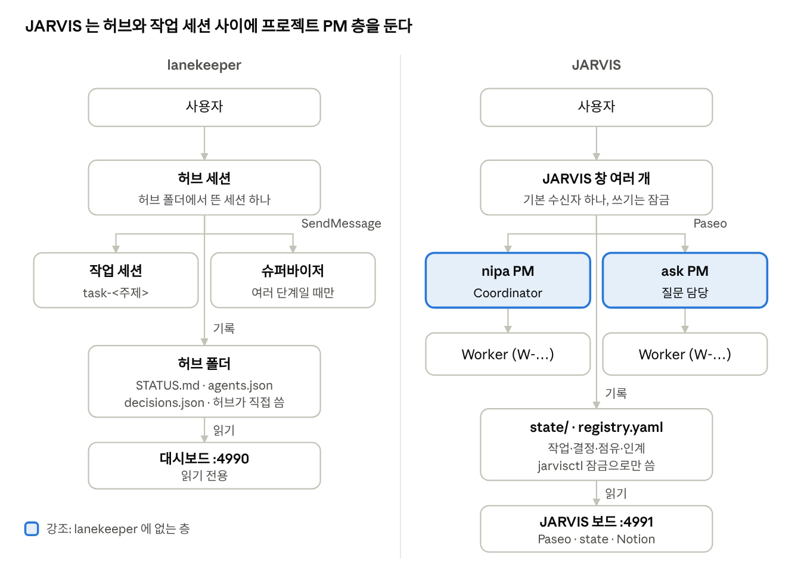

# lanekeeper 와 JARVIS 비교

참고 자료다(정책 아님). JARVIS 는 lanekeeper 의 "허브가 맡기고 보고받는다" 모델과 대시보드를 가져와, 세션 실행과 메시지를 Paseo 로 바꾸고 프로젝트별 PM 층과 잠금·인계·업무 도구(Notion·Linear)를 더한 구현이다. Paseo 자체는 세션 문서(`docs/02`) 2절 에 있다.

- 기준일: 2026-11-09
- lanekeeper: [holiday0726/lanekeeper](https://github.com/holiday0726/lanekeeper) main(2026-11-05 커밋)의 `README.ko.md`, `templates/hub/CLAUDE.md`·`COORDINATION.md`, `hooks/hooks.json`·`hub_only_write.py`
- JARVIS: `CLAUDE.md`, `.claude-plugin/plugin.json`(0.2.0), `hooks/hooks.json`, `scripts/jarvisctl.py`, `dashboard/README.md`
- 편집용 사본: [Claude Docs](https://claude.ai/artifact/JppBECA459PUmVZikswFjA)

## 0. 구조

lanekeeper 는 허브가 작업 세션(필요하면 슈퍼바이저)을 직접 띄우는 2층이다. JARVIS 는 프로젝트마다 상주 PM(Coordinator)을 두고 PM 이 Worker 를 띄우는 3층이다. JARVIS 는 방법(쪼개기, Worker 수)을 PM 에게 맡기고 자신은 배정·판단·기록만 한다. lanekeeper 허브는 배정서에 레인·작업 공간·완료 조건까지 직접 쓴다.

## 1. 한눈에

| 항목 | lanekeeper | JARVIS |
|---|---|---|
| 성격 | Claude Code 플러그인, 범용 틀(MIT) | Claude Code 플러그인 `jarvis` 0.2.0 + JARVIS 폴더, 사내 운영용 |
| 층 | 허브 → 작업 세션(필요하면 슈퍼바이저) | JARVIS → 프로젝트 PM(Coordinator) → Worker |
| 세션 띄우기 | `claude --bg --name` | Paseo `create_agent`(라벨·detach 포함) |
| 메시지 | Claude Code `SendMessage`(세션 이름이 주소) | Paseo `send_agent_prompt`(에이전트 ID 가 주소) |
| 작업 단위 | `T-YYYYMMDD-NN`, `STATUS.md` 표 한 줄 | `W-YYYYMMDD-NN`, `state/tasks/` 파일 하나 |
| 결정 | `decisions.json` 한 파일 | `state/decisions/D-….md` 파일 하나씩, `jarvisctl decide` |
| 공유 자원 | `dev-occupancy.json`(허브가 적음) | `state/occupancy.json`, `jarvisctl occupy`·`vacate`(잠금) |
| 동시 허브 | 하나만, 겹치면 사용자에게 물음 | JARVIS 창 여러 개, 잠금으로 겹침 막음, 기본 수신자 하나 |
| 세션 교체 | "큰 작업 끝나면 새로 띄운다" 한 줄 | PM 교체 절차(컨텍스트 200k 기준, 인계 노트, lock, switch) |
| 훅 | 3개: 대시보드 띄우기, 허브 폴더 쓰기 막기, git 문구 검사 | 7개 이벤트: 맥락 주입, 폴더·상태 보호, PM 생성 검사, 사용량 기록, 세션 이벤트 등 |
| 업무 도구 | 없음(파일만) | Notion 할일·루틴, Linear 이슈, 작업일지 |
| 대시보드 | 에이전트·흐름·결정·할 일·현황, 읽기 전용 | 같은 화면 + 루틴 탭, Notion 할 일 체크, 카드 흐름 |

## 2. 세션 사이 통신

| 항목 | lanekeeper | JARVIS |
|---|---|---|
| 통로 | `SendMessage`(같은 PC 는 세션별 파이프), 받는 쪽은 `crossSessionInbound: accept` 필요 | Paseo `send_agent_prompt`, 끝나면 자동 알림 |
| 주소 | 세션 이름(`task-<주제>`), 재시작마다 바뀔 수 있음 | 에이전트 ID, `registry.yaml` 의 `coordinator` 로 프로젝트에 묶음 |
| 머리말 | `[배정]` `[보고]` `[알림]` | `[배정]` `[진행]` `[질문]` `[승인요청]` `[계획]` `[보고]` `[점유]` `[해제]` `[인계노트]` `[준비]` |
| 보고 형식 | 상태·증거·증명한 것·증명하지 않은 것·혼자 정한 가정·인터페이스 영향 | 바뀐 것·확인한 것·보고만 받은 것·기준으로 정한 것·운영 반영 대기·남은 것 |
| 권한 승인 | 허브가 풀 수 없음, `claude attach` 로 사용자가 직접 | `[승인요청]` 을 JARVIS 가 받아 `respond_to_permission`(위험한 것은 사용자에게) |
| 멈춘 세션 | `claude respawn <id>` | 닫히면 훅이 `[알림]`, 다음 `[배정]` 때 PM 을 mode `crash` 로 다시 띄움 |

## 3. 상태·결정·작업 기록

| 기록 | lanekeeper (허브 폴더) | JARVIS (`state/` 외) |
|---|---|---|
| 역할·규칙 | `CLAUDE.md`, `COORDINATION.md`(레인·소유권·인터페이스·변경 로그) | `CLAUDE.md`, `rules/coordinator.md`·`worker.md`, `docs/01`~`03`, `criteria.md` |
| 세션 명부 | `agents.json`(resident / task) | `registry.yaml`(프로젝트 → root·PM·Linear), Paseo 라벨 |
| 작업 | `STATUS.md` 현황판 한 장 | `state/tasks/W-….md` |
| 결정 | `decisions.json` | `state/decisions/D-….md`(open·waiting·decided·dropped, 지우지 않음) |
| 공유 자원 | `dev-occupancy.json` | `state/occupancy.json`(닫힌 PM 점유는 자동 회수) |
| 운영 반영 대기 | 없음 | `state/releases.json` |
| 인계 | 없음 | `state/handoff/manager/`, `state/handoff/<프로젝트>/` |
| 세션 이력·사용량 | 없음 | `state/sessions.jsonl`, `state/sessions/<ID>.json` |
| 하루 기록 | 변경 로그·측정 시각 | 작업일지 `worklog/raw` + Obsidian 위키 |

lanekeeper 훅은 "허브가 아닌 세션의 허브 폴더 Edit·Write" 만 막고 Bash 쓰기는 못 막는다고 스스로 적는다. JARVIS 는 폴더 보호에 더해 결정·점유 파일을 훅이 직접 편집하지 못하게 하고 `jarvisctl` 로만 바꾼다.

## 4. 대시보드

JARVIS 보드는 lanekeeper 대시보드(`index.html`·`server.py`, Python 표준 라이브러리만)를 가져와 데이터 어댑터 `jarvis_data.py` 를 끼운 것이다.

| 탭·기능 | lanekeeper | JARVIS 보드 |
|---|---|---|
| 데이터 출처 | `claude agents`, 허브 폴더 JSON·`STATUS.md` | Paseo 에이전트 기록, `state/`, Notion API |
| 포트 | 4990 | 4991(같은 PC 에서 나란히 뜸) |
| 루틴 | 없음 | 새 탭: Notion 루틴 기록, 매일·주 N회, 최근 7일 점 |
| 할 일 | 세션별 Claude Todo 목록 | Notion 할일 DB(오늘·이번 주·다음 주·이번 주 전·완료), 완료 체크·오늘로 옮기기, 세션 Todo 는 접힌 칸 |
| 흐름 | 입체 궤도·평면 그래프 | 기본 '카드' 보기(JARVIS → PM → Worker 트리, 선 이름표에 배정·보고·질문 건수, 오른쪽 패널) |
| 결정 | `decisions.json` | `state/decisions/` + "작업은 끝났는데 안 정한 것" 칸 |
| 쓰기 | 없음(읽기 전용) | Notion 할 일·루틴 체크만. 같은 화면에서 온 요청(Origin·`X-Jarvis` 머리)만 받음 |

Claude 사용량 칸은 두 쪽 모두 상태줄이 쓰는 `~/.claude/usage.json` 을 읽는다. 이 PC 는 상태줄을 Orca 가 쓰고 있어 아직 비어 있다.

## 5. 운영 안전장치

| 장치 | lanekeeper | JARVIS |
|---|---|---|
| 세션 시작 맥락 | 대시보드만 띄움 | SessionStart 훅이 기본 수신자·PM 현황·닫힌 PM·인계 노트·열린 작업을 넣음(compact·clear 때도) |
| 폴더 보호 | 허브 폴더 Edit·Write 만 | JARVIS 폴더 + 결정·점유 파일은 `jarvisctl` 전용 |
| 세션 만들기 | 규칙: 띄우기 전에 `agents.json` 등록 | 훅: PM 라벨 없으면 막음, 같은 프로젝트 후보가 있으면 막음, 만들면 detach·후보 기록, `kill_agent` 금지 |
| 세션 교체 | "큰 작업 뒤 새로 띄우고 STATUS 줄을 인수" | `can-rotate` → lock → `[인계요청]` → `[인계노트]` → 띄우기 → `[준비]` 검사(nonce) → `switch` |
| 사용량 기록 | 없음 | Stop 훅이 PM 컨텍스트 Snapshot 을 남김 |
| 동시 허브 | 하나만 | 창 여러 개. 번호·결정·점유·registry 쓰기는 잠금, 성공한 창만 PM 에게 답함 |
| 동시 작업 수 | 작업 세션 4개까지 | PM 이 정함(규칙 없음) |
| 사용자에게 물을 일 | 운영 반영·공유 브랜치 병합 | push·병합·배포·DB 변경·삭제·재실행·큰 비용 + `criteria.md` 에 없는 판단 |
| 검토 스킬 | addy-skills(보고 검토·의도 확인·검증) 연결 | 없음. PM 이 확인한 것과 보고만 받은 것을 나눠 전함 |

## 6. 한쪽에만 있는 것과 가져올 만한 것

lanekeeper 에만 있는 것:

- `COORDINATION.md` 의 레인·소유 경로·인터페이스(IF-xx) 표와 바꾸는 절차, 변경 로그
- 보고의 "증명한 것 / 증명하지 않은 것 / 혼자 정한 결정과 가정 / 근거 원본" 칸과 "보고에 데이터 값을 넣지 않는다" 규칙
- 설치·업데이트 경로: 마켓플레이스, `/lanekeeper:setup`, 설정 예시, 테스트 5개
- 슈퍼바이저 세션용 권한 설정(`supervisor.settings.json`)과 워크트리 규칙
- 동시 작업 세션 상한(4개)

JARVIS 에만 있는 것:

- 프로젝트별 PM 층과 PM 세션 교체·인계·crash 복구 절차
- JARVIS 창 여러 개와 `jarvisctl` 잠금, 기본 수신자
- 결정 파일 생애(open·waiting·decided·dropped)와 `criteria.md` 기준 자동 판단
- 운영 반영 대기(`releases.json`), Linear 이슈 연동, Notion 할일·루틴, 작업일지·위키
- 07:20 아침 할일 정리 schedule(Paseo)

가져올 만한 것(추천 순):

| 순서 | 항목 | 이유 | 크기 |
|---|---|---|---|
| 1 | 보고 형식에 "증명한 것 / 증명하지 않은 것 / 혼자 정한 가정" 칸 | 지금 "확인한 것 / 보고만 받은 것" 보다 PM 의 가정이 드러남 | `rules/coordinator.md` 문구만 |
| 2 | "보고에 데이터 값·고객 원문을 넣지 않고 경로·id 로" 규칙 | 보고가 작업 파일·작업일지·Notion 에 그대로 복사됨 | 규칙 한 줄 |
| 3 | 프로젝트 간 인터페이스 표(IF-xx) | NIPA 안에서도 Langflow·DB·대시보드가 서로 기대는 약속이 많음 | `docs/` 표 하나 |
| 4 | 설치 스킬과 테스트 | 다른 PC 에 JARVIS 를 다시 깔 때 | 중간 |

lanekeeper 에 줄 것도 있다. 훅으로 강제하는 세션 교체 절차와 결정 파일 잠금은 다른 사용자에게도 쓸모가 있다.
