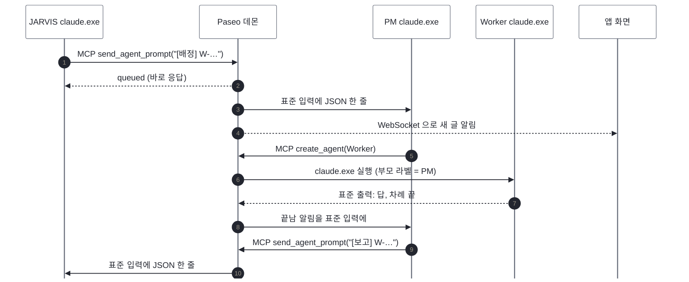

# Paseo 는 어떻게 돌아가나

참고 자료다(정책 아님). JARVIS·PM·Worker 가 모두 올라타 있는 Paseo 가 안에서 무슨 일을 하는지 쉽게 풀었다. 정책 쪽 요약은 세션 문서(`docs/02`) 2절 에 있다.

- 기준일: 2026-11-09, Paseo 0.15.2, Windows
- 근거: 이 PC 의 프로세스 목록과 실행 인자, `~/.paseo/config.json`, `~/.paseo/daemon.log`, Paseo 앱 파일(`resources\app.asar`) 안의 문자열. Paseo 코드를 처음부터 읽은 것은 아니다. 직접 본 것과 미루어 본 것은 8절에서 나눈다.

## 1. 한 줄 요약

Paseo 는 내 PC 에서 도는 작은 서버(데몬)다. 데몬이 `claude.exe`·`codex.exe` 같은 CLI 를 직접 실행하고, 그 입력과 출력을 쥐고 대신 타자를 친다. 앱 화면과 에이전트는 모두 이 데몬에게 부탁해서 일한다.

## 2. 비유: 콜센터 교환대

| Paseo | 비유 |
|---|---|
| 데몬 | 교환대. 모든 전화가 여기를 거친다 |
| `claude.exe`·`codex.exe` | 상담원. 교환대가 불러 자리에 앉히고, 헤드셋(입출력 파이프)으로 말을 전한다 |
| 앱 화면 | 관리자 모니터. 교환대에 연결해 지금 누가 무슨 말을 하는지 본다 |
| MCP 도구 | 상담원 책상의 내선 버튼. 다른 상담원을 부르거나 말을 전해 달라고 교환대에 누른다 |
| `~/.paseo/agents/` | 상담원 명부. 사람이 퇴근해도(프로세스가 끝나도) 명부와 상담 기록은 남는다 |

상담원끼리 직접 통화하지 않는다. 언제나 교환대를 거친다.

## 3. 프로세스 구조

작업 관리자에서 보면 `Paseo.exe` 가 여러 개다. Electron 앱 실행 파일이 Node 로도 돌 수 있어서 같은 파일이 역할만 바꿔 여러 번 뜬다.

```text
explorer.exe
└─ Paseo.exe                 앱 화면 (Electron)
   └─ Paseo.exe              supervisor-entrypoint.js   ~/.paseo/paseo.pid 에 적힌 PID
      └─ Paseo.exe           daemon-worker.js           실제 데몬, 127.0.0.1:6767
         ├─ claude.exe       JARVIS 창
         ├─ claude.exe       ask PM
         ├─ claude.exe       odw-analysis PM
         └─ claude.exe       Worker …
```

- 앱 화면이 감시 프로세스(supervisor)를 띄우고, 감시 프로세스가 실제 데몬(daemon worker)을 띄운다.
- 에이전트 하나가 `claude.exe` 프로세스 하나다. 모두 데몬의 자식이다.
- 터미널에서 직접 연 `claude` 는 이 나무에 없다. Paseo 가 모르는 세션이다.

## 4. 데몬의 입구 셋

데몬은 누가 말을 거느냐에 따라 다른 입구로 받는다.

| 누가 | 입구 | 무엇을 주고받나 |
|---|---|---|
| 에이전트(`claude.exe` 등) | MCP, HTTP `127.0.0.1:6767/mcp/agents?callerAgentId=<자기 ID>` | `create_agent`, `send_agent_prompt`, `get_agent_status`, `respond_to_permission` 같은 도구 호출 |
| 앱 화면, `paseo` CLI | WebSocket, Paseo 전용 메시지 | `fetch_agents_request`, `send_agent_message_request`, `fetch_agent_timeline_request`, 구독, heartbeat |
| 데몬 → CLI | 표준 입출력 파이프 | 지시를 넣고, 답·도구 호출·권한 요청·끝남·토큰 사용량을 받는다 |

MCP 는 에이전트용 입구다. Claude 와 Codex 가 모두 MCP 를 지원하니 데몬이 자기 기능을 MCP 도구로 감싸 준다. 앱은 대화가 실시간으로 흘러 들어와야 해서 연결을 계속 열어 두는 WebSocket 을 쓴다. 두 입구로 들어온 부탁은 데몬 안에서 같은 처리를 거쳐 같은 파이프로 나간다. 그래서 앱에서 보내든 에이전트가 보내든 화면과 기록이 같이 맞춰진다.

URL 의 `callerAgentId` 덕분에 데몬은 누가 불렀는지 안다. 에이전트가 만든 에이전트에 부모 라벨(`paseo.parent-agent-id`)이 자동으로 붙는 이유이고, JARVIS 가 만든 PM 을 detach 해야 했던 이유다.

## 5. 에이전트를 띄우는 방법

데몬은 CLI 를 사람이 쓰는 대화 화면 모드가 아니라 프로그램이 조종하는 모드로 실행한다. CLI 마다 그 모드가 달라서 데몬 안에 CLI 별 연결 부분(어댑터)이 있다.

| 제공자 | 데몬이 실행하는 명령 | 대화 방식 |
|---|---|---|
| Claude | `claude.exe --input-format stream-json --output-format stream-json --permission-prompt-tool stdio --mcp-config {…} [--resume=<세션 ID>]` | JSON 한 줄씩 |
| Codex | `codex app-server --disable plugins --disable apps …` | JSON-RPC |
| Copilot 등 | `copilot --acp` | ACP(Agent Client Protocol, 편집기와 에이전트를 잇는 공개 표준) |

Claude 실행 인자의 뜻은 이렇다.

| 인자 | 뜻 |
|---|---|
| `--input-format stream-json`, `--output-format stream-json` | 화면에 그리지 않고 JSON 줄로 읽고 쓴다 |
| `--permission-prompt-tool stdio` | 권한 확인 창 대신 파이프로 "허용할까요?" 를 묻는다 |
| `--mcp-config {"mcpServers":{"paseo":…}}` | Paseo 도구를 쥐어 준다(`~/.paseo/config.json` 의 `mcp.injectIntoAgents: true`) |
| `--resume=<Claude 세션 ID>` | 다시 실행할 때 이전 대화를 불러온다 |

어댑터가 CLI 마다 다른 말을 공통 형태(프롬프트 보내기, 중단, 권한 응답 / 답 글, 도구 호출, 권한 요청, 끝남, 사용량)로 바꾸므로, 앱과 MCP 도구는 상대가 Claude 인지 Codex 인지 몰라도 된다. Claude PM 이 `create_agent(provider: "codex")` 로 Codex Worker 를 만들고 서로 메시지를 주고받을 수 있는 것도 이 덕분이다.

같은 방식은 Paseo 만 쓰지 않는다. 이 PC 에서 ChatGPT 데스크톱 앱도 자식으로 `codex.exe app-server` 를 띄워 쓰고 있었다.

## 6. 한 번의 배정이 흐르는 길

JARVIS 가 PM 에게 `[배정]` 을 보내고 PM 이 Worker 를 거쳐 `[보고]` 를 돌려보내는 과정이다.



- 2번: 데몬은 부탁을 큐에 넣고 곧바로 `queued` 를 돌려준다. 실제 전달은 받는 쪽이 2초 조용해진 뒤다.
- 6번: 데몬이 Worker 프로세스를 새로 실행한다. 부른 쪽이 PM 이라 부모 라벨이 PM 으로 붙는다.
- 8번: 끝남 알림은 부모에게만 간다. detach 한 PM 의 끝남 알림이 JARVIS 에게 오지 않는 이유이고, PM 이 `[보고]` 를 직접 보내는 이유다.

권한 요청도 같은 길로 간다. Claude 가 위험한 도구를 쓰려 하면 표준 출력으로 묻고, 데몬은 앱 화면에 띄우거나 `respond_to_permission` 을 기다렸다가 답을 표준 입력에 쓴다.

## 7. 에이전트와 프로세스는 따로 산다

| 남는 것 | 자리 | 쓰는 쪽 |
|---|---|---|
| 대화 원문 | `~/.claude/projects/<폴더>/<세션 ID>.jsonl` | Claude 자신 |
| "이 에이전트 = 이 Claude 세션 ID", 제목, 라벨, 부모 | `~/.paseo/agents/` | 데몬 |

`claude.exe` 가 끝나도 위 두 가지가 남으므로 에이전트는 사라지지 않는다. 다음에 글이 오면 데몬이 `--resume=<세션 ID>` 로 다시 실행해 대화를 잇는다. JARVIS 가 "프로세스만 닫힌 PM 은 새로 띄우지 않고 이어 띄운다"(`jarvisctl pm-check` 의 `resume`)고 정한 것이 이 원리에 기댄다.

보관(archive)은 명부에 "보관됨" 표시를 하는 것이라 지우는 것과 다르다. 원문은 Claude 설정대로 30일 뒤 지워진다.

## 8. 확인한 것과 미루어 본 것

| 내용 | 근거 |
|---|---|
| 데몬이 `claude.exe` 를 자식으로 실행, 실행 인자 | 확인: 프로세스 부모 관계와 실행 인자 |
| 프로세스 나무(앱 → supervisor → daemon worker) | 확인: 부모 PID 를 거슬러 올라감, `paseo.pid` |
| 에이전트 MCP 가 `127.0.0.1:6767/mcp/agents` HTTP | 확인: `--mcp-config`, `config.json` 의 `listen` |
| 앱 화면이 WebSocket | 확인: `daemon.log` 의 `websocket-server`, `origin: paseo://app`, 메시지 종류 |
| Codex 는 `app-server`, Copilot 등은 ACP | 확인: `app.asar` 안의 실행 코드와 `@agentclientprotocol/sdk` |
| `paseo` CLI 도 WebSocket | 미루어 봄: `~/.paseo/cli-client-id` 가 있음 |
| Codex 에이전트에도 MCP 를 넣어 줌 | 미루어 봄: Claude 와 같은 설정(`injectIntoAgents`), Codex 실행 인자는 안 봄 |
| supervisor 가 데몬이 죽으면 다시 띄움 | 미루어 봄: 이름과 구조 |
| 데몬이 Node 이벤트 루프 하나로 비동기 처리 | 미루어 봄: Node 의 일반 동작, `queued` 뒤 전달 |

## 9. 직접 확인하는 방법

PowerShell 에서 본다. 실행 인자에는 Paseo 인증 토큰이 들어 있으니 결과를 그대로 남이나 문서에 붙이지 않는다.

```powershell
# Paseo 가 띄운 claude.exe 와 그 부모
Get-CimInstance Win32_Process -Filter "Name='claude.exe'" |
  Where-Object CommandLine -match 'stream-json' |
  Select-Object ProcessId, ParentProcessId

# 데몬 PID 와 대기 주소
Get-Content $env:USERPROFILE\.paseo\paseo.pid

# 앱 화면이 보내는 메시지 종류
Select-String -Path $env:USERPROFILE\.paseo\daemon.log -Pattern '"type":"[a-z_.]+request"' |
  Select-Object -Last 20
```
